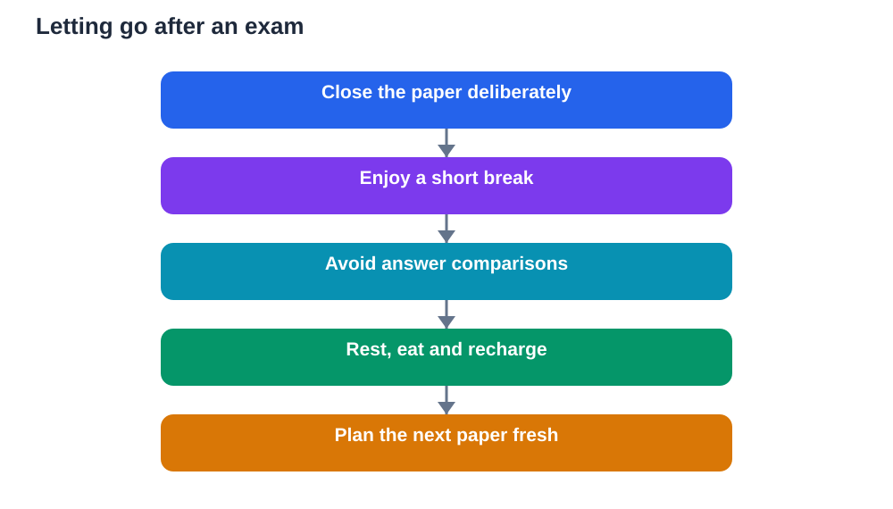

Walking out of an exam hall often brings a strange mix of relief and doubt. Relief that the paper is over, and doubt about every answer you wrote. It is tempting to replay questions, compare answers with friends, and search your notes for mistakes. That urge is understandable, but it rarely helps. Once the paper is submitted, you cannot change it, and reliving it only drains energy needed for rest and for the next paper. Letting go is a skill, and it can be practised like any other exam skill.

Letting go does not mean you do not care. It means you care wisely: you gave the paper your best effort, and now you protect your wellbeing and your future performance. Rumination, the habit of replaying the same worries without solving anything, increases stress and harms sleep. A deliberate after-exam routine, with rest, enjoyable activity, and a gentle transition to the next subject, breaks that cycle and keeps your exam season steady from first paper to last.

## Why the answer-checking spiral hurts

Checking answers immediately after an exam feels like seeking certainty, but it usually delivers the opposite. You may discover a possible mistake, and then spend hours imagining its consequences, even though the overall result is still unknown. You may also hear conflicting answers from others, which adds confusion without adding clarity. Since you cannot rewrite the paper, this information has no useful action attached to it. It only feeds worry, and worry interferes with sleep, appetite, and focus for the next paper.

The spiral also distorts memory. Under stress, learners remember uncertain answers vividly and forget confident ones, so the paper feels worse than it was. A few shaky answers can dominate your impression, even if most of the paper went well. Breaking the spiral early protects a fairer view of your performance. You do not need a verdict minutes after the exam. You need rest, perspective, and time, and the result will arrive in its own time regardless of how much you worry now.

## Give yourself a clear closing ritual

A closing ritual helps your mind accept that the paper is finished. Choose a simple, deliberate action when you leave the hall: put your materials away, take a slow breath, and say to yourself that this paper is done. Then do something enjoyable and unrelated: walk, listen to music, eat a good meal, talk with family about something other than the exam, or play a game. The activity itself matters less than its message: exam time is over for now, and normal life resumes. That boundary helps the mind switch off.

Avoid starting the next subject immediately in a frantic rush. A short break is not laziness. It is recovery that makes the next study session more effective. Even a brief period of rest improves concentration later, while jumping straight from one paper into intense revision often carries anxiety forward. Plan your break in advance, so you do not drift into answer-checking by default. A planned enjoyable break is far stronger than a vague intention not to worry.

## Talk about it briefly, then move on

It is natural to want to talk about the exam, and a brief conversation can help release tension. The key word is brief. Share how it felt in general terms, acknowledge what was hard, and then steer the conversation elsewhere. Avoid detailed answer-by-answer comparisons, which tend to reopen worry and create arguments about who is right. If friends want to dissect every question, it is perfectly fine to step away politely and say you prefer to rest and prepare for the next paper.

If a particular question keeps returning to your mind, write it down once, along with a note that the paper is finished and cannot be changed, then set the paper aside. Writing externalises the worry, so your mind does not need to carry it in a loop. You can also note one thing that went well, to balance the focus on mistakes. Over an exam season, this habit trains your mind to close each paper cleanly, rather than carrying every paper forward as an open worry.

## Rest and recharge properly

After-exam rest deserves the same respect as pre-exam sleep. Eat a proper meal, drink water, move your body gently, and get fresh air. Physical recovery supports mental recovery: a walk or light exercise often clears the mental fog faster than sitting and replaying questions. In the evening, protect your sleep with a normal wind-down routine, rather than staying up late analysing the paper or cramming anxiously for the next one. A rested mind learns faster tomorrow, which is the best use of tonight.

Be kind to yourself in the hours after a hard paper. A difficult exam does not mean you are a failure, and a disappointing performance on one paper does not erase your preparation or your abilities. Treat yourself as you would treat a friend: acknowledge the effort, allow disappointment without exaggerating it, and focus on the next controllable step. Self-kindness after exams is not indulgence. It is maintenance for a long exam season, where steady energy matters more than any single day.

## Prepare for the next paper, one at a time

When you are ready, turn to the next paper with a fresh, focused plan. Review what the next subject requires, choose the most important topics, and study in short, steady sessions. Do not try to fix the previous paper by overworking on the next one, and do not carry guilt forward as motivation. Guilt is a poor teacher. A clear plan, built from what the next paper actually needs, is a far better guide. Take it one paper at a time, as the title promises, and let each paper have its own beginning and end.

If several papers remain, pace yourself across the season. Alternate study with rest, keep meals and sleep regular, and celebrate small completions, such as finishing a topic or a practice set. Exam seasons reward consistency, not heroic single days followed by exhaustion. By letting each finished paper go, you free attention for the one ahead, and you arrive at each new paper with clearer energy than if you had dragged every previous paper along with you.

## AI Help: Muse AI

Muse AI is Meta's personal AI assistant, and it can help you move on after an exam with a calm plan. You could ask it to help you plan a relaxing break, or to organise a gentle study schedule for your next paper, one step at a time. Join Muse with invite code LTGSWD — in the Muse app, go to Settings > Redeem token and enter the code.
Disclosure: LTGSWD is the author's Muse invite code.

## FAQ

### Is it wrong to discuss answers after an exam?

Brief, general discussion is normal and can help release tension, but detailed answer-by-answer checking usually increases worry without changing anything. Since the paper cannot be rewritten, discovered mistakes only feed rumination. If discussion starts to feel anxious or argumentative, step away politely, enjoy a break, and focus on rest and the next paper instead.

### How do I stop replaying a question I got wrong?

Write the worry down once, note that the paper is finished, and set it aside. Then switch to an enjoyable, unrelated activity that fully occupies your attention, such as a walk, a meal with family, or music. If the thought returns, remind yourself gently that replaying it solves nothing, and return to your activity. Repeated redirection, not argument, is what breaks the loop over time.

### Should I start studying for the next exam immediately?

A short break first usually helps more than immediate intense study. Rest, eat, move, and recharge briefly, then begin the next subject with a clear, calm plan. Studying while exhausted and anxious from the previous paper is inefficient and carries stress forward. A rested start, even after a modest break, produces better focus and better learning for the next paper.

### What if the whole exam felt bad?

A paper that felt bad is not necessarily a bad result, since stress distorts how we judge our own performance. Allow disappointment, but avoid turning one paper into a judgement on your whole season. Rest, talk briefly with a trusted person if it helps, and then plan the next paper on its own merits. Steady work on remaining papers can still shape a strong overall outcome, and self-kindness keeps your energy available for that work.

## Conclusion

After the exam, letting go is an act of wisdom, not indifference. Avoid the answer-checking spiral, use a closing ritual, talk briefly and then move on, rest properly, and prepare for the next paper one at a time. Each paper deserves a clean ending, so the next one can begin with fresh energy. Trust the effort you gave, take care of yourself, and walk forward steadily into whatever comes next.

[Try the free AI lesson solver](/#tool)
