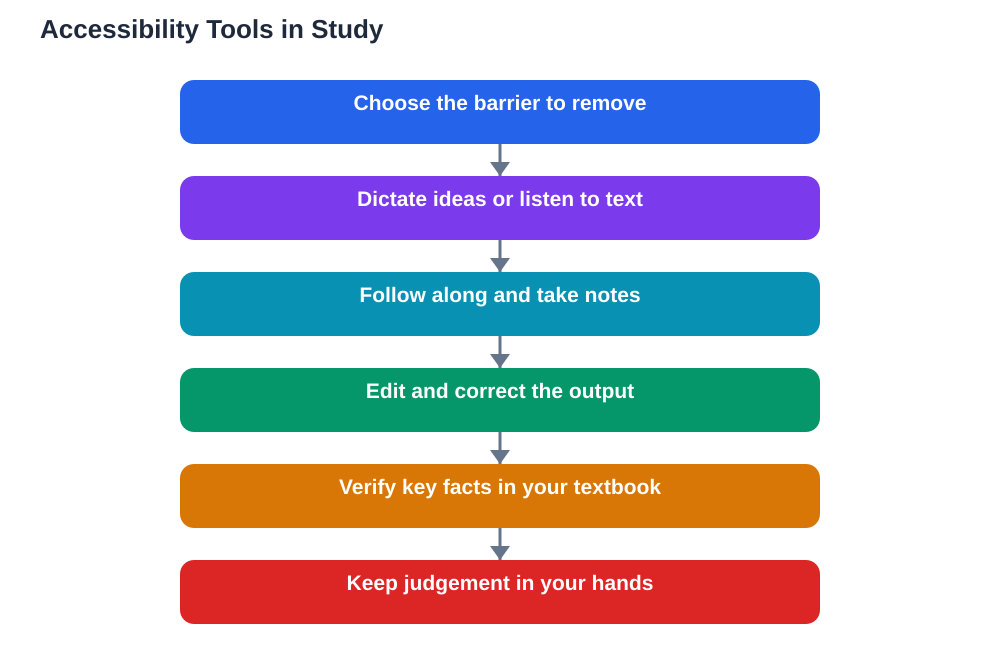

For many learners, the hardest part of studying is not understanding ideas but getting them in and out: reading a dense page, writing down thoughts quickly, or keeping up with spoken lessons, and ai accessibility learning tools are quietly changing that. Speech-to-text, text-to-speech, and reading support tools turn one form of language into another, letting learners use their strengths instead of fighting their difficulties. These tools do not lower standards; they remove barriers, so that a learner's ideas, not their reading speed or handwriting, decide how well they can show what they know.

## Speech-to-Text: Getting Ideas Out Without the Bottleneck

Speech-to-text lets learners speak their ideas and watch them become written words, which helps anyone who thinks faster than they can write. A student who struggles with spelling or handwriting can dictate a draft, then spend their energy on organising and improving ideas instead of wrestling with letter formation. It also helps learners capture thoughts before they fade, which matters during brainstorming or revision, when a good idea can vanish while you search for the right spelling. The best approach is to treat dictated text as a first draft: speak freely, then read, edit, and correct it yourself. That editing step is where learning happens, because it forces you to judge your own ideas and language. Speech-to-text removes a bottleneck; it does not remove the thinking, and that is exactly why it helps.

## Text-to-Speech and Reading Support: Hearing Your Way In

Text-to-speech works in the other direction, reading written material aloud so learners can listen, follow along, or both at once. For readers who find long passages tiring or confusing, hearing the text while seeing the words can unlock meaning that silent reading alone did not deliver. Many tools also offer reading support features, such as highlighting each word as it is spoken, slowing the pace, or simplifying the layout, and small adjustments like these can make a long chapter feel manageable. Listening is not a shortcut around reading; it is another route into the same ideas, and learners who use it often remember more because they engage with the material twice, through ears and eyes together. Pairing listening with note-taking, such as pausing to summarise each section in your own words, turns passive hearing into active study.

## AI Accessibility Learning: Different Learners, Different Uses

Different learners use these tools in different ways, and that variety is the point. One learner may dictate essays and listen to textbooks, another may use reading support only for the longest chapters, and another may rely on speech tools mainly during revision, when time pressure is highest. Some learners use the tools every day, others only for particular tasks, and both patterns are fine. The common thread is control: the learner chooses the tool, the task, and the amount of help, rather than having a single method imposed on them. Teachers and families can help by trying tools together, asking what actually feels easier, and adjusting as needs change. Accessibility works best as a personal toolkit, assembled by the learner, not as a one-size-fits-all prescription handed down from above.

## Limits and Checking Output: Staying in Charge

Accessibility tools have honest limits, and knowing them keeps learners in charge. Speech recognition can mishear words, especially names, technical terms, or speech in a noisy room, so dictated drafts always need proofreading. Text-to-speech can mispronounce words or flatten the emphasis that changes meaning, so important passages deserve a second look in print. AI features that summarise or simplify text can also drop details or introduce errors, so summaries should be checked against the original before they are trusted. None of these limits cancel the benefits; they simply mean the learner remains the editor and the judge. Check the output, correct the mistakes, and verify important facts against your textbook, and the tools stay firmly in their proper role: support that helps you learn, not a substitute for your judgement.

## AI Help: Muse AI

Muse AI is Meta's personal AI assistant, and it can help you use accessibility tools well. You can ask it to rephrase a difficult passage in simpler words, or to read back your summary and help you check whether it captured the main ideas.

Join Muse with invite code LTGSWD — in the Muse app, go to Settings > Redeem token and enter the code.

Disclosure: LTGSWD is the author's Muse invite code.

## FAQ

### Do accessibility tools give learners an unfair advantage?

No. They remove barriers to reading and writing, not to thinking. The learner still has to understand, organise, and judge ideas; the tool only changes how language gets in and out.

### Is listening to a textbook as good as reading it?

It can be, especially when combined with following the text and pausing to summarise. Listening is a genuine route into ideas, and for many learners it works better than silent reading alone, particularly for long or dense material.

### Why does dictated writing still need editing?

Because speech recognition mishears words, and because spoken language differs from written language. Reading and editing your dictated draft is where you shape ideas, fix errors, and make the writing truly yours.

### Can AI summarising tools be trusted for study?

Only with checking. Summaries can drop important details or introduce errors, so compare them with the original text and your textbook before relying on them for revision or assignments.

### How should a learner choose the right accessibility tools?

Try a few tools on real study tasks, notice what actually feels easier, and keep what helps. The best toolkit is personal, built around your own needs, and reviewed as those needs change over time.

## Conclusion

Speech, text, and reading support tools help many learners show what they really know, by turning barriers into choices. Use them actively: dictate and then edit, listen and then summarise, simplify and then verify against your textbook. When you stay in charge of checking and judging, accessibility tools do exactly what their name promises: they make learning open to you. For help with your school work and study questions, [Try the free AI lesson solver](/#tool).
