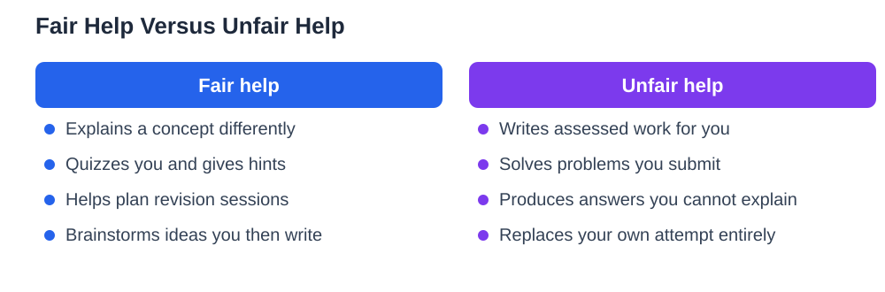

A recent multi-country survey of school learners reports a pattern most teachers will recognise: most learners now use AI chatbots when preparing for exams, mainly for revision, planning, and new ideas. The interesting part of the finding is not the popularity of chatbots but the line learners themselves draw. Revision help, explanations, and brainstorming feel fair. Having the chatbot do the work feels unfair. That instinct is sound, and it is worth turning into a clear personal rule before exam season, because the difference between help and cheating is not always obvious in the moment — especially when a chatbot offers a complete answer in seconds and nobody is watching.

## Revision Help Yes, Doing the Work No

The fair line rests on one question: who did the learning? If the chatbot helped you understand, practise, or organise, and you could still do the work yourself afterwards, the learning stayed with you. If the chatbot produced the essay, the solution, or the project, and you merely handed it in, the learning stayed with the chatbot. Revision is fair game: asking for a concept explained differently, generating practice questions, testing yourself with a quiz, or brainstorming ideas for an essay you will then write yourself. Planning is fair too: building a revision timetable, breaking a big topic into smaller sessions, or turning a chapter into a checklist. What crosses the line is submitting AI output as your own work, copying solutions without understanding them, or letting the chatbot answer questions that are meant to measure your knowledge.

## Why Hints Beat Full Answers Before an Exam

An exam measures what you can do without help, so preparation that removes all struggle leaves you unprepared for the real thing. When a chatbot gives you a full answer, you experience the fluency illusion: reading a clear solution feels like understanding it, but the feeling fades as soon as you must produce the answer alone. Hints work differently. A hint points you toward the next step while leaving the thinking to you, so the effort of completing the step builds the memory you will need later. Ask chatbots for hints, for a nudge when you are stuck, for an explanation of a step you do not follow — and then finish the work yourself. If you cannot finish it without the chatbot, you have found exactly what to restudy, which is far more valuable than a completed answer.

## A Fair-Use Checklist for Chatbot Revision

Before each chatbot session, decide what the chatbot is for and what it is not for. A simple checklist helps: the chatbot may explain, quiz, plan, and brainstorm; it may not write, solve, or complete assessed work for you. Keep your own notes open during the session, and write the final version of anything in your own words, from memory, after the chatbot is closed. If your school has an AI policy, read it and follow it, because school rules override personal judgement. If you are unsure whether a use is fair, apply the honest test: would you be comfortable explaining to your teacher exactly what the chatbot did and what you did? If the answer is no, you already know the use crossed the line. For guidance on honest coursework, see [Avoiding Plagiarism in School Work](/blog/avoiding-plagiarism-school-work.html).

## Planning and Ideas: The Safest Wins

Two chatbot uses are almost always fair and genuinely useful. The first is planning: turning a pile of topics into a realistic revision schedule with breaks, mixing subjects so you do not burn out on one, and setting small daily targets you can actually keep. The second is ideas: brainstorming angles for an essay, generating examples to test a concept, or asking for analogies that make a difficult idea click. Both uses leave the core learning with you, because you still do the studying and the writing. Use them generously, but verify anything factual the chatbot offers against your textbook or class notes. Chatbots can invent plausible facts, and an idea session is no place to absorb errors that later appear in your exam answers.

## When You Have Already Crossed the Line

Many learners have, at some point, let a chatbot do more than it should have. The useful response is not guilt but repair. Redo the work yourself, without the chatbot, and find out which parts you cannot do — those are your real revision targets. If the work was assessed, talk to your teacher honestly about what happened and ask how to make it right. Teachers are generally far more understanding about an honest admission than about a discovered deception. Going forward, set a simple rule for yourself: the chatbot opens after you have attempted the work, not before. Attempt first, hint second, finish yourself. That order keeps the chatbot in its proper place, as a helper for a learner who is already working.

## AI Help: Muse AI

Muse AI is Meta's personal AI assistant, and it can support fair exam preparation. You can ask it to explain a revision topic in simpler words, or to help you plan a study session and draft a revision checklist to work through yourself. Join Muse with invite code LTGSWD — in the Muse app, go to Settings > Redeem token and enter the code.
Disclosure: LTGSWD is the author's Muse invite code.

## FAQ

### Is using an AI chatbot for exam revision cheating?

Not when it is used for revision, explanations, planning, and practice. It becomes unfair when the chatbot does assessed work for you, or when you submit its output as your own. The line is about who did the learning: if you could still do the work yourself afterwards, the help was fair.

### Why are hints better than full answers when revising?

Hints leave the thinking to you, so completing the step builds the memory you need in the exam. Full answers create a fluency illusion: they feel like understanding while you read them, but that feeling fades when you must produce the answer alone.

### What should I do if my school bans chatbot use?

Follow your school's rules, which override any general advice. Even where chatbots are restricted, you can still use the underlying methods yourself: active recall, practice questions, planning, and explaining ideas in your own words all work without any tool.

### How can I tell if my chatbot use was fair?

Apply the honest test: would you be comfortable explaining to your teacher exactly what the chatbot did and what you did? If the chatbot explained, quizzed, or planned while you did the learning and writing, you are on safe ground. If not, redo the work yourself.

## Conclusion

Chatbots are now a normal part of exam preparation, and the question is no longer whether to use them but how. Keep the fair line clear: revision help yes, doing the work no. Ask for hints rather than answers, attempt work before you open the chatbot, and finish everything in your own words from memory. Used that way, a chatbot makes you a stronger learner rather than a weaker one. If you use the Lesson Solver tool for textbook exercises, remember to verify its solutions against your textbook, keep in mind that AI can make mistakes, and note that the tool needs your own free Google AI Studio API key.

[Try the free AI lesson solver](/#tool)
