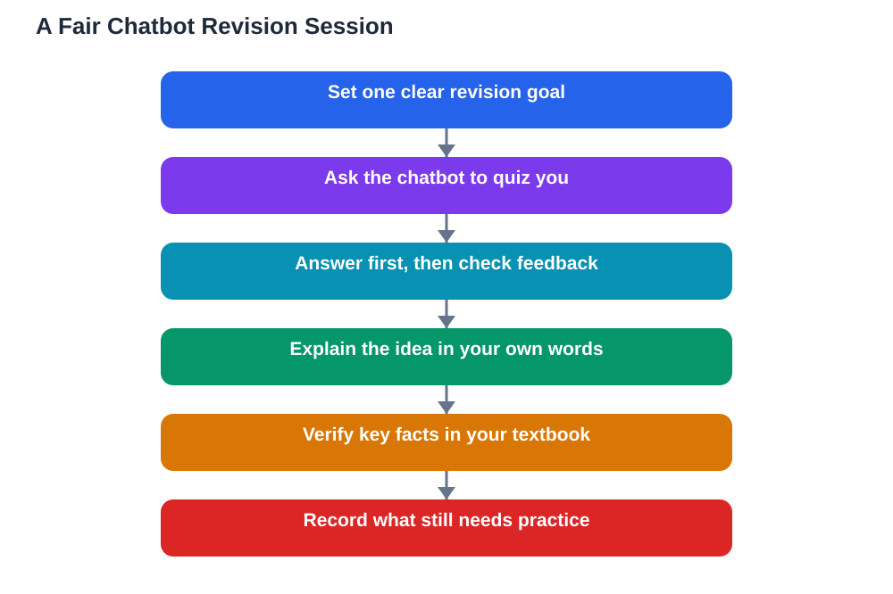

Many learners now turn to a chatbot when revision begins, and ai chatbots exam revision has become a normal part of how students prepare. The appeal is easy to understand: a chatbot is always available, never gets tired of questions, and can explain the same idea in a different way when the first explanation does not click. Used well, it acts like a patient study partner. Used badly, it becomes a shortcut that feels like learning while teaching very little. The difference lies in how you use it, and this guide shows how to keep chatbot revision fair, honest, and genuinely effective.

## AI Chatbots Exam Revision: Talking Your Way to Understanding

Revision works best when it is active, and a chatbot makes active revision easy. Instead of rereading notes passively, you can ask the chatbot to quiz you, to challenge your answers, and to explain why a wrong answer was wrong. You can ask it to rephrase a difficult concept in simpler words, to give an everyday example, or to connect a new idea to something you already know. Talking through a topic, even with a machine, forces your brain to organise what it knows and exposes the gaps you still need to fill. That is why many students describe a chatbot as a study aid to talk to rather than a source of answers: the conversation itself is the learning, and the value comes from the thinking you do along the way.

## Planning Revision With a Chatbot

A chatbot is also a strong planning partner. You can tell it how many days you have, which topics feel weakest, and how much time you can study each day, and ask it to suggest a realistic schedule. It can break a large topic into smaller daily tasks, suggest which topics to revisit first, and help you build a checklist that makes progress visible. Planning support like this reduces the overwhelm that stops many students from starting at all. But keep control of the plan yourself: if a suggested schedule feels impossible, say so and ask for a lighter version. A plan only works if you can actually follow it, and a chatbot that piles on extra hours is not helping you, however impressive its timetable looks. Review the plan each evening, move unfinished tasks honestly, and protect rest time, because a tired brain revises badly.

## Generating New Ideas Without Copying Answers

One of the most useful chatbot habits is asking for new ideas rather than finished work. When you are stuck on an essay plan, a project angle, or a way to explain a concept, a chatbot can suggest several directions, and choosing among them is real thinking. Ask for outlines, questions to explore, or examples to compare, and then develop the chosen idea in your own words. The danger comes when you ask for a complete answer and submit it unchanged, because then you have practised nothing and learned nothing. A simple test helps: after using a chatbot, close it and explain the idea aloud in your own words. If you cannot, you borrowed an answer instead of learning a concept, and it is time to go back and work through it properly.

## Fair Use: Adding To Learning, Never Replacing It

Fair use of a chatbot means it adds to your learning rather than replacing it. That means your notes, your textbook, and your teacher's guidance remain the main sources, while the chatbot helps you practise, clarify, and test yourself. It also means being honest about help you received when your school asks for a declaration, and never presenting chatbot text as your own writing. Remember too that AI can make mistakes, so verify important facts against your textbook before trusting them, especially dates, definitions, and formulas. Chatbot revision is at its best when it leaves you more confident because you understand more, not because you collected more answers. If your revision sessions end with you able to explain topics without looking, the chatbot has done its job well.

## AI Help: Muse AI

Muse AI is Meta's personal AI assistant, and it can help you revise by quizzing you on a topic. You can ask it to test your recall with short questions, or to explain a tricky concept in simpler words until it clicks.

Join Muse with invite code LTGSWD — in the Muse app, go to Settings > Redeem token and enter the code.

Disclosure: LTGSWD is the author's Muse invite code.

## FAQ

### Is using a chatbot for revision cheating?

Not when it is used as a study aid. Quizzing yourself, planning revision, and clarifying concepts are fair uses. Copying chatbot text into assessed work and presenting it as your own is not, so keep the line clear.

### How can a chatbot help if I keep forgetting a topic?

Ask it to quiz you in short rounds, to explain the topic with a new example, and to connect it to something you already know. Then test yourself again without looking, because recall practice, not rereading, builds lasting memory.

### Should I trust everything a chatbot tells me during revision?

No. AI can make mistakes, including confident-sounding errors in definitions and facts. Check anything important against your textbook or class notes, and treat surprising answers as prompts to verify, not as final truth.

### What is the best way to start a chatbot revision session?

Begin with a clear goal, such as testing one topic or building a plan for the week. Ask focused questions, answer quiz questions yourself before reading the chatbot's feedback, and finish by summarising what you learned in your own words.

### Can a chatbot replace my textbook or teacher?

No, and it should not. Your textbook and teacher provide the verified material your learning is judged on, while a chatbot helps you practise and understand it. Use both together, with the verified sources in charge.

## Conclusion

A chatbot can be a patient, tireless revision partner, helping you plan, practise, explore ideas, and test your understanding at any hour. Keep it in that role, verify what matters against your textbook, and stay honest about the help you receive, and it will strengthen your revision instead of hollowing it out. For help with your school work and study questions, [Try the free AI lesson solver](/#tool).
