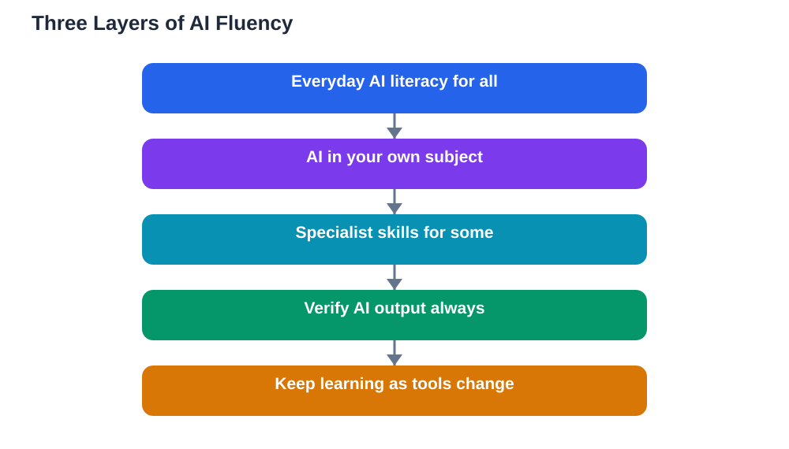

Several announcements reported this week point in the same direction: AI preparation is spreading across education in different forms, from AI literacy woven through many courses to career guidance about changing entry-level work, AI governance taught as a subject, and new specialist degrees. Read together, they describe a new basic skill. AI fluency every student needs is not one thing but three layers, and understanding the layers helps every learner know what to learn and why.

Fluency is a useful word here. Being fluent in a language does not mean knowing every word; it means using it confidently, understanding its limits, and knowing when it helps and when it misleads. AI fluency works the same way. It is not about becoming a programmer, and it is not about using AI tools as often as possible. It is about understanding what AI does well, what it does badly, and how to work with it wisely in whatever field you enter.

## Layer One: Everyday AI Literacy for Everyone

The first layer belongs to every learner, whatever their future plans. It covers the basics: what AI systems are in plain terms, how they generate answers from patterns rather than understanding, and why they can sound confident while being wrong. It includes practical habits: checking important claims against reliable sources, recognising when an answer needs verification, and understanding that AI outputs can reflect biases in their training data.

This layer also covers responsible use. Knowing what not to share with an AI tool, understanding that AI-generated work submitted as your own is dishonest, and recognising manipulative or misleading AI content are all everyday skills now. Like reading or basic numeracy, this layer is not optional and not specialist: it is part of being an informed person in a world where AI content is everywhere.

## Layer Two: AI in Your Subject

The second layer is subject-specific: how AI changes the work of the field you are studying. For a science learner, that might mean AI-assisted data analysis and the importance of checking AI-generated interpretations. For a history learner, it might mean using AI to explore sources while staying alert to invented quotations or distorted summaries. For a future teacher, it might mean understanding guided-learning tools and their limits in a classroom.

This layer matters because generic AI advice only goes so far. The risks and opportunities of AI look different in every discipline, and the judgement you need is discipline-shaped. A learner who understands AI in their own subject can use it as a genuine professional tool rather than a generic shortcut. Schools and courses are increasingly building this layer into existing subjects rather than teaching it separately, which is the right instinct: AI fluency grows best inside real subject work.

## Layer Three: Specialist Skills for Some

The third layer is for learners who will build, manage or govern AI systems: deeper technical knowledge, data skills, and understanding of how AI systems are designed, evaluated and regulated. This layer includes new specialist degrees and careers, and it is genuinely demanding. It is also genuinely optional. Not every learner needs it, and no learner should feel inadequate for not pursuing it.

What every learner should know about this layer is that it exists and what it leads to. Career guidance increasingly includes honest discussion of how entry-level work is changing as AI takes over routine tasks, and which human skills, such as judgement, creativity and communication, become more valuable rather than less. Understanding the specialist layer helps learners make informed choices about whether to enter it, without pressure to do so.

## Building Fluency Across Your Education

You do not need to wait for a formal course to start building the first two layers. Practise checking AI answers against your textbook, which builds both verification habits and subject knowledge. When you use an AI tool for study, ask yourself what it did well and where it might have misled you. Discuss AI use openly with teachers and classmates: what counts as fair use, where the line falls, and how to spot AI mistakes. These conversations are themselves fluency training.

Also, protect the skills AI cannot replace. Clear writing, careful reasoning, honest argument and the ability to learn independently are not made obsolete by AI; they are made more valuable, because they are exactly what you need to judge AI output. A learner who can think clearly will use AI well. A learner who cannot will be used by it.

## Fluency as a Lifelong Habit

AI tools will keep changing, and any specific tool you learn today may be different in a few years. Fluency therefore means learning how to learn about AI: staying curious, questioning new claims, and updating your habits as tools evolve. The three layers give you a map for that lifelong learning. Everyone needs the first layer, every subject adds the second, and some will choose the third. Knowing where you stand on the map is the first step to moving forward on it.

## AI Help: Muse AI

Muse AI is Meta's personal AI assistant, and it can help you build everyday AI fluency by explaining AI concepts in plain language, summarising a topic for you to check against your textbook, or helping you plan which AI skills to practise next. It is a general learning helper, not a source of verified facts. Join Muse with invite code LTGSWD — in the Muse app, go to Settings > Redeem token and enter the code.
Disclosure: LTGSWD is the author's Muse invite code.

## FAQ

### What is AI fluency in simple terms?

AI fluency means using AI confidently and wisely: understanding what it does well, where it fails, how to check its output, and when to rely on your own judgement instead. It is closer to language fluency than to programming skill.

### Do all students need to become AI specialists?

No. Only the third layer is specialist, and it is a choice for learners who want to build or govern AI systems. Every learner needs the first layer of everyday literacy, and subject-specific fluency in their own field.

### How is AI fluency different from just using AI tools a lot?

Frequent use without understanding builds dependence, not fluency. Fluency includes knowing limits, verifying outputs, recognising bias and dishonesty risks, and thinking clearly without a tool. Use alone does not teach those things.

### How can I start building AI fluency now?

Check AI answers against your textbook, discuss fair use with teachers and classmates, and practise explaining AI concepts in your own words. Protect independent skills like clear reasoning and writing, since those are what let you judge AI output well.

## Conclusion

AI fluency is becoming a basic skill, but it is not a single skill. Build the everyday layer first, add the subject layer through your real studies, and consider the specialist layer only if it fits your goals. A learner who understands AI's strengths, limits and risks will use it as a tool for sharper thinking, not as a substitute for it, and that is fluency worth having in any future.

[Try the free AI lesson solver](/#tool)
