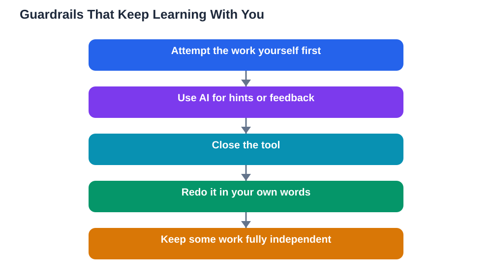

A large school system recently suspended student-facing generative AI for younger grades for a year, while keeping teacher preparation use and assistive technology exempt. The decision sparked debate about what research actually shows on AI help versus harm, and that debate is worth having honestly. AI help is not automatically good or automatically bad. The same tool can deepen learning for one student and hollow it out for another, depending on how it is used. The difference is not the tool. It is whether the thinking stays with the student or migrates to the machine. Recognising when help becomes a crutch is a skill every learner needs, and guardrails — personal, classroom, and school-level — can keep the learning where it belongs.

## Help That Builds Skill, Help That Replaces It

Help builds skill when it leaves you more capable afterwards. A hint that unlocks the next step, an explanation that clarifies a concept, a quiz that tests your recall — all of these end with you doing something you could not do before. Help replaces skill when it leaves you exactly as capable as before, only with a finished product in hand. A completed essay you did not write, a solution you did not work through, a summary you did not read the source for — these feel like progress but teach nothing. The test is simple and unforgiving: close the tool and do the task again. If you can, the help built skill. If you cannot, the help replaced it. Run that test regularly, especially on tasks that matter, because it tells you the truth your feeling of progress may hide.

## The Warning Signs of a Crutch

Crutches develop gradually, so watch for early signs. You open the AI tool before attempting the work, rather than after. You feel anxious or stuck without it, even on material you have studied. Your notes are mostly copied output rather than your own words. You can explain an answer while looking at it but not from memory. You finish work faster but score lower on tests, because test conditions remove the helper you practised with. Younger learners are especially vulnerable, because the habits formed early — struggling productively, persisting through confusion, checking your own work — are the foundation for later learning. That is one reason a cautious pause for younger grades, while keeping assistive uses that genuinely support access, is a defensible policy rather than a rejection of technology.

## Guardrails That Keep Learning With the Student

Good guardrails do not ban thinking aids; they sequence them. Attempt first, then use AI for hints, feedback, or checking — never as the first step. Set time limits: a short AI session after a longer independent session, not the other way round. Require a personal version: after any AI help, close the tool and rewrite the answer, summary, or solution in your own words from memory. Use AI for practice rather than production: generate quiz questions, ask for explanations, request feedback on your draft, rather than asking for the finished piece. Keep some work fully independent, with no AI at all, so you always know what you can do alone. Teachers can support this by designing tasks that reward process — drafts, working, explanations — rather than only final products. For building an independent routine, see [Building a Daily Study Habit](/blog/building-a-daily-study-habit.html).

## What the Evidence Debate Really Shows

The debate about AI help versus harm is often framed as a simple verdict, but the honest picture is more mixed, and more useful. Research findings differ because the uses differ: AI as a tutor that prompts retrieval and gives feedback tends to help, while AI as an answer machine that completes work tends to harm. Age matters too, because younger learners have less metacognition — less ability to judge whether they really understand — and so need more structure. Subject matters, because skills like writing and problem-solving are built through practice, not through reading finished products. Anyone quoting research to settle the debate with a single claim should be asked the critical questions: which use, which learners, compared with what? The evidence supports guardrails, not slogans, and it supports teaching students to use AI well rather than pretending it does not exist.

## A Personal Rule You Can Keep

End with a rule simple enough to remember under pressure: AI helps you learn; it does not learn for you. Before each session, state what you will do yourself and what the tool may do. After each session, prove the learning stayed with you by redoing one thing without help. If you cannot, restudy that thing before moving on. Talk to your teachers about how they want AI used in their subject, and follow their guidance, because fair use varies by task. And keep the assistive distinction clear: tools that help you access learning — reading support, speech tools, organisation aids — are not crutches; they remove barriers so learning can happen. A crutch is not a tool that helps you reach the work. It is a tool that does the work while you watch.

## AI Help: Muse AI

Muse AI is Meta's personal AI assistant, and it can help you use AI as support rather than a crutch. You can ask it to quiz you with hints, or to help you plan an independent study session before you check anything with a tool. Join Muse with invite code LTGSWD — in the Muse app, go to Settings > Redeem token and enter the code.
Disclosure: LTGSWD is the author's Muse invite code.

## FAQ

### How do I know if AI has become a crutch for me?

Close the tool and try the task again. If you cannot do it, the tool was doing the learning. Other signs include opening AI before attempting work, feeling stuck without it, and finishing faster while scoring lower on tests.

### Are all AI study tools crutches?

No, it depends on use. Tools used for hints, explanations, quizzes, and feedback build skill, because you still do the thinking. Tools used to produce finished work you submit as your own replace skill. The same tool can be either, depending on how you sequence it.

### Why are younger learners given stricter AI limits?

Younger learners are still building habits like productive struggle, persistence, and self-checking, and they have less ability to judge whether they really understand something. Stricter limits with more structure protect those foundations, while assistive uses that support access remain appropriate.

### What is the simplest guardrail I can use every day?

Attempt first, then use AI for hints or checking, then close the tool and redo one thing in your own words from memory. That sequence keeps the thinking with you and proves, each day, that the learning stayed where it belongs.

## Conclusion

AI help becomes a crutch the moment the thinking migrates from you to the machine, and it stays help as long as the thinking stays with you. Attempt first, use AI for hints and feedback, prove your learning without the tool, and keep some work fully independent. Those guardrails do not reject technology; they make it serve learning instead of replacing it. If you use the Lesson Solver tool for textbook exercises, remember to verify its solutions against your textbook, keep in mind that AI can make mistakes, and note that the tool needs your own free Google AI Studio API key.

[Try the free AI lesson solver](/#tool)
