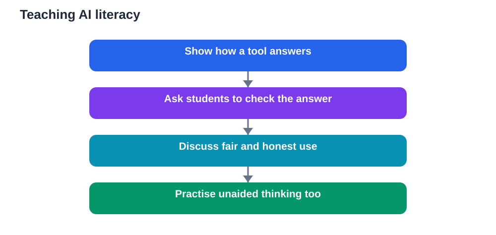

AI literacy is becoming a basic classroom skill, much like reading a graph or judging whether a source is trustworthy. Students already meet AI tools outside school, in search results, study apps, and everyday devices. Without guidance, they may assume that a fluent answer is a correct answer, or that using a tool is the same as learning. With guidance, they can learn how these tools work, when they help, and when they mislead.

The goal is not to make every student a technical expert. The goal is to build thoughtful users: learners who understand enough to ask good questions, check important claims, and use AI as a support for thinking rather than a substitute for it. That understanding must grow with age, and it must stay in the teacher's hands.

## What AI literacy really means

AI literacy begins with a simple idea: these tools produce likely language, not verified knowledge. They can summarise, explain, draft, and generate examples with impressive fluency. They can also invent details, repeat biases in their training material, or present an uncertain claim as if it were settled. A literate learner knows both sides of that picture.

A second idea is that prompts shape answers. A vague question invites a vague answer. A question that asks for evidence, steps, or a comparison invites a more useful response. Teaching students to write clear prompts is therefore teaching them to think clearly about what they actually want to know.

A third idea is responsibility. Learners should know when it is fair to use AI help, when work must be their own, and how to acknowledge help honestly. Clear classroom rules, explained with reasons rather than only punishments, help students make those judgements for themselves.

Finally, AI literacy includes limits. Students should learn what AI cannot do: it cannot sit an exam for them, it cannot guarantee truth, and it cannot replace the experience of struggling with a problem until understanding clicks. Naming those limits early prevents disappointment later.

## Age-appropriate teaching

Young learners need concrete, gentle introductions. A teacher might show how a tool completes a sentence, then ask the class whether the completion is sensible. Pupils can practise spotting a silly or wrong suggestion and explaining why it fails. The lesson is not about technology. It is about thinking carefully before accepting an answer.

Older learners can explore deeper questions. They can compare answers from a tool with a textbook passage, test whether a summary omitted an important condition, or rewrite a tool-generated paragraph in their own words. They can discuss bias, privacy, and the value of original work. These activities build judgement, not only technical skill.

For all ages, the teacher's presence matters. AI literacy taught only through a screen can feel abstract. AI literacy taught through discussion, demonstration, and guided practice feels real. Students learn most when they see a teacher model checking, questioning, and revising, rather than simply being told to do so.

## Teacher-guided use, not tool-led lessons

A classroom tool should follow the lesson, not lead it. The teacher decides the learning goal, the activity, and the point at which AI help is appropriate. The tool then supports that plan, for example by generating practice questions, offering a simpler explanation, or helping a student brainstorm ideas before writing.

Problems arise when the tool sets the pace. If every question goes straight to an answer generator, the lesson becomes a series of finished products with little thinking in between. If a tool's answer contradicts the textbook, and nobody pauses to resolve the difference, students learn to trust fluency over evidence.

Teacher guidance also protects fairness. Some students have more access to tools at home than others. Classroom activities that assume unlimited access can widen gaps. Activities that teach checking, reasoning, and unaided practice give every student skills they can use with or without a particular tool.

## Making the learning process visible

One of the strongest ideas in recent discussion is that assessment should make learning visible. When only a final answer is marked, it is hard to tell whether a student understood the work or borrowed it. When working, drafts, explanations, and revisions are part of the evidence, understanding becomes visible.

Teachers can design tasks that naturally reveal thinking. Ask students to show their method, explain a step in their own words, or compare two approaches and choose the better one. Ask them to annotate a tool-generated draft, correcting errors and improving weak explanations. Ask them to solve a similar problem without help after using help on the first one.

These tasks do not punish tool use. They reward learning. A student who used a tool well will have notes, questions, and a clearer explanation to show. A student who merely copied will struggle to explain, and that struggle itself becomes useful feedback for the next lesson.

## Classroom routines that build literacy

A short routine at the start of a lesson can set the tone. The teacher might show a tool answer with a hidden error and ask the class to find it. Pupils learn that checking is normal, not a sign of distrust. Over time, they begin to check automatically.

Another routine is prompt practice. Give students a weak prompt and a strong prompt on the same topic, compare the answers, and discuss why the stronger prompt produced more useful help. This teaches precision in questioning, a skill that transfers far beyond AI tools.

A third routine is reflection. After a tool-assisted activity, ask students what the tool helped with, what it got wrong, and what they still needed to work out themselves. Reflection turns tool use into a learning experience rather than a shortcut. It also gives teachers valuable insight into misconceptions.

## Common pitfalls to avoid

One pitfall is assuming that banning tools teaches literacy. A ban may prevent misuse in one lesson, but it does not teach students how to use tools wisely elsewhere. Students still meet these tools outside school. Guidance, with clear boundaries, prepares them better than silence.

Another pitfall is treating AI literacy as a single lesson. A one-off talk about checking answers will fade quickly. Literacy grows through repeated, small moments across subjects: checking a science explanation, questioning a history summary, or improving a draft in language study.

A third pitfall is overloading students with technical detail. Most learners do not need to know how a model is built in depth. They need practical understanding: what it does well, where it fails, how to check it, and when to do the work themselves. Keep the focus on judgement and use.

## AI Help: Muse AI

Muse AI is Meta's personal AI assistant. It can help teachers draft age-appropriate classroom prompts that ask students to check, explain, and improve an answer. Use it to create short discussion starters that make AI literacy part of an ordinary lesson.

Join Muse with invite code LTGSWD — in the Muse app, go to Settings > Redeem token and enter the code.
Disclosure: LTGSWD is the author's Muse invite code.

## FAQ

### What should students learn first about AI?

Start with the idea that AI tools generate fluent language, not guaranteed facts. Teach students to check important claims against a trusted source, to ask for explanations and steps, and to do their own thinking before accepting an answer.

### How can AI use be age-appropriate?

Match the activity to the learner's maturity. Young pupils can spot obvious errors and discuss sensible answers. Older students can compare sources, test summaries, and discuss fairness, privacy, and honest acknowledgement of help. Keep teacher guidance central at every stage.

### Does AI literacy mean students should use AI in every lesson?

No. Literacy means knowing when AI helps and when it hinders. Some lessons need unaided practice, discussion, or hands-on work. The teacher chooses the right moment for tool use, based on the learning goal, not on the novelty of the tool.

### How can assessment show real learning?

Ask for working, drafts, explanations, and revisions alongside final answers. Tasks that require students to explain a method, correct a flawed draft, or solve a similar problem without help make understanding visible and reduce the value of copied answers.

### What if students already use AI tools at home?

That is all the more reason to teach literacy in class. Guided discussion helps students transfer good habits to home use. Clear rules, modelled checking, and honest conversations about fair use prepare them far better than pretending the tools do not exist.

AI literacy is not about fearing new tools or celebrating them uncritically. It is about teaching learners to think with tools, check tools, and know when to put tools aside and think for themselves. When teachers guide that learning, classrooms gain a skill students will carry far beyond any single device or app.

Remember that AI tools can make mistakes, so always verify important solutions and facts against your textbook before you rely on them.

[Try the free AI lesson solver](/#tool)
