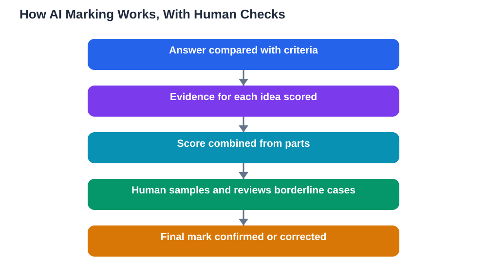

A school monitoring system recently announced plans to use AI to score open-ended student answers alongside multiple-choice questions, tracking learning progress over time. For students, this raises a fair question: how can a machine mark a written answer, which can be right in many different ways? The short answer is that AI marking does not read like a teacher reads. It compares your answer against patterns it has learned from examples, guided by criteria it has been given. Understanding that process helps you write answers that show your knowledge clearly, and helps you understand why human checks and clear criteria still matter enormously.

## What AI Marking Actually Does

AI marking systems are trained on examples of answers at different mark levels, together with the criteria those marks were based on. When your answer arrives, the system looks for evidence of the ideas, reasoning steps, vocabulary, and structure that the criteria reward. It may break your answer into parts, compare each part with the expected ideas, and combine those judgements into a score. Some systems also give feedback, pointing to missing ideas or unclear steps. This can be fast and consistent, which is why schools use it to track progress across many students and many terms. But it is pattern matching guided by criteria, not understanding in the human sense. An answer that expresses a correct idea in unusual words, or that takes a valid but unexpected route, can confuse a system that has only seen the common routes.

## Why Clear Criteria Matter More Than Ever

With human marking, a teacher can recognise a good idea even when it is expressed unexpectedly, because the teacher understands the subject. With AI marking, the criteria carry much more weight, because the system judges against them rather than understanding beyond them. Good criteria are specific: they list the ideas that earn marks, the reasoning steps that matter, and the common errors that lose marks. They are shared with students in advance, so learners know what a strong answer looks like. Vague criteria — such as rewarding "good understanding" without saying what that looks like — leave both the system and the student guessing. If you are ever marked by an AI system, you have a right to see the criteria, and to ask how your answer was judged against each one. For more on automated grading, see [AI Grading Tools: How They Work](/blog/ai-grading-tools-how-they-work.html).

## Consistency Is a Strength and a Risk

One genuine strength of AI marking is consistency: the system applies the same criteria to the first answer and the thousandth, without tiredness or mood. Human markers, however careful, can drift over a long marking session. But consistency cuts both ways. If the criteria are flawed, or the training examples are biased, the system will apply the flaw consistently to every student, which can feel deeply unfair. It may also reward surface features — length, key vocabulary, familiar phrasing — over genuine reasoning, if those features correlated with high marks in its training examples. That is why human checks remain essential: a teacher sampling marked answers, reviewing borderline cases, and overturning scores that do not fit the evidence. Consistency without human oversight is not fairness; it is only uniformity.

## How to Write Answers That Show Your Knowledge

Whether a human or a system marks your work, clarity helps. Start with a direct answer to the question, then support it with reasoning, evidence, or a worked step. Use the subject's key terms correctly, because they signal the ideas the criteria reward — but use them in real sentences that show you understand them, not as a list of buzzwords. Show your working for multi-step answers, one step at a time, so partial credit can be recognised even if the final result goes wrong. If the question asks you to explain, evaluate, or compare, make sure your answer actually does that, rather than merely describing the topic. Finally, reread the question before you finish, and check that every part of it has been addressed. An answer that covers all parts, in clear order, is easier to mark fairly by any marker.

## What to Do If a Mark Seems Wrong

If an AI-influenced mark seems wrong, treat it as a question to investigate, not a verdict to accept. Ask to see the criteria and how your answer was judged against them. Compare your answer with the criteria point by point, and note where you believe evidence was missed or misread. Ask for a human review, calmly and with your work in hand. Keep copies of your answers where you can, so a review can examine the original rather than a summary. Schools using AI marking should have a clear route for such reviews, and using it is not complaining — it is part of how fair assessment works. Human checks exist precisely because systems can be wrong, and a student who asks for one is helping the system improve for everyone.

## AI Help: Muse AI

Muse AI is Meta's personal AI assistant, and it can help you practise open-ended writing. You can ask it to explain what makes an answer clear and complete, or to help you plan the structure of an explanation before you write it yourself. Join Muse with invite code LTGSWD — in the Muse app, go to Settings > Redeem token and enter the code.
Disclosure: LTGSWD is the author's Muse invite code.

## FAQ

### Can AI really understand a written answer?

No, not in the human sense. AI marking compares your answer with patterns learned from marked examples, guided by written criteria. It can be fast and consistent, but it does not truly understand ideas, so unusual but valid answers can confuse it.

### Why are clear marking criteria so important for AI marking?

Because the system judges against the criteria rather than understanding beyond them. Specific criteria listing rewarded ideas, reasoning steps, and common errors make marking fairer and let students know what a strong answer looks like. Vague criteria leave both system and student guessing.

### Does AI marking favour long answers?

It should not, but it can, if length or key vocabulary correlated with high marks in its training examples. The defence is clear criteria focused on ideas and reasoning, plus human checks on samples and borderline cases. Write clearly and completely, but do not pad an answer to look longer.

### What should I do if I think an AI mark is wrong?

Ask to see the criteria and how your answer was judged against them, compare point by point, and request a human review with your original work in hand. A fair system will have a clear review route, and asking for it helps improve marking for everyone.

## Conclusion

AI marking of written answers works by comparing your work against criteria and learned patterns, quickly and consistently, but without human understanding. That is why clear criteria, human sampling, and a route to challenge a mark matter so much. As a student, your best strategy is unchanged by the technology: answer directly, show your reasoning step by step, use key terms meaningfully, and cover every part of the question. Good writing is good writing, whoever — or whatever — marks it first. If you use the Lesson Solver tool for textbook exercises, remember to verify its solutions against your textbook, keep in mind that AI can make mistakes, and note that the tool needs your own free Google AI Studio API key.

[Try the free AI lesson solver](/#tool)
