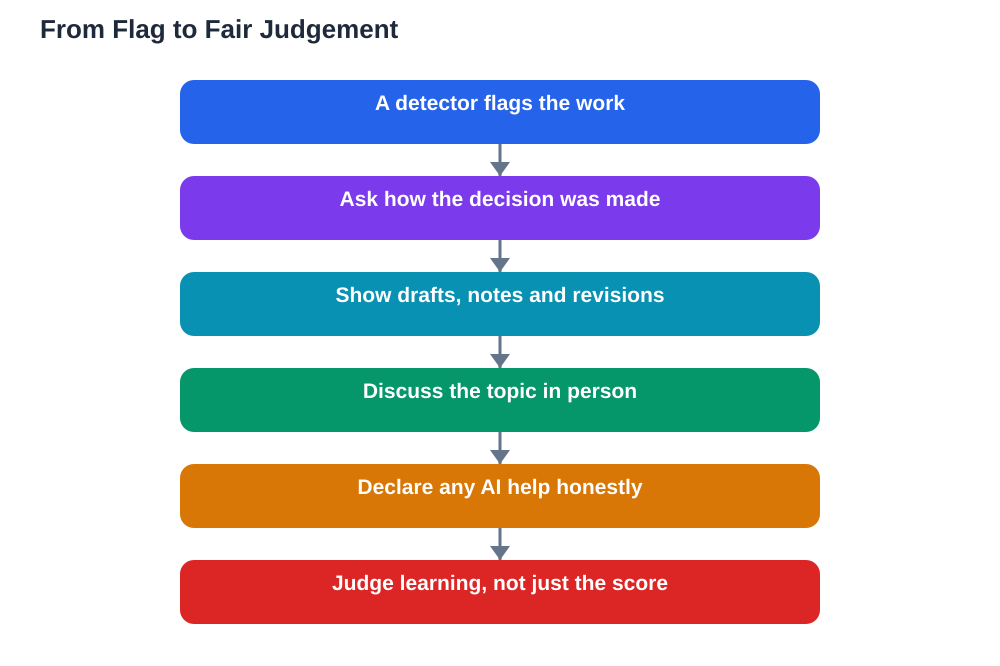

Being flagged by an AI detector can feel frightening and unfair, especially when you wrote the work yourself, and ai plagiarism detection limits explain why that fear is not misplaced. Detectors try to guess whether text was written by a machine, but guessing is all they do, and their guesses are wrong often enough that a flag should never be treated as proof. Understanding how these tools work, why false positives happen, and how to show your real process protects honest students and keeps assessment fair for everyone.

## How Detectors Guess, and Why Guessing Fails

AI detectors look for patterns that are common in machine-written text, such as very even sentence lengths, predictable word choices, and a lack of personal quirks. The problem is that human writing often shows those same patterns, especially when a student writes carefully, follows a template, or uses formal academic style. A clear, well-organised essay can therefore look machine-like to a detector, while genuinely machine-written text that has been lightly edited can slip past it. Detectors also struggle with short texts, where there is too little material to judge, and with writing by learners who use English as an additional language, whose careful, regular style can resemble machine output. A tool that mistakes careful human writing for machine writing is not a reliable judge, and its result should always be the start of a conversation, never the end of one.

## AI Plagiarism Detection Limits: False Positives Explained

A false positive means the detector flagged human writing as AI-generated, and these errors are one of the most widely discussed limits of detection tools. False positives matter because they punish exactly the students who worked hardest to write clearly, and because they are difficult to disprove once a flag exists. A student cannot easily prove a negative, and a single score gives no explanation of which sentences looked suspicious or why. That is why many educators now treat detector scores as weak evidence at best: a flag raises a question, but it does not answer it. Fair assessment requires something stronger than a guess, such as comparing the work with the student's known writing, discussing the topic with them, or reviewing how the work was produced. Any system that turns a detector score into an automatic penalty skips the very judgement that makes assessment fair.

## Process-Based Assessment: Showing Your Work

The fairest answer to detection limits is process-based assessment, which looks at how work was made, not only at the finished product. When students keep drafts, notes, outlines, and revision histories, they create a visible trail of their thinking, and that trail is powerful evidence of genuine work. A teacher who can see an essay grow from rough notes to a finished draft, with changes and corrections along the way, has far better evidence than any detector score. Students can help themselves by saving early drafts, keeping planning notes, and being ready to talk through their work: if you can explain your argument, defend your choices, and point to your sources, your understanding speaks for itself. Schools that value process over a single score protect honest students and also teach better habits, since drafting and revising are where real learning happens.

## What to Do If You Are Flagged Unfairly

If a detector flags work you wrote yourself, stay calm and respond with evidence, not anger. Ask politely how the decision was made, whether the detector score alone decided it, and whether your drafts and notes can be reviewed. Offer to discuss the topic in person, since a short conversation quickly reveals whether a student understands their own work. Keep copies of your drafts, your planning notes, and any earlier versions, and save them as you go, not after a problem arises. You can also declare any AI help you did use, honestly and briefly, since a clear declaration separates legitimate support from substitution and strengthens your credibility. A fair process will listen to this evidence, and if it does not, you have a clear, respectful case for asking that the decision be reviewed by another teacher.

## AI Help: Muse AI

Muse AI is Meta's personal AI assistant, and it can help you build a strong writing process. You can ask it to help you plan an essay outline, or to suggest revision questions that help you improve a draft you wrote yourself.

Join Muse with invite code LTGSWD — in the Muse app, go to Settings > Redeem token and enter the code.

Disclosure: LTGSWD is the author's Muse invite code.

## FAQ

### Does a detector flag prove AI wrote my work?

No. Detectors make educated guesses based on patterns, and those guesses produce false positives, especially for clear, formal, or carefully structured human writing. A flag is a reason to ask questions, not proof of an answer.

### Why do detectors flag honest human writing?

Because careful human writing often shares the patterns detectors associate with machines: even sentences, predictable word choices, and formal style. Short texts and writing in a second language are flagged more often, since there is less distinctive material to judge.

### How can drafts protect me against a false flag?

Drafts, notes, and revision histories show your thinking developing over time, which is strong evidence of genuine work. A finished essay can be questioned, but a visible process of planning, drafting, and revising is very hard to fake.

### Should schools stop using detectors entirely?

Many educators now use them only as a weak signal, if at all, and rely instead on process evidence and conversation with the student. That approach is fairer, because it judges learning directly rather than trusting a guess about authorship.

### What should I do first if I am flagged?

Stay calm, ask how the decision was made, and offer your drafts and notes for review. Ask to discuss the topic in person, since explaining your own work is the clearest evidence that you understand it.

## Conclusion

Detector flags are guesses, not verdicts, and false positives fall hardest on honest, careful writers. Keep your drafts, show your process, declare any help you used, and be ready to talk through your work with confidence. Fair assessment judges what you learned and how you worked, and no score from a guessing tool should replace that judgement. For help with your school work and study questions, [Try the free AI lesson solver](/#tool).
