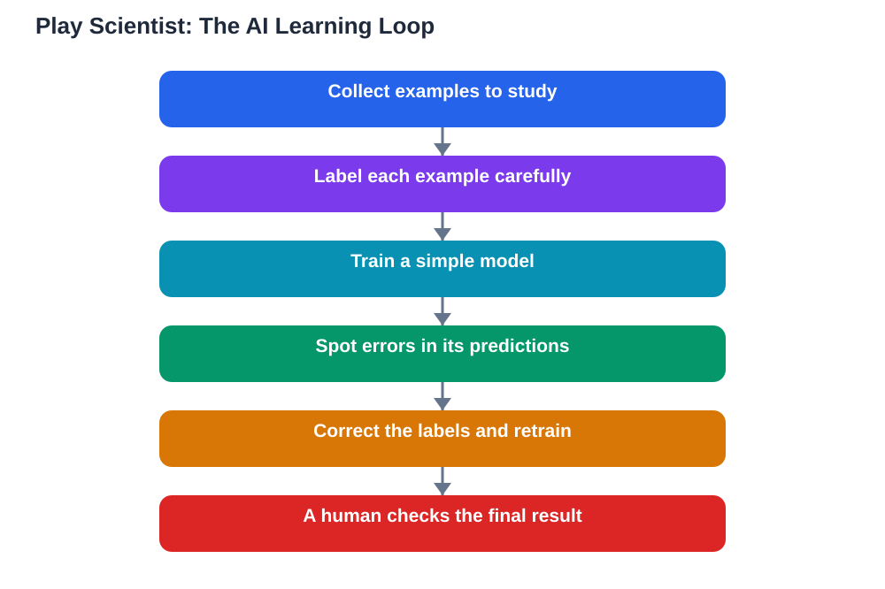

Playing the role of a researcher is one of the most memorable ways to understand artificial intelligence, and ai science games students can try make that experience possible in an ordinary lesson. Instead of reading a definition of machine learning and trying to memorise it, learners step into a game where they sort information, label examples, and watch a simple model improve or fail depending on the quality of their work. The lesson feels like play, but the thinking is serious: every decision about a label or a data point changes what the model learns. That is exactly how real AI systems behave, and discovering it first-hand teaches more than a paragraph of explanation ever could.

## AI Science Games Students Play as Young Researchers

In a typical game-based lesson, students take on the job of a research team. They might be given a set of images or patterns to sort, and their task is to decide which category each one belongs to. Some examples are clear, but others are blurry, incomplete, or misleading, and those tricky cases spark the best discussions. Learners argue about what counts as evidence, check each other's reasoning, and revise their labels when a classmate points out something they missed. This mirrors real research, where teams debate, double-check, and correct one another before they trust a result. The game format lowers the fear of being wrong, because a wrong label is simply a step in the game, not a failed test, and students learn to treat mistakes as information rather than embarrassment.

## Why Data Quality Matters More Than Clever Code

One of the most valuable lessons these games teach is that an AI system is only as good as the data it learns from. If labels are sloppy, inconsistent, or biased, the model will confidently repeat those flaws, no matter how clever the program behind it seems. In the game, students see this happen in real time: a model trained on careless labels makes odd predictions, and the class has to hunt for the bad labels that caused the trouble. Fixing the data and retraining the model shows a powerful idea, which is that careful human work at the start saves confusion later. This lesson transfers directly to schoolwork. When learners use AI tools for study, they should ask where the information came from, whether it was checked, and whether it could carry hidden errors, rather than accepting a polished answer at face value.

## Spotting Errors and Correcting Labels Together

Spotting errors is a skill that grows with practice, and games give students a safe place to practise it. A good game includes deliberate traps: an example that looks like one category but belongs to another, a duplicate that has been labelled two different ways, or a pattern that only appears because of a mistake in how the data was collected. Working through these cases teaches learners to slow down, compare examples side by side, and look for the feature that actually matters instead of the first thing that catches the eye. It also teaches humility, because even confident students get some cases wrong, and the class learns that checking each other's work is a strength, not a sign of weakness. When the group corrects a label together, everyone understands the concept more deeply than if a teacher had simply given them the answer.

## Human Supervision: Why People Stay in Charge

Every game like this ends with the same important message: humans must supervise AI. The model does not know whether its training data was fair, accurate, or complete; it only finds patterns in whatever it was given. People decide what data to use, what counts as a correct label, and whether the final result is trustworthy enough to act on. That is why researchers check their data, test their models on new examples, and stay ready to overrule a machine that produces a strange result. Students who learn this early become wiser users of AI tools later. They will question surprising answers, verify important claims against their textbook, and remember that AI can make mistakes, especially when its data was thin or flawed. Supervision is not about fearing AI; it is about keeping human judgement in the loop where it matters most.

## AI Help: Muse AI

Muse AI is Meta's personal AI assistant, and it can help you explore how AI learns. You can ask it to explain, in simple language, why clean training data matters, or to quiz you on spotting errors in a set of examples.

Join Muse with invite code LTGSWD — in the Muse app, go to Settings > Redeem token and enter the code.

Disclosure: LTGSWD is the author's Muse invite code.

## FAQ

### Do you need to know programming to enjoy an AI science game?

No. These games are designed around decisions, not code. You sort, label, compare, and discuss, which teaches the ideas behind AI without requiring you to write a single line of programming first.

### What is the most important thing a student learns from these games?

That data quality decides everything. A model trained on careless or biased labels will produce unreliable results, so checking and correcting data is just as important as building the model itself.

### Why do games include deliberately tricky or wrong examples?

Because real data is messy. Tricky examples teach you to look closely, compare cases, and defend your reasoning, which are exactly the skills you need when judging AI output in real study.

### Can a game like this help with ordinary school subjects?

Yes. The habits it builds, such as checking sources, questioning surprising results, and correcting mistakes calmly, help in science, mathematics, reading, and any subject where evidence matters.

### Should students trust an AI tool's answer after playing such a game?

They should trust it more wisely, not blindly. The game shows why verification matters, so a good habit is to check important answers against your textbook and your teacher's guidance before relying on them.

## Conclusion

Games that let students play scientist turn an abstract idea into something they can touch, test, and fix. Learners discover that AI learns from data, that bad data leads to bad answers, and that human supervision keeps the whole process honest. Those are lessons that stay useful long after the game ends, whatever tools learners use next. For help with your school work and study questions, [Try the free AI lesson solver](/#tool).
