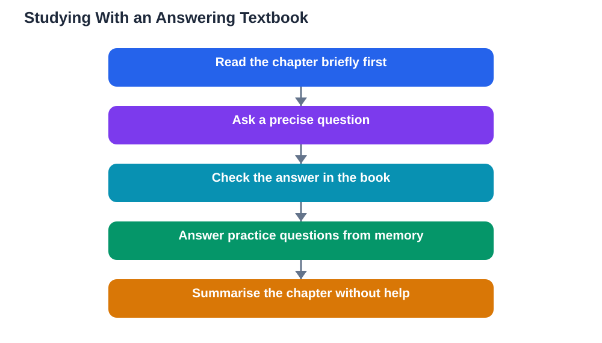

Textbooks equipped with AI study tools are now in regular use by many students across many institutions: a question chatbot built into the book, plus practice questions generated from the chapter itself. Reports suggest learners engage more with these books than with traditional ones, and that is easy to believe. A textbook that answers back feels alive, and a question asked at the moment of confusion is worth more than a question saved for later. But a textbook that can answer your questions also demands a new skill: checking the answer against the book itself. The tool is only as good as its grounding in the chapter, and AI can still invent confident-sounding details that are not in the text at all.

## Why an Answering Textbook Feels So Different

A traditional textbook waits silently while you struggle. You reread a paragraph, search the index, and hope the explanation clicks on the second pass. An answering textbook changes that rhythm: you ask in your own words, and you get an immediate response in plain language. That immediacy keeps momentum going, which is why engagement rises. It also changes what you practise. Instead of only reading, you start a conversation with the material, testing your understanding as you go. The danger is that the conversation can feel like understanding when it is only recognition. Reading a clear answer and nodding along is not the same as being able to produce that answer yourself later, under exam conditions, without the helper beside you.

## Ask Questions the Book Can Actually Answer

The quality of the help depends heavily on the quality of your question. Vague questions produce vague answers, while precise questions force the tool to stay close to the chapter. Instead of asking for a summary of everything, ask about the one idea that confused you: why a step works, how two concepts differ, or what an example is showing. Ask the helper to point to the part of the chapter its answer comes from, and then open that part yourself. If the helper cannot show its source in the book, treat the answer as unverified. Good questions also include your own attempt: explain what you think the answer is, and ask where your reasoning goes wrong. That turns the helper from an answer machine into a tutor that corrects your thinking.

## Check Every Answer Against the Book

This is the habit that makes an answering textbook safe to use. After every important answer, find the matching passage in the chapter and compare the two. Does the answer use the book's definitions, or has it quietly substituted a different meaning? Does it follow the book's method, or has it introduced a shortcut the book does not teach? Does it mention a fact, formula, or example that you cannot find in the chapter at all? If anything does not match, trust the book. AI systems can hallucinate: they can invent plausible details, blend ideas from different topics, and present guesses as facts. A textbook with a built-in helper is still a textbook first. The helper's job is to guide you back to the text, not to replace it. For more on this habit, see [Checking AI Answers for Mistakes](/blog/checking-ai-answers-for-mistakes.html).

## Use the Practice Questions Properly

AI-generated practice questions from a chapter can be excellent revision, if you use them actively. Answer each question from memory before looking at the suggested answer, even if your first attempt is rough. Cover the answer, write your version, then compare. Where you were wrong, return to the chapter passage and restudy it, rather than simply reading the correct answer and moving on. Vary the questions too: ask for questions that mix ideas from different sections, and for questions that ask you to explain rather than only recall. If a practice question seems to test something the chapter never taught, flag it and check with your teacher. A question bank is only useful when every question is fair, grounded, and matched to what you are actually expected to learn.

## Keep the Textbook in Charge

The healthiest way to use an answering textbook is to keep a clear hierarchy: the textbook decides what is true for your course, the helper explains, and you do the learning. Read the chapter first, even briefly, before asking questions, so you have a mental map the helper's answers can attach to. After a study session, close the helper and summarise the chapter from memory in your own words. If you cannot, you have found the gap to restudy, and that discovery is worth more than another hour of asking questions. The tool supports textbook photos in English, Urdu, and Sindhi as a multilingual feature of the Lesson Solver, but whatever language you study in, the same rule applies: verify against your own textbook, because AI can make mistakes.

## AI Help: Muse AI

Muse AI is Meta's personal AI assistant, and it can help you use an answering textbook well. You can ask it to rephrase a difficult textbook paragraph in simpler words, or to turn a chapter idea into a practice question you can answer from memory. Join Muse with invite code LTGSWD — in the Muse app, go to Settings > Redeem token and enter the code.
Disclosure: LTGSWD is the author's Muse invite code.

## FAQ

### Are AI textbooks better than traditional textbooks?

They can be more engaging, because you can ask questions at the moment of confusion and get immediate practice. But they are only better when answers stay grounded in the chapter and you still do the active work of recalling and explaining. A traditional textbook read actively can beat an answering textbook used passively.

### How do I know if an AI textbook answer is wrong?

Compare it with the chapter itself. Check definitions, methods, and examples against the text, and be suspicious of any fact or example you cannot find in the book. If the helper cannot point to its source passage, treat the answer as unverified and ask your teacher.

### Should I read the chapter before using the AI helper?

Yes, at least briefly. Reading first gives you a mental map of the chapter, so you can judge whether the helper's answers fit and notice when something is off. Without that map, you have no way to tell a good answer from a confident invention.

### Can AI-generated practice questions replace past papers?

No, they are a useful addition, not a replacement. Practice questions from the chapter help you rehearse the material, but past papers show you how questions are actually asked and marked. Use both: chapter questions for learning, past papers for exam readiness.

## Conclusion

A textbook that can answer your questions is a genuine step forward for studying, but only if you keep the textbook in charge. Ask precise questions, demand sources in the chapter, check every important answer against the text, and use practice questions actively rather than passively. Used that way, the helper deepens your understanding instead of replacing it. If you use the Lesson Solver tool for textbook exercises, remember to verify its solutions against your textbook, keep in mind that AI can make mistakes, and note that the tool needs your own free Google AI Studio API key.

[Try the free AI lesson solver](/#tool)
