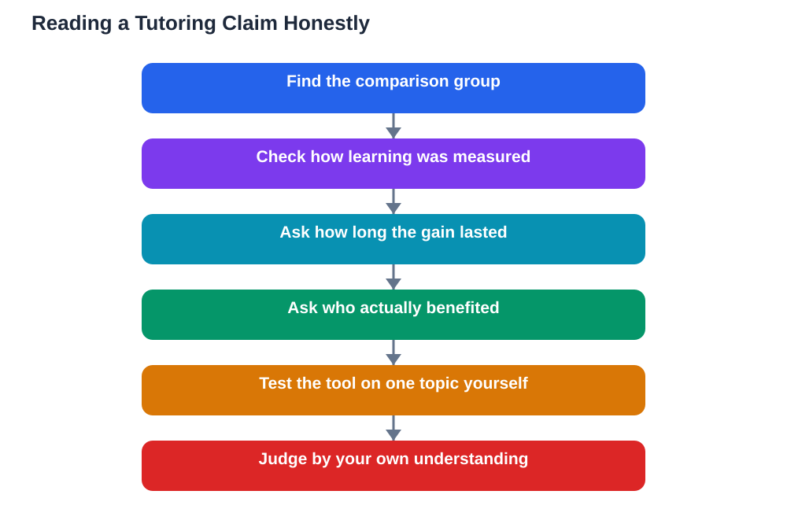

Headlines about AI in education often sound spectacular, promising large gains from personalised tutoring and hours saved on planning and grading, and ai tutoring gains honest reading is the skill that separates genuine insight from marketing. None of this means AI tutoring is useless; personalised practice, instant feedback, and patient explanations help many learners. But averages hide as much as they reveal, and a claim that sounds impressive for a group may say very little about what will happen for you. Learning to read these claims critically protects you from disappointment and helps you use AI tutoring where it truly helps.

## Personalised Tutoring Gains: What the Claims Usually Mean

When a report says personalised tutoring improved results, it usually means that a group of learners using the tool scored better on average than a comparable group that did not. That average is real information, but it is not a promise. Within the group, some learners may have improved a great deal, others barely at all, and a few may have done worse, perhaps because they leaned on the tool instead of thinking for themselves. Averages also hide who was studied: motivated volunteers, well-supported learners, or students with strong internet access may respond very differently from the average student. Before trusting a claim, ask who was included, what the comparison group did instead, and whether the improvement was measured on a meaningful test or a quick quiz. Those three questions turn a headline into something you can actually judge.

## Teachers Saving Time: Planning, Grading, and the Catch

Claims about teachers saving time on planning and grading deserve the same careful reading. AI can genuinely draft lesson outlines, generate practice questions, and give first-pass feedback far faster than doing everything by hand, and that time can be returned to actual teaching. But the saved time is only real if the generated material is checked, corrected, and adapted, and checking takes time too. A teacher who blindly uses unreviewed AI output may save an hour on planning and lose more later, fixing confusion the material caused. The honest version of the claim is subtler: AI can shift teacher time from routine production toward review, guidance, and one-to-one help, and that shift is valuable, but it is not the same as work simply disappearing. When you hear a time-saving claim, ask what checking and correction were counted, because that is where the truth lives.

## What Averages Do and Do Not Prove

Averages are useful summaries, but they prove less than they appear to. An average gain does not prove that the tool caused the improvement, since other changes, such as extra practice time, teacher enthusiasm, or simply being studied, can lift results too. It does not prove the gain will last, since a short-term boost from novelty often fades once the tool feels ordinary. And it does not prove the gain applies to you, since your subject, your starting level, and your study habits all shape the outcome. What averages can do is point you toward tools worth trying carefully, with your own results as the real test. Try a tutor for a few weeks, track your own recall and understanding, and judge it by whether you can explain topics better without the tool, not by whether a headline promised success.

## AI Tutoring Gains Honest: Judging Claims Yourself

A practical checklist makes honest reading easy. First, look for the comparison: was there a fair group that did not use the tool? Second, look for the measure: was learning tested properly, or only satisfaction surveyed? Third, look for the time span: did the gain survive beyond the first few weeks? Fourth, look for who benefits: do struggling learners gain, confident learners gain, or only the already motivated? Finally, test the claim yourself in miniature, using the tool for one topic and checking your understanding against your textbook. Claims that survive these questions deserve your attention. Claims that dodge them deserve your scepticism, however polished their presentation. Reading critically is not cynicism; it is how you make sure a promising tool earns its place in your study routine.

## AI Help: Muse AI

Muse AI is Meta's personal AI assistant, and it can help you read education claims critically. You can ask it to explain what an average result does and does not prove, or to help you draft questions for judging a tutoring claim before you trust it.

Join Muse with invite code LTGSWD — in the Muse app, go to Settings > Redeem token and enter the code.

Disclosure: LTGSWD is the author's Muse invite code.

## FAQ

### Does an average improvement mean AI tutoring will help me?

Not necessarily. An average describes a group, and your result depends on your subject, starting level, study habits, and how actively you use the tool. Treat averages as a reason to try a tool carefully, not as a personal guarantee.

### Why might a tutoring gain fade over time?

Novelty often boosts early results, and learners may practise more simply because a new tool feels exciting. When the novelty wears off, only genuine learning habits remain, so long-term results matter more than first-week enthusiasm.

### If teachers save planning time, does that mean less work overall?

Not exactly. AI can shift time from producing material to checking, correcting, and guiding students. That shift can be valuable, but unreviewed output can create extra work later, so checking time must be counted honestly.

### What is the most reliable way to test an AI tutor myself?

Use it for one topic over a few weeks, then test yourself without it. If you can explain the topic clearly and answer new questions on it, the tutor helped you learn; if you can only repeat its answers, it helped you copy.

### Should impressive statistics make me suspicious?

They should make you curious, not automatically suspicious. Ask who was studied, what the comparison was, how learning was measured, and how long the gain lasted, and let the answers decide how much weight the claim deserves.

## Conclusion

AI tutoring can genuinely help, and teachers can genuinely reclaim time, but honest reading means looking past the headline to the average, the comparison, and the conditions behind it. Use claims as a starting point, test tools on your own learning, and keep your textbook and your own understanding as the final judge. That way, promising tools earn their place, and empty promises do not waste your time. For help with your school work and study questions, [Try the free AI lesson solver](/#tool).
