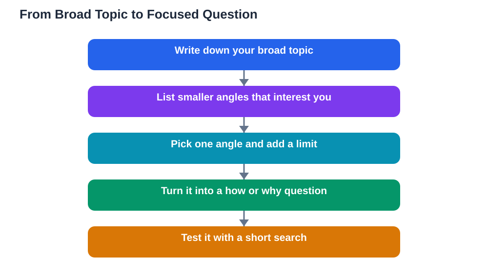

Asking a research question well is the step that decides whether a school project feels exciting or exhausting. A good question gives your reading a purpose: every source you open either helps answer it or it does not, and that simple test saves hours of wandering. A vague topic, on the other hand, pulls you in every direction at once. You collect facts that do not fit together, your notes grow messy, and writing the final piece feels like assembling a puzzle with no picture on the box. The good news is that asking a research question is a skill, not a talent. With a few narrowing moves and a short checklist, almost any broad topic can become a question you can actually answer in the time you have.

## Asking a Research Question: Start Broad, Then Narrow

Every strong research question starts life as a broad topic, and that is perfectly normal. You might begin with a subject you find interesting, such as oceans, healthy eating, or how people learn. The mistake is stopping there and treating the topic itself as the question. Instead, treat the topic as a starting field, then look for a smaller corner of it that genuinely interests you. Ask yourself what part of the topic puzzles you, what change or comparison you would like to understand, or what problem you would like to explore. If your topic is oceans, you might narrow to how coastal plants protect shorelines, or how one sea animal adapts to deep water. Each narrowing step makes the next step easier, because a smaller field has fewer sources to sort through and a clearer story to tell. Keep narrowing until you can picture the kind of answer you are looking for, even if you do not yet know what that answer is.

## Three Tests for a Question Worth Researching

Before you commit to a question, run it through three simple tests. First, is it clear? A reader should understand exactly what you are asking without needing extra explanation. Words like "things" or "stuff" are warning signs, because they hide what you really mean. Second, is it focused enough for the time and length you have? A question that would need a whole book to answer is too big for a school project, while a question with a one-word answer is too small to research properly. Third, can it actually be researched with sources you can reach, such as library books, trusted websites, or interviews? A question about something nobody has recorded or studied will leave you stuck. If your question passes all three tests, it is ready to guide your work. If it fails one, adjust that part rather than starting over completely.

## Turn a Topic Into a Question in Four Moves

A reliable way to shape a question is to move through four small steps. Begin by writing down your broad topic in a sentence. Next, list two or three smaller angles within it that interest you, such as causes, effects, comparisons, or solutions. Then pick the angle that excites you most and add a limit, such as a particular group, place type, or time period described in general terms rather than as a specific named case. Finally, turn what is left into a question that starts with how, why, or what. For example, a broad interest in healthy eating might become a question about how school lunches can be made both healthy and appealing to students. Notice how the final question names a subject, an action, and a tension to explore. That tension is what makes research interesting, because it gives you something to investigate rather than a list of facts to copy.

## Wording That Helps Your Research Stay on Track

The words you choose for your question shape the sources you will find, so choose them with care. Questions beginning with "how" and "why" usually lead to richer research than questions that can be answered with a simple yes or no, because they invite explanation. Avoid questions that already assume their own answer, such as questions loaded with an opinion, because they push you toward only the evidence that agrees with you. Also avoid double questions packed into one sentence, since they pull your project in two directions and make writing much harder. If you catch yourself asking two things at once, split them and choose the stronger one as your main question, keeping the other as a supporting question if it still fits. Read your question aloud and check that it sounds like something a curious person would genuinely ask, not like a sentence written only to sound formal.

## Test Your Question Before You Start Searching

A quick test run can save you from discovering a weak question halfway through your project. Try a short search using the key words from your question and see what kinds of sources appear. If you find nothing at all, your wording may be too unusual or too narrow, and you may need broader terms. If you find an overwhelming flood of unrelated material, your question is probably still too broad and needs another limit. Also check whether the sources you find are ones you can actually read and understand at your level; a question whose only sources are extremely technical may need reframing in simpler terms. It is far better to revise your question now, while your notes are still empty, than to force a weak question through weeks of work. Good researchers revise their questions often, and changing your question early is a sign of careful thinking, not failure. For more help shaping questions you can ask in class and in research, see [Asking Better Questions](/blog/asking-better-questions.html).

## AI Help: Muse AI

Muse AI is Meta's personal AI assistant, and it can help you shape a research question. You can ask it to suggest narrower angles on your broad topic or to reword a vague question so it is clearer and more focused.
Join Muse with invite code LTGSWD — in the Muse app, go to Settings > Redeem token and enter the code.
Disclosure: LTGSWD is the author's Muse invite code.

## FAQ

### What makes a research question good?

A good research question is clear, focused, and researchable. A reader should understand it at once, it should fit the time and length you have, and it should be answerable from sources you can actually reach. If a question is vague, enormous, or impossible to investigate with available sources, it needs narrowing or rewording before you begin.

### How narrow should my research question be?

It should be narrow enough that you can cover it properly in your project, but broad enough that you can find several useful sources about it. A useful test is to imagine your final piece: if you can picture its main sections, the scope is probably right. If you can only picture a single paragraph, it is too narrow, and if you cannot picture where it would end, it is too broad.

### Can I change my research question after I start?

Yes, and good researchers often do. Early reading frequently reveals a more interesting angle or shows that the first question was too broad or too vague. Changing your question early, while your notes are still small, is sensible. Just make sure your new question still fits your project length and that you update your notes and source list to match it.

### What is the difference between a topic and a research question?

A topic is a subject area, such as healthy eating or ocean life, while a research question asks something specific about that area. The question turns a subject into a job to do: it tells you what to look for, what to ignore, and what your final piece needs to explain. Without a question, research easily becomes collecting facts with no direction.

## Conclusion

A strong project starts with a strong question, and a strong question is built, not found. Start broad, narrow to an angle that interests you, test your question for clarity, focus, and researchability, and revise it without embarrassment if the test shows a weakness. When your question is clear, every later step becomes easier: sources are simpler to judge, notes are simpler to organise, and writing has a natural shape. Choose your question with care, and your whole project will thank you for it.

[Try the free AI lesson solver](/#tool)
