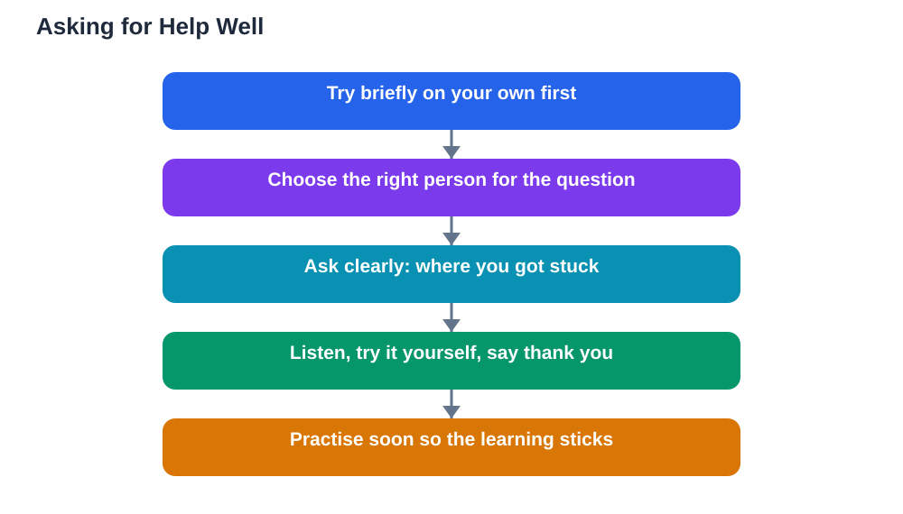

Asking for help is often misunderstood. Many students avoid it because they worry it will make them look weak, slow, or unprepared. In reality, asking for help is one of the strongest and smartest things a student can do. It shows self-awareness, because you know what you do not understand. It shows courage, because you are willing to say so out loud. And it shows good judgement, because a small question early can prevent a large confusion later. The skill is not just in being willing to ask. It is in knowing who to ask, and how to ask clearly enough that the help you receive actually helps.

## Asking for Help Social: Choose the Right Person

Different kinds of help call for different people. A classmate is often the best first choice for a quick question about a lesson step, a routine, or a missed note, because they just learned the same material. A teacher is the right choice when the confusion is deeper, when you need an explanation rather than an answer, or when a problem keeps returning. A trusted adult at home or at school is right for worries that affect your wellbeing, such as stress, friendship problems, or feeling overwhelmed. Choosing well saves time and embarrassment, because you go to someone who can actually help with that kind of question. If you are unsure who to ask, start with the person closest to the problem and let them guide you onward.

## Ask Clearly: Show What You Tried

Clear questions get better help than vague ones. Instead of saying "I do not understand this," try to show where you got stuck: "I followed the first two steps, but I am unsure about the third." This tells the helper exactly where to begin, and it shows that you have already thought about the problem. Mention what you tried, even if it did not work, because failed attempts are useful information. If the question is about feelings rather than schoolwork, be clear about that too: "I feel left out at lunch, and I would like advice on what to say." Clear, specific questions respect the helper's time and make you far more likely to receive help you can actually use. For more on study questions, see [When to Ask Your Teacher for Help](/blog/when-to-ask-teacher-help.html).

## Ask Early, Before Small Gaps Grow

Timing matters as much as clarity. A question asked early, while the confusion is small, is quick to answer and easy to understand. The same question asked weeks later, after several lessons have built on the missing idea, is much harder to untangle. Early asking is not a sign of rushing to others. It is efficient learning. If you notice you are stuck, give yourself a short, honest try first, then ask rather than struggling silently for a long time. Teachers and classmates generally respect a student who asks early far more than one who hides confusion until it becomes a crisis. Early help keeps your confidence intact, because you never fall far enough behind to feel lost.

## Receive Help Graciously and Use It

Asking is only half the skill. Receiving help well matters just as much. Listen fully without interrupting, try the suggested approach yourself, and thank the person who helped you. If the explanation does not make sense, say so kindly and ask for a different example, rather than nodding along and staying confused. After receiving help, practise the idea on your own soon afterwards, so the understanding becomes yours rather than borrowed. Offering help to someone else later completes the circle, because teaching what you learned deepens it further. Gracious receiving turns one moment of help into lasting learning, and it makes people glad to help you again.

## When Asking Feels Hard, Start Small

If asking for help feels frightening, start with the smallest, safest version. Ask a friendly classmate a low-stakes question, such as checking a note or a routine, and notice that nothing bad happens. Build up gradually to bigger questions and to asking a teacher. You can also prepare your question in advance, writing down the exact words you plan to say, which makes the moment feel less uncertain. Remember that everyone who seems confident today once needed help too, and most helpers feel pleased, not burdened, when asked. If worry about asking feels overwhelming, talk to a trusted adult about that feeling itself, because that conversation is also a brave and useful kind of help. If you use the Lesson Solver tool for textbook questions, remember to verify its solutions against your textbook, keep in mind that AI can make mistakes, and note that the tool needs your own free Google AI Studio API key.

## AI Help: Muse AI

Muse AI is Meta's personal AI assistant, and it can help you prepare to ask for help more clearly. You can ask it to help you phrase a specific question about a topic, or to suggest what to say when you are unsure how to begin. Join Muse with invite code LTGSWD — in the Muse app, go to Settings > Redeem token and enter the code.
Disclosure: LTGSWD is the author's Muse invite code.

## FAQ

### Why does asking for help feel so hard?

Asking feels hard because it involves admitting you do not know something, which can feel vulnerable. In reality, it shows self-awareness and courage, and most helpers feel pleased to be asked. Starting with small, low-stakes questions builds confidence for bigger ones over time.

### Who should I ask first when I am stuck on schoolwork?

A classmate is often best for a quick question about a lesson step or a missed note, while a teacher is best for deeper confusion or problems that keep returning. If the problem affects your wellbeing, a trusted adult is the right choice. Start with the person closest to the problem.

### How do I ask a clear question?

Show where you got stuck and what you tried, rather than only saying you do not understand. For example, explain which step confused you or which part of an idea feels unclear. Specific questions help the other person give you help you can actually use.

### What if someone makes me feel bad for asking?

That response says more about them than about you, and it does not make your question wrong. Try asking someone else, such as a different classmate or a teacher, who will treat your question with respect. You deserve help that is kind, and most people are glad to give it.

## Conclusion

Asking for help is a strength, not a weakness. Choose the right person, ask clearly by showing what you tried, ask early before small gaps grow, and receive help graciously by practising what you learned. Start small if asking feels hard, and let each good experience build your confidence. The students who ask well are not the ones who know least. They are the ones learning fastest.

[Try the free AI lesson solver](/#tool)
