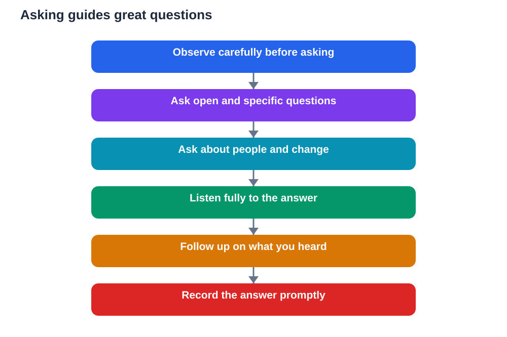

Guides know things that labels cannot tell you. They have stories, explanations, and experience gained from spending long hours in a place and answering questions from many visitors. Yet many students stay quiet on trips, unsure what to ask or worried about asking something silly. The result is a missed opportunity. A good question can unlock an explanation, a story, or a way of seeing that transforms the whole visit.

Asking great questions is a skill, and like any skill it improves with preparation and practice. It begins with curiosity and observation, and it grows when you learn to ask open questions that invite a thoughtful answer rather than a one-word reply. When you ask well, you do not only learn more yourself. You often help the whole group see something they would otherwise have missed.

## Observe First, Then Ask

The best questions usually grow out of careful observation. Before asking, spend a little time looking, listening, and noticing what puzzles or interests you. A detail that seems odd, a process you do not understand, or a contrast with something you learned in class can all become strong questions. Observation gives your question a concrete starting point, which makes it easier for a guide to answer helpfully.

Avoid asking a question you could answer by reading the nearest label. Instead, ask about what lies behind the label: why something was done a certain way, how it changed over time, or what daily life around it was like. Questions rooted in what you have actually seen show genuine curiosity, and guides usually respond to that curiosity with richer answers.

## Prefer Open Questions

Open questions invite explanation, while closed questions invite a short answer. Asking how something works, why it was designed that way, or what surprised the guide most will usually lead to a fuller response than asking whether something is old or new. Open questions give the guide room to share stories, reasoning, and details that a brief answer would hide.

A useful pattern is to connect your question to something specific you noticed. You might ask how a particular feature worked, why a certain material was chosen, or what challenge the people involved faced. Specific, open questions are easier to answer well than vague ones, because they show the guide exactly what you are curious about and why.

## Ask About People, Not Just Objects

Objects and places become far more interesting when you ask about the people connected to them. Who used this, and what was their daily life like? What skills did they need? What problems did they face, and how did they solve them? People-focused questions turn a display into a human story, which is easier to remember and more meaningful to discuss later.

You can also ask about change. How has this place or practice changed over time, and why? What has stayed the same? Questions about change reveal history as a living process rather than a fixed set of facts. They also show a guide that you are thinking beyond the surface, which often leads to especially thoughtful answers.

## Listen Fully Before Following Up

Asking well includes listening well. When a guide answers, listen for the main idea, the example, and any detail that raises a new question. Resist the urge to plan your next question while the answer is still being given. A follow-up question that builds on what was just said is far stronger than a prepared question that ignores the answer.

Good follow-ups are often simple. You might ask for an example, for clarification of a term, or for what happened next. These follow-ups show respect for the guide's knowledge and help you check your understanding in real time. They also model a habit that serves every kind of learning: listen first, understand, then dig deeper.

## Ask One Clear Question at a Time

It is tempting to pack several questions into one long sentence, but that usually confuses the answer. Ask one clear question, listen to the reply, and then decide whether a follow-up is needed. Clarity helps the guide give a focused answer and helps you remember what was actually said.

If you have many questions, note them down and prioritise. Ask the one that matters most to your learning or that only this guide can answer, and save the rest for later discussion, textbook checking, or class. A notebook full of good questions is a sign of an active mind, even if you only ask a few of them aloud during the visit.

## Thank the Guide and Record the Answer

A short thank-you matters. Guides give their time and knowledge generously, and appreciation encourages them to keep sharing. It also closes the conversation politely and leaves a good impression for the next group. Good manners are part of good learning on a trip, not an optional extra.

As soon as you can, record the key point of the answer in your own words. Note the question you asked, the main idea of the reply, and anything that surprised you. Memory fades quickly after a busy visit, and a brief note made promptly will preserve far more than you expect. If you later use the answer in homework, check important details against your textbook, and remember that AI helpers can make mistakes too, so verify rather than copy uncritically.

## AI Help: Muse AI

Muse AI is Meta's personal AI assistant, and it can help you ask guides better questions on trips. You can ask it to turn a rough curiosity into a clear open question before a visit, or to help you organise the answers you recorded afterwards. It is useful for explaining ideas simply, drafting questions, and shaping notes into revision material.

Join Muse with invite code LTGSWD — in the Muse app, go to Settings > Redeem token and enter the code.

Disclosure: LTGSWD is the author's Muse invite code.

## FAQ

### What makes a question a great question for a guide?

A great question is open, specific, and rooted in something you observed. It invites explanation or a story rather than a one-word answer, and it asks about something only the guide's experience can illuminate.

### What if I feel shy about asking?

Start with one simple question about something you genuinely noticed. Most guides welcome questions, and asking once usually makes asking again much easier. Writing your question down beforehand also helps.

### Should I ask questions even if I can read the label?

Yes, when your question goes beyond the label. Ask about reasons, processes, people, or changes over time, which labels rarely explain in full and guides often can.

### How many questions should I ask on a visit?

Quality matters more than quantity. A few thoughtful questions, listened to fully and followed up well, teach more than many rushed questions asked without listening to the answers.

### What should I do with a guide's answer afterwards?

Record the main point promptly in your own words, note anything surprising, and check important details against your textbook before using them in homework. That habit turns a conversation into reliable learning.

## Conclusion

Great questions come from observation, curiosity, and respect for the person answering. Observe first, ask open and specific questions, listen fully, and record what you learn. Done this way, a short conversation with a guide can become one of the most memorable and useful parts of any trip.

[Try the free AI lesson solver](/#tool)
