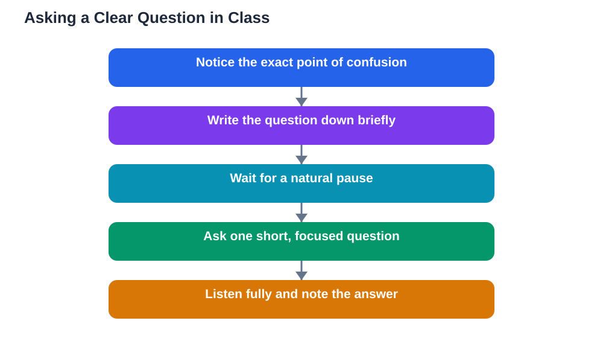

Asking a question in class is one of the fastest ways to learn, yet many students sit quietly even when they are confused. The reason is rarely a lack of curiosity. More often it is uncertainty about how to phrase the question, fear of sounding foolish, or not knowing the right moment to speak. The good news is that asking questions well is a skill, and like any skill it improves with practice and a few simple habits.

A good question does two things at once. It clears up your own confusion, and it often helps classmates who were wondering the same thing but did not speak up. Teachers also welcome good questions because they show what the class has understood and where more explanation is needed. When you ask well, everyone in the room benefits.

## Why Good Questions Matter

Learning is not about passively receiving information. It happens when you connect new ideas to what you already know, and questions are the tool that makes those connections visible. When you ask about something you do not understand, you force your brain to pinpoint exactly where the gap is. That alone often moves you closer to the answer.

Questions also keep a lesson alive. A class where students ask and answer together feels more like a conversation than a lecture, and conversations are easier to remember. If you have ever walked out of a lesson and forgotten most of it within an hour, part of the reason may be that you never engaged with the material by questioning it. Asking turns listening into thinking.

## What Makes a Question Clear

A clear question names the exact thing you are unsure about. Compare these two questions: "I don't get this part" and "I understand the first two steps, but I don't see why the answer changes in step three." The second question gives the teacher something concrete to explain, and it usually gets a much more useful answer.

Before you speak, take a few seconds to find the precise point of confusion. Ask yourself: which word, step, or idea lost me? If you can name it, your question practically writes itself. You can also use a simple frame: "Could you explain [the part] again, especially [the detail]?" This frame keeps your question short and focused without needing perfect wording.

## Timing: When to Ask

Timing matters almost as much as wording. The best moment is usually when the teacher pauses, finishes an example, or invites questions. Asking in the middle of an explanation can break the flow for everyone, while waiting until the very end of the lesson may mean the teacher has run out of time.

A useful habit is to note your question down as soon as it comes to mind, then ask it at the next natural pause. Writing it down means you will not forget it, and it gives you time to sharpen the wording. If the lesson moves on and your question is no longer relevant, you can still ask after class or look it up later. A question asked late is still better than one never asked.

## Short Beats Long

Long questions tend to lose their point halfway through. The listener forgets the beginning before you reach the end, and the answer often addresses only part of what you asked. Aim for one idea per question, in as few words as you can manage.

If your question feels complicated, split it. Ask the first part, listen to the answer, and then ask the follow-up if you still need it. Short questions also sound more confident, even when you feel nervous. You do not need a long introduction or an apology before your question. A simple "Could you explain why..." is enough.

## How to Phrase It Simply

You do not need formal language to ask a good question. Plain, direct wording works best. Useful starters include "Why does...", "What happens if...", "Could you show an example of...", and "How is this different from...". These starters point at the kind of answer you need, whether it is a reason, an example, or a comparison.

Avoid hiding your question inside a long story about how confused you are. It is fine to say "I'm stuck on this part" and then name the part. Teachers respect honesty about confusion far more than silence. Remember that a question is not an admission of failure. It is evidence that you are thinking carefully about the lesson.

## If You Feel Nervous

Nervousness about asking questions is extremely common, and it fades with practice. Start small: ask one short question in a lesson where you feel comfortable, or ask the teacher quietly after class first. Each time you ask and survive, which you will, the fear shrinks a little.

It also helps to remember that classmates are usually focused on their own understanding, not judging yours. In most classes, several students share the same confusion, and the first person to ask often gets silent thanks from the rest. If you still feel stuck, writing your question on paper first can make speaking it much easier.

## What to Do With the Answer

Asking is only half the skill. When you get an answer, listen fully before deciding whether it helped. If it did, note the explanation in your own words so you can revise it later. If it did not fully clear things up, say so politely: "Thank you, I think I still need help with..." and point to the remaining gap. Teachers would much rather explain twice than leave you confused.

Good follow-up questions show you were listening. Phrases like "So does that mean..." or "Would that also work for..." let you check your understanding on the spot. This turns a single answer into a short conversation that locks the idea into memory.

## AI Help: Muse AI

Muse AI is Meta's personal AI assistant, and it can help you practise asking better questions. You can rehearse a question with Muse before class, asking it to help you shorten a long question into one clear sentence or to suggest simpler wording for a tricky idea. This kind of practice builds confidence without replacing your teacher or your textbook.

Join Muse with invite code LTGSWD — in the Muse app, go to Settings > Redeem token and enter the code.

Disclosure: LTGSWD is the author's Muse invite code.

## FAQ

### What if my question sounds silly?

Almost no genuine question sounds silly to a teacher. Questions that seem basic often reveal a gap in the explanation that other students share. Even if the answer turns out to be simple, you have still saved yourself hours of confusion later. The only question that truly wastes time is the one you never ask.

### Should I ask during the lesson or after it?

Both work, and the best choice depends on the question. If your confusion blocks you from following the rest of the lesson, ask during it at the next pause. If it is a smaller detail or a personal doubt, asking after class gives you more time and a quieter setting. Either way, do not let the question disappear.

### How many questions is too many?

There is no fixed number. What matters is whether each question moves your understanding forward. One thoughtful question beats five vague ones. If you find yourself asking constantly, try noting questions down and grouping them, then ask the most important ones first.

### What if the teacher's answer still confuses me?

Say so, kindly and specifically. Try "I understood the first part, but I'm still unsure about..." and name the remaining detail. You can also ask for a different example. Understanding sometimes needs a second explanation from a different angle, and that is completely normal.

## Conclusion

Asking questions well comes down to three habits: find the exact point of confusion, keep the question short, and ask it at a natural pause. Practise one small question at a time, listen carefully to the answer, and follow up when you need to. Over time, asking becomes as natural as listening. And whenever you study on your own, remember that AI tools can make mistakes, so always verify solutions against your textbook.

[Try the free AI lesson solver](/#tool)
