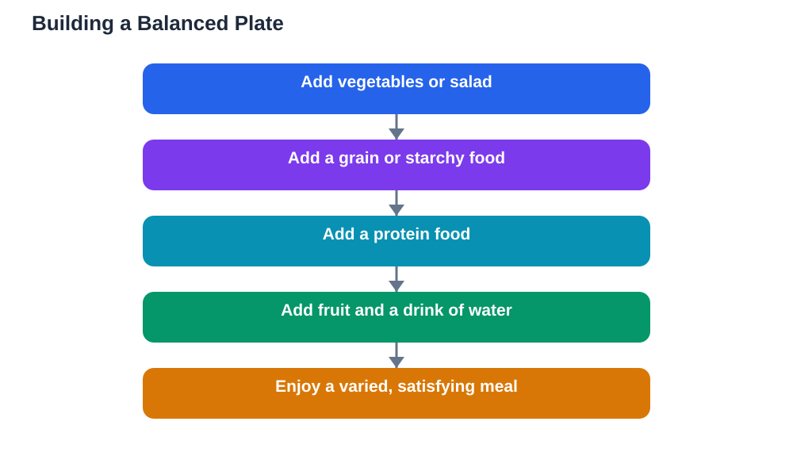

A balanced diet students can actually follow is simpler than many guides suggest. It does not require special products, strict rules, or perfect meals. It means eating a variety of foods from different groups, in sensible portions, across the day, so your body gets steady energy and everything it needs to grow, learn, and stay well. This guide explains plates, portions, and variety in plain language, with practical ideas for real school days.

The word balanced is the key. No single food group can do the whole job alone. Grains provide steady energy, protein foods support growth and staying power, fruit and vegetables add freshness and variety, and dairy or alternatives contribute to the overall mix. Drinks, especially water, complete the picture. When these groups appear across your day in reasonable amounts, your diet is balanced, even if no single meal is perfect.

## Understanding the food groups

Grains and starchy foods form the energy base of most meals. Bread, rice, oats, pasta, and similar foods release energy gradually, especially in wholegrain forms, and they help you stay comfortable between meals. A portion at each main meal is a sensible starting point, adjusted to your appetite and activity.

Protein foods include meat, fish, eggs, dairy, beans, lentils, and nuts where suitable. They help you feel full and support growth and repair. Fruit and vegetables bring colour, freshness, and variety, and they make meals more enjoyable. Aim to include them at meals and as snacks through the day. Dairy foods, or suitable alternatives, contribute to the mix, and water should be your main drink. Together, these groups cover the daily pattern without complicated counting.

## Building a balanced plate

A simple way to build a meal is to picture the plate in parts. Fill a good share with vegetables or salad, add a grain or starchy food, include a protein food, and finish with fruit or a drink of water. The exact shares can flex with appetite and the meal, but the pattern stays the same: more than one group, with vegetables and variety always present.

This plate idea works for home meals, packed lunches, and school meals alike. It also makes choices easier when you face a menu or a lunchbox. Instead of asking whether one item is good or bad, ask whether the whole plate has variety. A plate with several groups is almost always a better choice than a plate with only one, and that simple check guides you well every day.

## Portions without measuring

You do not need scales or charts to judge portions. Your hand and your appetite are useful guides. A portion of grains roughly matches a fist-sized amount, a protein portion roughly matches a palm, and vegetables can fill a generous share of the plate. These are rough guides, not strict rules, and they flex with age, activity, and hunger.

Listen to fullness as well as hunger. Eat at a calm pace, pause when you feel satisfied, and avoid finishing everything out of habit if you are already full. Equally, do not leave yourself hungry by eating too little at main meals, since hunger later often leads to rushed snacking. Balanced portions mean enough to feel comfortable until the next meal, without heaviness or discomfort.

## Variety across the week

Variety is what turns a balanced day into a balanced week. Eating the same meal every day, even a healthy one, narrows the range of foods you enjoy and the nutrients you take in. Rotating grains, protein foods, fruits, and vegetables through the week widens both. Try a new vegetable, a different fruit, or a new way of preparing a familiar food each week.

Variety also keeps eating enjoyable. A learner who looks forward to meals is more likely to eat regularly and calmly. Keep a list of meals you enjoy, and rotate them so favourites return often without becoming monotonous. If you dislike a food, try it prepared differently or in a small amount alongside foods you like. Tastes change with gentle exposure, and patience works better than pressure.

## Balanced eating on busy school days

School days test even the best intentions. Busy mornings, short breaks, and after-school activities all squeeze meal times. The answer is planning, not perfection. A simple breakfast, a packed lunch built on the plate pattern, and a light evening meal cover the day. Snacks between meals can fill gaps, provided they are part of the pattern rather than a replacement for meals.

Prepare what you can ahead of time. Wash fruit, pack lunch the night before, and keep water bottles clean and ready. On very busy days, a simple fallback meal, such as bread with a protein filling plus fruit, is a perfectly balanced choice. Consistency across busy days matters more than an elaborate meal on a quiet one.

## Treats, balance, and a kind approach

A balanced diet includes room for treats. Sweets, fried snacks, and fizzy drinks are enjoyable, and banning them completely often backfires. The balanced approach places them as occasional extras within an otherwise varied diet, rather than as daily staples. When treats are enjoyed calmly, after a meal or on special occasions, they add pleasure without disturbing the overall pattern.

Be kind to yourself about food. A single unbalanced day does not ruin a healthy pattern, just as a single good day does not complete it. What matters is the general direction across weeks. If you have dietary needs, allergies, or a health condition, personal advice from a trusted adult or health guide should guide your choices. General guides support most learners, but individual needs always come first.

## AI Help: Muse AI

Muse AI is Meta's personal AI assistant, and it can help you plan balanced meals for the week. You could ask it to suggest varied plate combinations from foods you enjoy, or to help you build a simple weekly meal plan. Join Muse with invite code LTGSWD — in the Muse app, go to Settings > Redeem token and enter the code.
Disclosure: LTGSWD is the author's Muse invite code.

## FAQ

### What does a balanced diet actually mean?

A balanced diet means eating a variety of foods from different groups, in sensible portions, across the day. Grains for steady energy, protein foods for staying power, fruit and vegetables for freshness, and water as the main drink form the pattern. No single meal needs to be perfect.

### How do I judge portions without measuring?

Use rough guides: a fist-sized portion of grains, a palm-sized protein portion, and a generous share of vegetables. Eat calmly, stop when satisfied, and aim to feel comfortable until the next meal. Portions flex with appetite and activity, so listen to your body.

### Do I need to eat perfectly every day?

No. Balance works across weeks, not single days. One unbalanced day does not spoil a healthy pattern, and one good day does not complete it. Aim for a general direction of variety and regularity, and be patient with yourself when busy days disrupt the plan.

### How can I add more variety to my meals?

Rotate foods through the week: different grains, protein foods, fruits, and vegetables. Try one new item at a time, prepared in a way you enjoy, and keep a list of favourites to rotate. Gentle exposure builds wider tastes far better than pressure.

### What if I have dietary needs or allergies?

Follow personal advice from a trusted adult or health guide, and build your balanced pattern from foods that suit you. Every food group has alternatives, and a balanced diet can be shaped around individual needs. Never let a general guide override personal health advice.

## Conclusion

A balanced diet for students comes down to three ideas: plates with variety, portions that satisfy without heaviness, and a range of foods across the week. Build meals from more than one group, listen to hunger and fullness, plan ahead for busy days, and leave room for treats without guilt. With those habits, eating well becomes a steady, enjoyable part of school life, and it gives your learning the comfortable foundation it deserves.

[Try the free AI lesson solver](/#tool)
