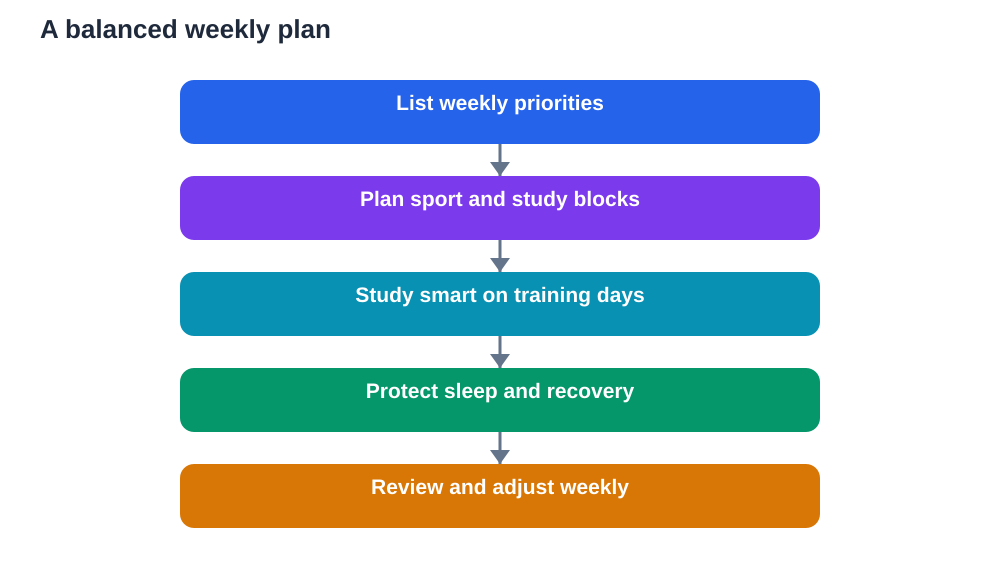

Students often feel caught between sport and study, as if choosing one means neglecting the other. In truth, sport and study can support each other, but only when they are balanced. Balancing sports and study is not about perfect time management or filling every hour with work. It is about building a weekly plan that gives both activities their place, protects rest, and sets clear priorities. With a simple, realistic plan, students can enjoy sport, keep study steady, and avoid the exhaustion that comes from trying to do everything at once.

Balance starts with honesty about time. A week has limited hours, and students also need sleep, meals, family time, and rest. A plan that ignores those needs will fail, no matter how motivated the student is. A good weekly plan is therefore realistic first and ambitious second. It protects the essentials, schedules sport and study in harmony, and leaves room for life to happen.

## Start with priorities, not with hours

A weekly plan should begin with priorities, not with a packed timetable. What must happen this week? Which homework is due soon? Which topics need revision? Which training sessions or matches are fixed? Listing these priorities first prevents the common mistake of filling a plan with easy tasks while urgent work waits. Priorities give the week a shape, and the timetable then fits around them.

Students can sort priorities simply: urgent and important work comes first, regular practice comes next, and enjoyable extras fill remaining time. Sport is not an extra to be squeezed in only if study is finished. For many students, sport is a priority too, because it supports health, focus, and mood. Naming both sport and study as priorities, and planning for both, prevents the guilt and conflict that arise when one is treated as a distraction from the other.

## Build a realistic weekly timetable

A realistic timetable maps the week in broad blocks, not in rigid minutes. Morning school hours are fixed. After school, students can plan blocks for homework, sport, rest, and family time. The order matters. Many students study better after a short rest and a snack following school, while others prefer sport first to release energy, followed by study. Either order can work, if it is consistent and leaves enough time for both.

The timetable should also include buffers. Travel, meals, and unexpected delays take time, and a plan without buffers quickly falls apart. Students should avoid stacking a long training session, a large homework load, and late revision on the same evening. Spreading demanding tasks across the week keeps energy steadier. A timetable is a guide, not a prison. If a day goes differently, the student adjusts the plan calmly instead of abandoning it entirely.

## Study smarter, not longer, on training days

On training days, study time may be shorter, so it must be smarter. Short, focused sessions work well: read a lesson, write key points from memory, answer questions, and check answers against the textbook. This active approach teaches more in less time than passive re-reading. Students should start with the most important task, so that even a shorter session covers what matters most.

Training days also benefit from using small gaps wisely. A short review before training, or a quick recall exercise after training and rest, can reinforce learning without adding a long session. The key is to keep study regular, even on busy days, rather than skipping it entirely and facing a backlog later. Small, steady study, combined with sport, beats irregular bursts of cramming followed by exhaustion.

## Protect rest, sleep and recovery

Rest is not wasted time. It is when the body recovers from sport and the brain consolidates learning. A balanced weekly plan therefore protects sleep above almost everything else. Students should aim for a regular bedtime, with screens put away before bed and a calm wind-down. Late-night study after intense training rarely helps, because a tired mind retains little and starts the next day exhausted.

Recovery also includes lighter days. Not every day should be intense in both sport and study. A weekly plan with a mix of harder and easier days allows the body and mind to recover. Rest days from sport, and lighter study days, are part of balance, not laziness. Students who protect rest perform better in both areas, because they arrive at training and study refreshed rather than drained.

## Handle busy weeks and setbacks calmly

Some weeks are unusually busy: matches, assessments, and deadlines may collide. During such weeks, balance means adjusting, not abandoning the plan. Students can shorten training, focus study on the most urgent topics, and ask teachers or coaches for guidance. Communicating early helps: a coach who knows about an important assessment week, or a teacher who knows about a major match, can often help a student plan sensibly.

Setbacks will also happen. Illness, bad weather, a cancelled session, or an unexpectedly large homework load can disrupt a week. A balanced student responds flexibly: reschedule, shorten, or swap activities, rather than giving up on the whole plan. One disrupted week does not ruin a routine. The habit of returning to the plan, calmly and without guilt, is what keeps balance working over months, not just days.

## Review the week and adjust together

A weekly plan improves through review. At the end of each week, students can ask simple questions: did sport and study both get time? Did I sleep enough? What felt rushed? What worked well? This short review, done with a parent, teacher, or coach where helpful, turns planning into a learning process. The student discovers their own rhythms: when they study best, how much sport refreshes them, and where time quietly disappears.

Review also builds responsibility. Students learn that balance is not given by a perfect timetable, but built through choices, adjustments, and honesty about what is working. Over time, they become skilled at managing their own weeks, a skill that will serve them far beyond school. Balancing sports and study is, in the end, practice for balancing life itself: knowing what matters, protecting health, and making room for both effort and joy.

## AI Help: Muse AI

Muse AI is Meta's personal AI assistant, and it can help you build a balanced weekly plan. You could ask it to suggest a timetable that fits sport, study, and rest around your school day, and then adjust its ideas to your real commitments. Join Muse with invite code LTGSWD — in the Muse app, go to Settings > Redeem token and enter the code.
Disclosure: LTGSWD is the author's Muse invite code.

## FAQ

### How can students balance sport and study without burnout?

Balance comes from a realistic weekly plan that protects sleep, spreads demanding tasks, and treats both sport and study as priorities. Short, focused study on training days, rest days, and buffers for travel and delays all help. Burnout usually comes from overpacking days, so students should keep plans manageable and adjust calmly when weeks get busy.

### Should sport come before or after study?

Either order can work, depending on the student. Some students study better after sport, because movement releases energy and sharpens focus. Others prefer to study first while the mind is fresh, then train. Consistency matters more than the exact order. Students should try both patterns, notice which leaves them more focused and less tired, and build their routine around that.

### What should students do on very busy weeks?

On busy weeks, students should adjust rather than abandon balance. Shorten training, focus study on urgent priorities, and communicate with teachers or coaches for guidance. Protecting sleep remains important, even when time feels short. A flexible plan that bends during busy weeks, and returns to normal afterwards, keeps balance sustainable.

### How does a weekly review help students?

A weekly review helps students learn what worked, what felt rushed, and where time disappeared. By asking simple questions at the end of each week, students discover their own best rhythms for study, sport, and rest. Regular review turns planning into a skill, helping students adjust their routines and take responsibility for their own balance over time.

## Conclusion

Balancing sports and study is possible with a weekly plan built on priorities, realistic timetables, smarter study on training days, protected rest, flexible responses to busy weeks, and regular review. Sport and study are not rivals. When planned together, sport refreshes the mind for study, and study gives structure to the week around sport. Start with a simple plan, keep it realistic, protect your sleep, and adjust it week by week. Balance is not perfection. It is a steady habit of making room for health, learning, and enjoyment, all in the same good week. For study questions, verify solutions against your textbook, and remember that AI tools can make mistakes, so use them as helpers, not as final authorities.

[Try the free AI lesson solver](/#tool)
