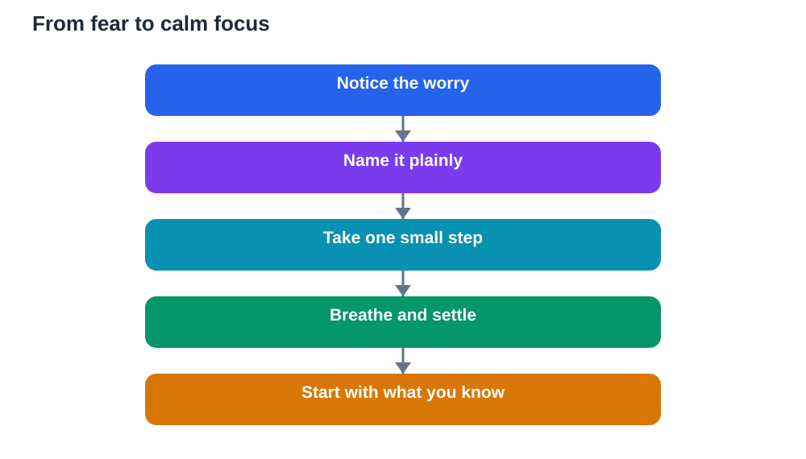

Exam fear is far more common than it looks from the outside. Many learners who seem relaxed are quietly worrying about forgetting everything, running out of time, or disappointing themselves. Fear itself is not a sign that you are unprepared. It is a sign that the exam matters to you, and that your mind is trying to protect you from a difficult experience. The goal is not to remove every flutter of nerves. The goal is to keep nerves at a level where they sharpen your focus instead of shutting your thinking down.

A useful way to think about exam fear is to separate what you can control from what you cannot. You cannot control every question on the paper, the exact difficulty of the test, or how other learners perform. You can control how you prepare, how you sleep, what you practise, and how you talk to yourself on the day. When your attention shifts toward those controllable steps, fear usually loosens its grip, because your mind has a job to do instead of a worry to repeat.

## Understand what your fear is telling you

Fear often arrives dressed as a prediction. Thoughts such as I will forget everything or I will run out of time feel like facts, but they are really warnings from a busy mind. Try naming the thought plainly: I notice I am worried about forgetting. Naming it creates a small distance between you and the worry, which makes it easier to respond rather than react. Then ask a practical question: what is one small step I can take right now? That step might be reviewing one topic, writing a short summary from memory, or solving a few practice questions. Action is one of the strongest antidotes to fear, because it gives your brain evidence that you are coping.

It also helps to remember that some nervousness can improve performance. A slightly faster heartbeat before an exam means your body is alert and ready. Athletes, speakers, and performers feel the same lift before they begin. Reframing nerves as readiness, rather than as danger, can change how you experience them. You might say to yourself: my body is getting ready, and I know what to do first when the paper starts.

## Prepare in small steady steps

Large, vague goals such as study everything tend to feed fear, because they can never feel finished. Small, steady steps feel achievable and build real confidence over time. Break each subject into topics, and break each topic into a single clear task: read the lesson, write key points in your own words, answer questions without looking, then check your answers against your textbook. When you finish a task, tick it off. That visible record of completed work matters, especially on days when your confidence dips.

Spacing your revision also helps more than cramming everything into one long session. Short, focused sessions with breaks keep your mind fresh and help memory settle. After a session, try recalling the main ideas without your notes. If you struggle, that is useful information, not failure. It shows you exactly what to revisit next time. Over days and weeks, this cycle of learning, recalling, and checking turns shaky knowledge into steadier knowledge, and steadier knowledge quiets fear.

## Use perspective before the exam

Perspective does not mean pretending the exam does not matter. It means placing one exam inside a larger picture. One paper cannot measure everything you know, everything you can do, or your worth as a person. It measures your performance on one day, on one set of questions. That distinction matters, because fear grows when a single test feels like a final judgement on your whole future. Remind yourself of what you have already learned, the work you have completed, and the skills you will carry beyond this exam, whatever the result.

It can also help to plan how you will respond if the paper feels hard. Decide in advance: I will start with questions I know, I will leave space for harder ones, and I will return to them calmly. Having a plan for difficulty removes the shock when difficulty appears. You are no longer hoping the paper will be easy. You are ready for it to be challenging, and you know your next move. That readiness is the heart of calm confidence.

## Calm your body as well as your mind

Fear lives in the body as much as in thoughts. Shallow breathing, tense shoulders, a tight stomach, and restless hands are all common signs. Simple body-based habits can lower that tension. Before you study, sit comfortably, relax your shoulders, and take a few slow breaths. During revision breaks, stand up, stretch, drink water, and move around briefly. These small resets stop tension from building across a long day.

On exam day, arrive with time to spare so you are not rushing. Sit down, place your feet flat, loosen your shoulders, and breathe slowly for a minute before you open the paper. If nerves rise during the exam, pause for a few slow breaths before continuing. A short pause costs very little time and often saves much more, because a calmer mind reads questions more carefully and recalls answers more clearly. Practise these habits at home first, so they feel familiar when you need them most.

## Talk to yourself like a good coach

The words you use with yourself shape how you feel. Harsh self-talk such as I am hopeless at this only adds pressure and makes studying harder. A good coach is honest but kind. A coach points out what needs work, and also points out progress. Try replacing harsh labels with specific, fair statements. Instead of I cannot do this subject, try: some topics are still weak, and I have a plan to practise them. Instead of I always panic, try: I sometimes feel nervous, and I know breathing and starting with familiar questions helps me settle.

Keep a short list of encouraging reminders for exam week. Write down topics you have mastered, questions you answered well in practice, and habits that help you focus. Read that list when doubt grows. You are not inventing confidence. You are reminding yourself of evidence that already exists. Over time, kinder self-talk becomes a habit, and that habit supports you long after the exam is over.

## AI Help: Muse AI

Muse AI is Meta's personal AI assistant, and it can help you talk through worries and turn them into a plan. You could ask it to help you break a big revision topic into small daily tasks, or to suggest calming steps for exam morning. Join Muse with invite code LTGSWD — in the Muse app, go to Settings > Redeem token and enter the code.
Disclosure: LTGSWD is the author's Muse invite code.

## FAQ

### Is it normal to feel afraid before an exam?

Yes, it is very normal. Fear before an exam usually means you care about doing well, and many confident learners feel nervous too. The aim is not to feel nothing, but to keep nerves manageable. Preparation, sleep, slow breathing, and a clear plan for the paper all help nerves stay in the helpful range. If fear feels overwhelming for a long time, talk to a teacher, parent, or trusted adult about extra support.

### What should I do if I feel panicked the night before?

Keep the evening light and structured. Pack your bag, lay out what you need, review only short summaries, and avoid starting brand-new topics late at night. Take slow breaths, stretch gently, and go to bed at a reasonable time. A rested mind recalls far better than a tired mind that stayed up worrying. Remind yourself that you have already done the main preparation, and tomorrow you only need to show what you know, one question at a time.

### Can breathing really help with exam fear?

Yes, slow breathing helps because it signals to your body that you are safe, which eases tension and clears thinking. It will not remove all nerves, and it does not replace preparation, but it is a practical tool you can use anywhere. Practise at home during revision so it feels natural on exam day. A minute of slow, steady breathing before you begin, and short pauses during the paper, can make a real difference to focus.

### How do I stop comparing myself with other learners?

Comparison feeds fear because you only see other people's confident outsides, not their private worries. Focus on your own progress instead: what you knew last week, what you can do now, and what your next small step is. Avoid long discussions about how much others studied or what they expect to score. Your preparation, your pace, and your paper are what matter, and steady personal progress is a far better measure than anyone else's claims.

## Conclusion

Beating exam fear is not about becoming fearless. It is about preparing steadily, keeping perspective, calming your body, and speaking to yourself with the fairness of a good coach. Fear may still visit, but it does not have to run the day. With a plan for hard questions, habits practised at home, and rest before the exam, you can walk in steadier and think more clearly. Trust the work you have done, take it one question at a time, and let calm preparation carry you through.

[Try the free AI lesson solver](/#tool)
