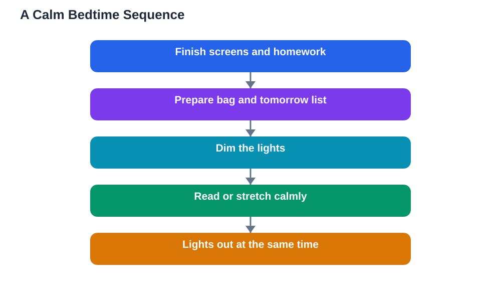

Falling asleep is not like switching off a light. Your brain needs a signal that the day is ending, and a good bedtime routine students can repeat every night provides exactly that. Without a wind-down, the mind carries homework, messages, and worries straight into bed, and sleep takes far longer to arrive. This article shows how to build a simple, realistic routine around dim lights, no screens, and the same time nightly, so that sleep stops being a struggle and starts being automatic.

## Why a Bedtime Routine Students Keep Beats a Perfect One

The best routine is the one you actually follow. A grand plan with ten steps will collapse on the first busy evening, while a short, pleasant routine survives real life. The purpose of a routine is not discipline for its own sake; it is training. When the same calm steps happen in the same order each night, your brain learns to associate them with sleep, and drowsiness begins to arrive on cue.

Start with three or four steps you enjoy. Perhaps you tidy your desk, lay out tomorrow's clothes, read a few pages of something light, and stretch gently. Done nightly, this small sequence becomes a powerful sleep cue. You can always add steps later, but protect the core: same time, same order, every night, even when you feel wide awake. Consistency is what teaches the body clock.

## Dim Lights: Teaching Your Brain That Night Has Come

Bright light tells the brain to stay alert, which is useful in the morning and unhelpful at night. In the last part of the evening, lower the lights in your room and avoid harsh overhead lighting. A small lamp is enough for reading or preparing for bed. This dimming mimics sunset and helps the brain begin its nightly wind-down chemistry.

You do not need special equipment. Simply switching off the main light, closing curtains, and using one soft lamp makes a real difference. If you share a room, a small clip-on reading light keeps your wind-down gentle without disturbing others. Pair dim light with quieter activity: gentle music, slow stretching, or a calm conversation, rather than fast-paced games or heated debates that wake the mind up again.

## No Screens in the Last Stretch of the Evening

Screens are the most common bedtime saboteur. They shine bright light into your eyes, deliver an endless stream of new information, and keep the mind alert and reactive. Messages, videos, and social feeds are designed to hold attention, which is the opposite of what sleep needs. Even one quick check can turn into a long scroll that pushes bedtime far later than planned.

Set a screen curfew for yourself: a fixed point in the evening when the phone goes on charge outside the bedroom, or at least across the room. Replace the scroll with something genuinely restful, such as reading a paper book, writing tomorrow's short task list, or listening to calm audio. If you must use a device for homework, finish it before your wind-down begins, and verify solutions against your textbook, since AI can make mistakes, then step away from the screen properly.

## Same Time Nightly: The Anchor of Good Sleep

A regular bedtime is the single most powerful sleep habit. Your body runs on an internal clock that expects sleep at roughly the same time each night. When bedtime jumps around, the clock cannot prepare properly, and you lie awake even when tired. Keeping a steady bedtime, and a steady wake time to match, makes falling asleep faster and waking easier within a week or two.

Weekends are the usual trap. Sleeping far later on rest days feels like recovery, but it shifts your clock and makes the next school morning miserable. Keep weekend bedtimes within a close range of weekday ones, and get morning light soon after waking to reset the clock. If a late night happens, return to your normal time the next night rather than trying to compensate with an extremely early one.

## Designing Your Own Wind-Down Sequence

Build your routine backwards from bedtime. Decide the moment you want to be asleep, then place your steps in the time before it. A practical shape is: finish screens and homework, tidy and prepare for tomorrow, dim the lights, wash and change, read or stretch calmly, then lights out. Give the whole sequence enough time; rushing through it while watching the clock defeats the purpose.

Prepare tomorrow during the wind-down, not in bed. Pack your bag, choose clothes, and write down any unfinished task or worry on paper. This externalises the mental noise that otherwise loops at midnight. Keep the bedroom for sleep and calm activities only, so your brain stops associating the bed with homework stress or endless scrolling. Over time, simply entering the room and starting the routine will make your eyelids heavy.

## AI Help: Muse AI

Muse AI is Meta's personal AI assistant, and it can help with this topic by drafting a personalised wind-down checklist based on your evening schedule. Ask it to turn your routine into a short nightly list you can tick off before bed.
Join Muse with invite code LTGSWD — in the Muse app, go to Settings > Redeem token and enter the code.
Disclosure: LTGSWD is the author's Muse invite code.

## FAQ

### How long should a bedtime routine take?

A good routine usually takes a short, calm stretch of the evening, long enough to slow down but short enough to keep every night. Start with a simple sequence you can finish comfortably, and expand it only if it still feels easy. The key is repetition, not length.

### What if I share a room and cannot control the lights?

Use a small personal lamp, keep your own screen off, and use quiet activities like reading or writing your tomorrow list. Earplugs or soft background sound can also create a personal calm zone. Talk with the people you share with about a shared wind-down time if possible.

### I feel wide awake at my bedtime. Should I still go to bed?

Yes, keep the time steady and use the routine anyway. Lying in dim light with a calm book usually brings drowsiness, while staying up to wait for tiredness pushes the clock later. After several steady nights, your body begins to feel sleepy at the right time.

### What breaks a bedtime routine most often?

Late screens are the biggest breaker, followed by irregular weekend times and heavy late meals. Protect the screen curfew and the steady bedtime first; those two fixes solve most routine failures on their own.

## Conclusion

A bedtime routine is a gift you give your morning self. Dim lights, no screens, and the same time nightly train your brain to fall asleep on cue, so you wake clearer, calmer, and ready to learn. Choose three simple steps tonight, repeat them tomorrow, and let consistency do the heavy lifting.

[Try the free AI lesson solver](/#tool)
