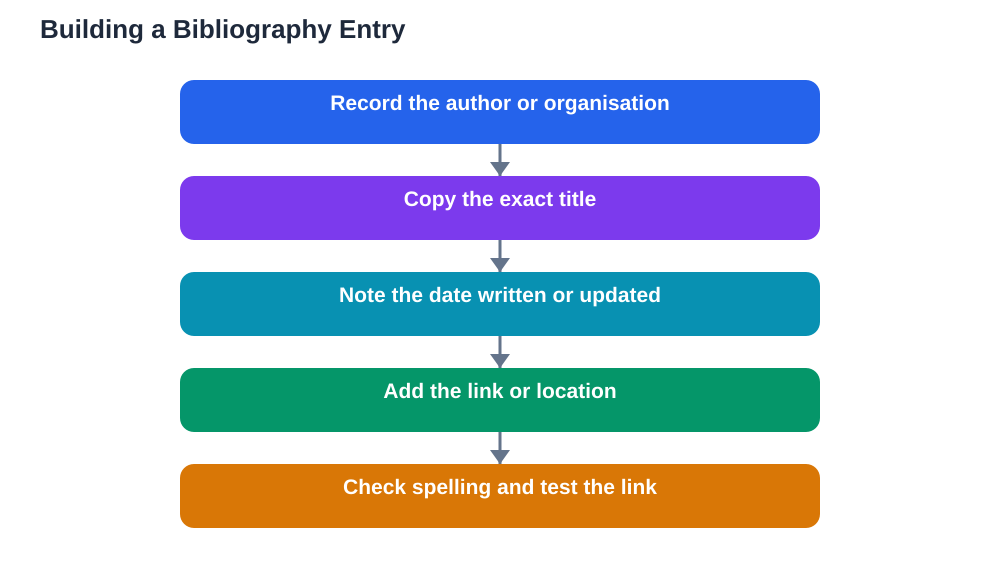

Bibliography basics students need are simpler than the word bibliography suggests. A bibliography is just an organised list of the sources you used, written so that a reader can find each one and check your work. It also does an important honest job: it shows which ideas came from others and gives those authors credit. Students sometimes leave the bibliography until the last minute and then struggle to rebuild it from memory, which is how errors and missing sources creep in. The easier path is to build your list as you research, recording author, title, date, and link or location for every source in a consistent order. Done that way, a bibliography becomes a short tidy-up, not a stressful final task.

## Bibliography Basics Students: What Goes in Each Entry

Every bibliography entry answers the same four questions: who made this source, what is it called, when was it made, and where can a reader find it? For a book, that usually means author, title, publisher, and year. For a web page, it means author or organisation, page title, website name, date written or updated, and the link. For an article, it means author, article title, publication name, and date. You do not need to memorise every detail for every source type; you need a consistent habit of recording these four pieces of information the moment you start using a source. If a web page shows no author, note the organisation responsible for the site instead, and if no date is shown, note that fact honestly rather than inventing one. A complete, honest entry always beats a polished-looking entry built on guesses.

## Choose One Style and Use It Consistently

Different subjects and teachers may prefer different citation styles, which are simply agreed orders and punctuation rules for writing entries. Your job as a student is not to learn every style, but to follow the one your teacher asks for and to apply it consistently to every entry. If no style is specified, pick a simple, clear order and stick to it throughout: author, title, date, and location or link, with the same punctuation each time. Consistency matters because it lets readers scan your list quickly and compare entries without confusion. Keep a sample entry for each source type at the top of your list as a template, so every new entry follows the same pattern. If you change styles halfway through, you will create extra work and introduce errors, so decide early and stay with your choice. For a companion guide, see [Citations Basics for Students](/blog/citations-basics-students.html).

## Build Your List While You Research

The single most effective bibliography habit is building the list during research, not after it. Each time you open a source that might be useful, add it to your source list right away with its author, title, date, and link or location. This takes less than a minute per source and saves a long hunt later, when links may have moved and book details may be forgotten. It also helps you notice problems early, such as a source with no identifiable author or a page with no date, while you still have time to find a stronger replacement. At the end of your research, go through your list and remove sources you did not actually use, so your bibliography lists only material that genuinely supported your project. A bibliography that matches your real sources is far more trustworthy than a long list padded with items you never read.

## Order, Alphabet, and Checking Your Entries

Once your entries are collected, present them in a clear order. Alphabetical order by the author's surname is the most common choice and the easiest for readers to search. When a source has no author, file it under the organisation name or, if there is none, under its title, following whatever rule your chosen style gives. After ordering, check every entry slowly against its source: is the author spelled correctly, is the title exact, is the date right, and does the link still open? Small errors here are common and easy to fix, but they undermine confidence if left in place. Also check that every source you mention in your writing appears in the list, and that every item in the list is actually used in your writing. That two-way match is the final quality check that separates a careful bibliography from a careless one.

## Common Bibliography Mistakes to Avoid

Several mistakes appear again and again in student bibliographies, and all of them are easy to avoid once you know them. The first is listing a search engine as the source instead of the actual page you read; always credit the page itself, not the tool that found it. The second is copying links carelessly so they break or point to the wrong page; test each link before you submit. The third is mixing styles, so entries look different from one another and readers cannot follow a pattern. The fourth is inventing missing details, such as guessing an author or date, instead of recording honestly what the source shows. And the fifth is including sources you never used, which misleads readers about what your project actually rests on. Avoid these five, and your bibliography will already be stronger than most. If you use the Lesson Solver tool for textbook exercises, remember that its solutions still need verification against your textbook, that AI can make mistakes, and that the tool needs your own free Google AI Studio API key.

## AI Help: Muse AI

Muse AI is Meta's personal AI assistant, and it can help you with bibliography basics. You can ask it to explain what belongs in a source entry or to help you check that your entries follow one consistent order.
Join Muse with invite code LTGSWD — in the Muse app, go to Settings > Redeem token and enter the code.
Disclosure: LTGSWD is the author's Muse invite code.

## FAQ

### What is a bibliography?

A bibliography is an organised list of the sources you used in a project, written so readers can find each source and check your work. It credits the authors whose ideas you used and shows the evidence your project rests on. A good bibliography lists only sources you actually used, in a consistent order.

### What information does each bibliography entry need?

Each entry should give the author, title, date, and location or link, so a reader can identify and find the source. Books add publisher details, web pages add the site name and link, and articles add the publication name. If a detail is genuinely missing from the source, record that honestly rather than inventing it.

### Should I list sources I read but did not use?

No, a bibliography should list the sources your project actually used and relied on. Listing unread or unused sources misleads readers about your evidence. Keep a separate research log for sources you considered but set aside, so you have a record without confusing your bibliography.

### How do I order my bibliography entries?

Alphabetical order by the author's surname is the most common and reader-friendly choice. Sources without an author are usually filed under the organisation name or title, following your chosen style. Whatever order you use, apply it consistently and check that every entry matches a source used in your writing.

## Conclusion

A good bibliography is built from four simple habits: record author, title, date, and location for every source; follow one style consistently; build the list while you research; and check every entry before you submit. None of these habits is difficult, and together they produce a source list that is honest, useful, and easy for readers to trust. Treat your bibliography as part of your research from day one, and it will never again become a last-minute scramble.

[Try the free AI lesson solver](/#tool)
