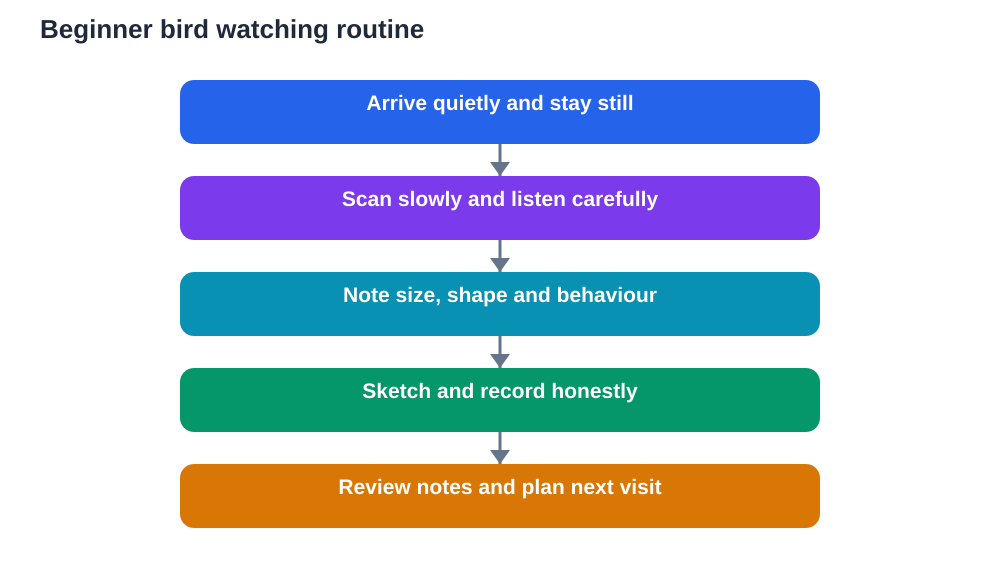

Bird watching is one of the gentlest ways to study nature. It asks for quiet, patience and attention rather than speed or equipment, and it can begin in a garden, a park, a school ground or beside any quiet green space. Birds are active, musical and full of behaviour worth noticing, and a beginner can learn a great deal simply by watching carefully and writing down what is seen and heard.

The best bird watchers are not the ones who rush to name everything. They are the ones who look slowly, listen well and record honestly. A bird you watched for ten minutes but could not name has still taught you about movement, feeding, flight and sound. That attitude keeps bird watching enjoyable and turns every outing into study.

## Begin With Quiet, Not Equipment

The first rule of bird watching is to be quiet and still. Birds notice sudden movement and loud voices quickly, and they will move away before you have a good look. Walk slowly, pause often, and stand or sit in one spot for a while. Let the birds come back to their normal activity around you.

Choose a comfortable, safe spot with a clear view of trees, bushes, open grass or water edges. Early morning and late afternoon are often lively times, because many birds feed actively then, but any quiet hour can work. Dress in dull, comfortable clothes and avoid bright, rustling materials when you can. The goal is to blend into the surroundings, not to stand out.

Patience matters more than speed. If you arrive and see nothing at first, wait. Birds often return within a few minutes once the area feels calm again. Use waiting time to notice the surroundings: wind direction, shade, sounds and movement in the branches. Those details are part of the observation too.

## What to Take on a First Outing

A beginner needs very little. A small notebook and a pencil are essential for notes and quick sketches. Binoculars help a great deal, because they bring a distant bird into clear view without disturbing it, but they are not required for a first outing. If you use binoculars, practise focusing on a still object such as a branch before you try to follow a moving bird.

A simple field guide or a reliable reference can help later, but avoid trying to identify every bird in the moment. Watch first, note the details, and check the reference afterwards. A water bottle, sun protection and comfortable shoes make the outing safer and more pleasant. Leave food for birds at home unless a responsible adult advises otherwise, because feeding can change natural behaviour and may not suit local wildlife.

Before you go, tell someone where you are going and when you expect to return, and stay on safe paths. Good bird watching never requires climbing, entering restricted areas or approaching nests closely.

## Build Your First Ten Birds List

A first ten list is a friendly goal, not a race. It simply means recording ten different kinds of birds you have observed well enough to describe. Different does not mean rare. Common birds seen clearly count fully, and they are often the best teachers because you can watch them again and again.

For each bird, note size in comparison with a familiar bird, overall shape, main colours, beak shape, tail length, behaviour and sound. A note such as small, brownish, short tail, hopping on the ground, picking at seeds is far more useful than a vague note saying small bird. Quick sketches help too, even rough ones. Mark the shape of the body, the length of the tail and any strong pattern you noticed.

Do not worry if your first list takes several outings. Ten careful records are worth far more than a long list of hurried guesses. Review your list at home and see which descriptions are strong and which need more detail next time. That review is where identification skill grows.

## Learn to Listen as Well as Look

Bird sound is half of bird watching. Many birds are heard before they are seen, and sound can tell you where to look. Sit quietly and separate the sounds you hear. Is the sound a repeated song, a short call, a harsh alarm note or a soft contact sound between birds moving together? Note the rhythm and pitch in plain words, such as three clear notes repeated, or a fast chattering burst.

Try to locate the sound before looking. Turn slowly toward it and scan the branches at different heights. Birds often sing from an exposed perch, while feeding birds may stay hidden in leaves. Watching a singing bird also teaches you about territory and communication, because song often marks a claimed area or attracts a mate.

Record sounds with words, not with invented spellings alone. A description such as high, thin notes repeated four times is clearer and more honest than a made-up imitation. Over time, you will start to recognise repeated patterns, and familiar sounds will feel like old friends.

## Watch Behaviour, Not Just Appearance

Appearance helps with identification, but behaviour reveals how a bird lives. Watch how it moves. Does it hop or walk on the ground? Does it climb a trunk, hover in the air, soar high, or dart quickly between branches? Watch how it feeds. Does it pick from the ground, probe bark, catch insects in the air, or visit flowers?

Also notice social behaviour. Is the bird alone, in a pair, or in a loose group? Does it chase other birds away, or feed peacefully beside them? Does it carry nesting material, or sing from the same perch repeatedly? Behaviour notes turn a sighting into a small story, and stories are easier to remember than isolated facts.

Flight style is another useful clue. Some birds fly in a straight, steady line, others undulate up and down, and others soar on rising air with wings held still. Sketching a flight path in your notebook, even as a wavy or straight line, helps you remember it later.

## Record Honestly and Review Regularly

A bird notebook should record what you actually saw, not what you hoped to see. If you are unsure about an identification, write unsure and describe the bird instead. That honesty protects your records and helps you learn, because a careful description can be checked later while a confident guess cannot.

For each outing, record the date, time, general location type, weather in general terms, and a short list of birds seen with a few notes each. At the end of the outing, mark your best observation and one question for next time. That habit turns a pleasant walk into steady progress.

Review your notebook weekly. You will notice which birds appear often, which appear only in certain weather, and how behaviour changes across weeks. Those patterns are the real reward of bird watching, and they grow directly from your own patient records.

## Respect Birds and Their Homes

Respect is central to bird watching. Keep a sensible distance, especially around nests and young birds, and never touch nests, eggs or chicks. If a bird shows alarm behaviour, such as loud repeated calls or agitated movement, move calmly away. Your observation is never more important than the comfort of the bird.

Stay on paths, avoid breaking branches, and leave the area as you found it. Do not play recorded bird sounds loudly to attract birds, because that can disturb them and waste their energy. Quiet, patient watching gives you better views anyway, and it keeps the birds behaving naturally.

If you bird watch with others, agree on quiet behaviour before you start. Whisper, point slowly rather than waving, and share binocular views without rushing. A calm group sees far more than a noisy one.

## AI Help: Muse AI

Muse AI is Meta's personal AI assistant, and it can help you organise your bird notes into clear study material. For this topic, you can ask it to help you turn rough field notes into a tidy first ten birds list with descriptions.

Join Muse with invite code LTGSWD — in the Muse app, go to Settings > Redeem token and enter the code.

Disclosure: LTGSWD is the author's Muse invite code.

## FAQ

### Do I need binoculars to start bird watching?

No, you can start with your eyes, ears and a notebook. Binoculars are very helpful once you want closer views, but a first outing without them still teaches quiet movement, listening and note-taking. Add binoculars when you are ready, and practise focusing on still objects first.

### How do I identify a bird I cannot name?

Describe it carefully instead of guessing. Note size, shape, colours, beak, tail, behaviour and sound, and sketch what you saw. Compare your notes with a reliable guide or your textbook afterwards. A good description often leads to a confident identification later, while a rushed guess teaches nothing.

### What is the best time of day for bird watching?

Early morning and late afternoon are often active, but any quiet time can be rewarding. Choose a time when you can be calm and unhurried. Regular outings at a similar time also make your records easier to compare across days and weeks.

### Should I feed birds to attract them?

Not on a casual outing. Feeding can change natural behaviour and may not suit local wildlife or local rules. Quiet watching in places where birds already feed and sing gives you more natural behaviour to study, and it respects the birds and their habitat.

### How long should a beginner outing last?

Thirty to sixty minutes is plenty for a beginner, especially if much of it is spent sitting quietly. Short, focused outings build patience better than long, tiring ones. Stop while you are still enjoying the watch, and note your best observation before you leave.

## Conclusion

Bird watching rewards quiet feet, open ears and an honest notebook. Start simply, build a careful first ten list, listen as much as you look, and respect every bird you meet. With patience, a garden or park becomes a living classroom full of movement, song and behaviour worth studying.

[Try the free AI lesson solver](/#tool)
