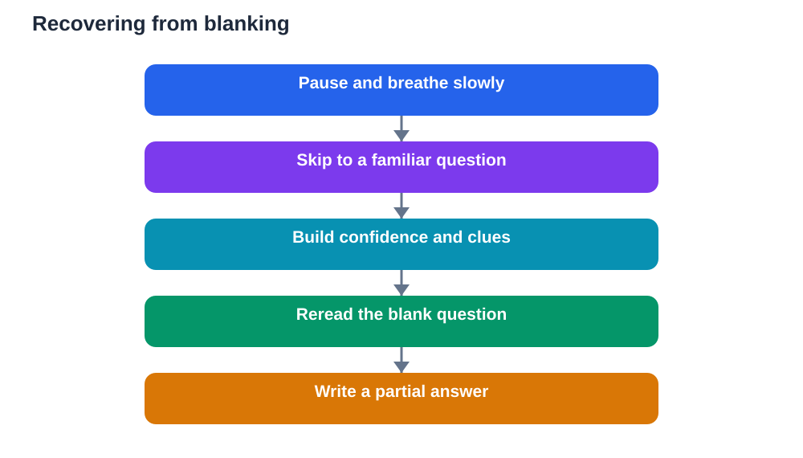

Blanking out in an exam is a frightening moment. You read a question you studied, and your mind offers nothing. The harder you push, the emptier it feels, and panic starts to rise. This experience is common, even among well-prepared learners, and it does not mean you have forgotten everything. It usually means stress has temporarily blocked recall. With a calm response, memory often returns, sometimes within minutes, and sometimes after another question triggers it.

The worst response to blanking is to freeze and stare, repeating the same thought while time passes and panic grows. A better response is a short, practised sequence: pause, breathe, move on, and return later with fresh clues. This sequence protects your time, lowers stress, and gives your brain other routes back to the answer. Learning it before exam day, and practising it during timed practice papers, turns a scary moment into a manageable one.

## Why blanking happens

Blanking is usually a stress response, not a knowledge failure. When anxiety spikes, attention narrows and the brain prioritises threat over recall. You may know the material well, but the retrieval path feels blocked because your mind is busy with worry: what if I fail, what if time runs out, what if everyone else knows this. That worry loop competes with memory, and memory loses while the loop runs. Understanding this helps, because it reframes blanking as a temporary block, not as proof of ignorance.

Tiredness, rushing, and misreading also contribute. If you skim a question too quickly, your brain may search for the wrong idea and find nothing. If you spent too long on an earlier question, time pressure adds to the block. If you slept poorly, recall is slower overall. None of these mean you are incapable. They mean conditions are working against recall right now, and changing conditions, even slightly, can reopen the path. A pause, a breath, and a different question are often enough to shift those conditions.

## Pause and breathe first

When you blank, your first move should be to stop pushing. Put your pen down, sit back slightly, and take two or three slow breaths. Relax your shoulders and jaw as you breathe out. This pause lasts less than a minute, but it interrupts the panic loop and gives your mind space to settle. Forcing recall while panicked rarely works, because panic and recall pull in opposite directions. A calm pause does not waste time. It restores the conditions memory needs.

During the pause, remind yourself of a simple fact: blanking is temporary and common, and you have a plan for it. That reminder alone can lower the pressure that caused the block. Avoid telling yourself catastrophic stories about the whole paper. One blank question is one question, not the entire exam. Your plan is to recover, move on, and return. Say that plan silently, breathe again, and then act on it. Calm action beats frantic effort every time.

## Skip ahead and let other questions help

After pausing, move to another question, preferably one you feel confident about. Answering a familiar question rebuilds momentum and confidence, and it often triggers the missing memory indirectly. Questions in a paper frequently share themes, vocabulary, and ideas. A later question may contain a clue, a term, or an example that unlocks the earlier answer. Even unrelated questions help, because success on them lowers anxiety, and lower anxiety improves recall for every question.

Mark the skipped question clearly so you can find it again, and leave space for its answer. Do not keep glancing back at it while answering others, since that splits attention. Give the new question your full focus. Work through several questions if needed. Many learners find that the blank answer surfaces while they are busy elsewhere, like a word remembered once you stop searching for it. If it does not surface, you still have a paper full of answered questions, which is far better than a paper stalled on one blank.

## Use clues in the question itself

When you return to the blank question, read it again slowly, word by word. Underline key terms, identify what is actually being asked, and break a long question into smaller parts. Sometimes blanking comes from misreading: you searched for a complex answer when the question asked for something simpler, or you missed a limiting word that changes the meaning. Slow rereading often reveals the intended path. Ask yourself: what topic is this from, what kind of answer fits, and what is the first step, even if you cannot see the whole solution yet.

Try writing down anything related, even partial ideas, key terms, or a rough outline. Writing activates memory differently from silent staring, and a partial note can lead to the next idea. If the question involves steps, write the first step you know and see what follows. If it asks for explanation, write a simple definition and build from there. Partial answers earn credit and often grow into fuller answers as you write. A blank page helps no one, but a page with a beginning gives your mind something to work with.

## Manage time and finish steadily

Blanking can distort time. You may spend far too long on one question while easier marks wait elsewhere. Protect your time with a simple rule: if a question stays blank after a pause and a second careful read, move on and return at the end. Keep an eye on the clock at planned intervals, not constantly, and adjust your pace calmly. If time is short near the end, answer every remaining question as best you can, starting with the ones worth the most or the ones you feel closest to solving.

At the end, revisit skipped questions with whatever time remains. Reread them once more, use clues from the rest of the paper, and write your best reasoned answer. Even an incomplete answer is better than none, and it may trigger a final piece of recall. When time ends, let the paper go. You used a recovery plan, protected your time, and answered as widely as you could. That is a strong performance under pressure, whatever one blank moment felt like at the time.

## AI Help: Muse AI

Muse AI is Meta's personal AI assistant, and it can help you practise recovering from blank moments before exams. You could ask it to help you create a short recovery plan, or to quiz you gently so you can practise moving on and returning to hard questions. Join Muse with invite code LTGSWD — in the Muse app, go to Settings > Redeem token and enter the code.
Disclosure: LTGSWD is the author's Muse invite code.

## FAQ

### Does blanking out mean I did not study enough?

No. Blanking often happens to well-prepared learners when stress temporarily blocks recall. It is a retrieval problem under pressure, not a simple measure of preparation. If you studied steadily and can recall the material at home, a blank in the exam hall is most likely anxiety, tiredness, or misreading at work. A calm pause and a move to another question usually help memory return.

### How long should I stay on a blank question?

Give it a brief pause, a slow reread, and a genuine attempt, but do not stall for a long stretch while other questions wait. If it remains blank after that, mark it clearly and move on. Return later with fresher eyes and clues from other questions. This protects your time and your confidence, and it often leads to the answer surfacing when pressure has eased.

### What if the answer never comes back?

Answer as best you can with partial knowledge, key terms, or a reasoned outline, rather than leaving the space empty. Partial answers can earn credit and may trigger further recall as you write. Then move on and focus on the rest of the paper. One unanswered or partially answered question does not decide the whole result, and a steady performance elsewhere matters far more than a single blank.

### Can I prevent blanking before the exam?

You can reduce it, though no method guarantees it never happens. Steady spaced revision, practice under timed conditions, good sleep, and a calm morning routine all lower the stress that causes blanking. Practising a recovery plan during mock papers also helps, because the sequence feels familiar when it happens for real. Preparation plus a plan is the strongest protection available.

## Conclusion

Blanking out feels alarming, but it is a recoverable moment, not a verdict on your ability. Pause and breathe, move to a question you know, let other questions trigger memory, and return to the blank with fresh clues and a careful reread. Protect your time, write partial answers rather than nothing, and finish steadily. With this plan practised in advance, a blank moment becomes a brief detour on the way to a strong paper, not a dead end.

[Try the free AI lesson solver](/#tool)
