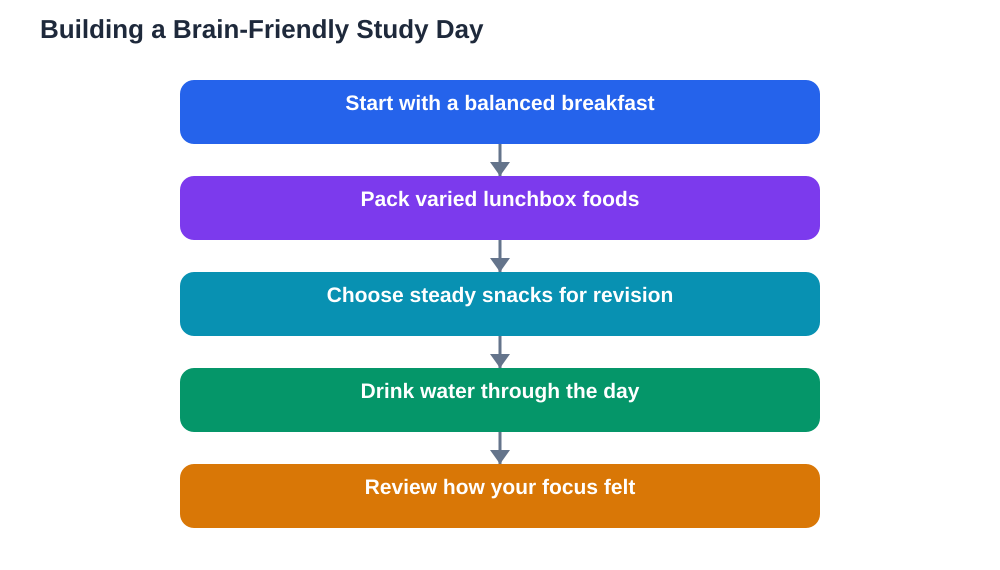

Brain foods students hear about are often surrounded by big promises. One snack is said to unlock memory, another to make you clever overnight. The honest truth is less dramatic but far more useful: no single food makes you smart, and no single meal can replace good study habits. What food can do is support steady energy, comfortable focus, and a body that is ready to learn. That support comes from everyday foods, eaten in variety, not from expensive extras or miracle products.

The idea of brain food is best understood as a pattern, not a product. A learner who eats varied, balanced meals across the day gives their body a steadier supply of energy than one who lives on snacks alone. Fish, nuts, fruit, and whole grains all have a place in that pattern, but so do vegetables, dairy or other protein foods, and plenty of water. The goal is a whole diet that keeps you comfortable and alert, rather than a single magic ingredient.

## Why no single food makes you smarter

Learning depends on attention, memory, sleep, practice, and teaching. Food supports those processes, but it cannot replace them. A student who eats well yet never revises will not outperform a student who revises steadily on an ordinary diet. Claims that a food boosts intelligence should therefore be treated with healthy doubt, especially when they come from advertising rather than general health guidance.

That does not mean food is unimportant. Hunger, discomfort, and energy swings all interfere with learning, and a poor eating pattern can quietly hold you back. Think of food as the foundation of a study day: it will not build the house by itself, but a weak foundation makes everything else harder. Balanced meals protect your focus, while steady habits protect your mood and energy.

## Fish, nuts, fruit, and whole grains

Fish is often mentioned in brain-food discussions because oily fish provides nutrients that the body uses in many processes, including those linked to general health. You do not need to eat it every day, and if you do not eat fish, other protein foods can form part of a balanced diet. The point is variety in protein sources across the week, not a single compulsory item.

Nuts and seeds are useful study snacks because they combine protein and natural fats in a small, portable portion. A small handful can be more satisfying than a large bag of crisps, and it travels well in a school bag. Check for allergies first, and keep portions modest, since nuts are filling. Fruit provides freshness, natural sweetness, and variety, and it makes a far steadier snack than sweets alone. Whole grains, such as wholemeal bread, oats, and brown rice, release energy more gradually than refined grains, which helps you stay comfortable between meals.

## Variety beats a superfood list

Chasing a list of fashionable superfoods often leads to a narrow diet and wasted money. A better approach is to widen the range of ordinary foods you already eat. Add a vegetable to lunch, try a different fruit, rotate your protein foods through the week, and choose whole grains where you can. Each small addition improves the overall pattern without demanding a dramatic change.

Variety also protects you from boredom. A learner who enjoys their meals is more likely to eat regularly and calmly, while one who forces down foods they dislike may start skipping meals. Build your meals around foods you genuinely like, then add one new item at a time. Over weeks, that gentle expansion creates a diet that is both balanced and sustainable, which is exactly what steady learning needs.

## Meals that support a study day

A study day works best when meals are spread across the day rather than bunched into one large sitting. Breakfast sets the tone, lunch restores energy for the afternoon, and a light evening meal supports homework without heaviness. Snacks between meals can help, provided they are part of the pattern rather than a replacement for meals.

Think of each meal as a small team: a grain or starchy food for steady energy, a protein food for staying power, and fruit or vegetables for freshness and variety. When a meal contains only one element, such as a sugary snack alone, energy tends to rise and fall quickly. When the team works together, you stay comfortable for longer, and your attention stays with the lesson instead of drifting toward hunger.

## Snacks, sweets, and study focus

Sweets and fried snacks are enjoyable, and there is no need to ban them completely. The problem comes when they become the main fuel for a study session. A large amount of sugar can bring a quick lift followed by a slump, which is the opposite of what revision needs. Crisps and fizzy drinks often leave you thirsty and restless, and they crowd out foods that would keep you comfortable for longer.

A steadier study snack combines foods: fruit with yoghurt, bread with a protein filling, or a small portion of nuts with a piece of fruit. These combinations satisfy hunger without a sharp energy swing, and they are easy to prepare. Keep sweets as an occasional treat after study, rather than the fuel that powers it, and notice how much calmer your focus feels.

## Building the habit without pressure

Changing how you eat can feel overwhelming if you try to fix everything at once. Choose one change, such as adding fruit to your lunchbox or swapping a sugary snack for a steadier one during revision. Practise that change for a week, notice how you feel, and then add another small step. Gradual changes last, while sudden overhauls usually collapse.

Families and friends can make this easier by keeping balanced options visible and easy to reach. A fruit bowl on the table, a bottle of water on the desk, and a simple lunch prepared the night before all remove friction from good choices. If you have dietary needs, allergies, or a health condition, follow personal advice from a trusted adult or health guide rather than general articles. Good eating habits respect individual needs.

## AI Help: Muse AI

Muse AI is Meta's personal AI assistant, and it can help you plan simple, balanced meals for study days. You could ask it to suggest lunchbox combinations from foods you already enjoy, or to help you build a weekly meal routine. Join Muse with invite code LTGSWD — in the Muse app, go to Settings > Redeem token and enter the code.
Disclosure: LTGSWD is the author's Muse invite code.

## FAQ

### Is there one best brain food for students?

No single food deserves that title. Learning is supported by a varied, balanced diet across the day, not by one item. Fish, nuts, fruit, whole grains, vegetables, and protein foods all contribute to a steady pattern. Focus on variety and regular meals rather than searching for a miracle snack.

### Do nuts and fish really help learning?

They can be part of a healthy pattern, but they do not directly raise intelligence or replace revision. Nuts make a satisfying, portable snack, and fish provides nutrients used in general health. Their value lies in supporting steady energy and comfort, which helps you concentrate on real study.

### Should I stop eating sweets completely?

There is no need for a total ban. Sweets are best kept as occasional treats rather than study fuel. During revision, choose steadier snacks that combine food groups, and enjoy sweets after study or on special occasions. That balance keeps both your energy and your enjoyment steady.

### What if I dislike many healthy foods?

Start from foods you already enjoy and expand slowly. Add one new item at a time, try different ways of preparing a food, and keep portions small at first. Tastes change with exposure, and a gradual approach builds a wider diet without pressure. Personal dietary needs should always guide your choices.

### Can food replace good study habits?

No. Food supports learning, but it cannot replace revision, practice, sleep, and good teaching. The strongest results come from combining steady eating with steady study habits. Think of balanced meals as the foundation that lets your study methods work at their best.

## Conclusion

Brain foods students should trust are ordinary, varied, and enjoyable: fish, nuts, fruit, whole grains, vegetables, and protein foods, eaten regularly across the day. Ignore promises of instant intelligence, and build a pattern that keeps your energy steady and your mind comfortable. Add variety gradually, choose steadier snacks for revision, and keep sweets as a treat rather than fuel. When your body is well supported, your study habits have the best chance to shine.

[Try the free AI lesson solver](/#tool)
