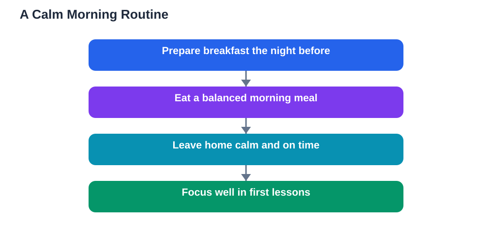

Breakfast and focus are closely connected, because the morning is when your brain gets its first real chance to refuel after the night. During sleep your body keeps working, and by morning it is ready for fresh energy. When you skip breakfast, you start lessons running on empty, and that often shows up as wandering attention, a short temper, or difficulty remembering what the teacher just explained. A steady morning meal does not need to be fancy or large. It needs to be regular, balanced, and eaten with enough time to enjoy it calmly.

Many students skip breakfast because mornings feel rushed. Clothes, bags, and transport all compete for time, and food becomes the easiest thing to drop. The trouble is that the cost of skipping shows up later, usually in the first lessons of the day, when concentration matters most. Building breakfast into the morning routine is therefore not just a health habit. It is a study habit, and it deserves the same planning as packing your bag or reviewing yesterday's notes.

## Why skipping breakfast hurts concentration

When you go without food for a long stretch, your body signals hunger through restlessness, low energy, and difficulty settling. In a classroom, that restlessness competes directly with learning. Instead of listening to the lesson, part of your mind keeps tracking the empty feeling, the clock, and the wait until the next break. Concentration is a limited resource, and hunger spends it quickly.

Skipping breakfast can also make your mood less steady. You may feel fine at first, then suddenly irritable or tired during a lesson, without realising that hunger is part of the reason. Teachers sometimes notice this pattern before students do: the same learner who is bright and chatty after a break becomes quiet and distracted in the early morning. Eating something in the morning gives your body a steadier base, so your energy and mood are less likely to swing sharply before lunch.

## What a balanced morning meal looks like

A useful breakfast usually combines a few different food groups rather than relying on one item alone. A grain-based food, such as bread, oats, or a flatbread, provides steady energy. A protein food, such as eggs, yoghurt, cheese, beans, or nuts where suitable, helps you feel full for longer. A fruit or vegetable adds freshness and variety, and a drink of water or milk completes the meal. You do not need all of these in large amounts. A modest portion from each group is enough.

Variety matters more than perfection. If you eat the same sweet item every morning, you may feel full quickly but hungry again soon after. Mixing food groups slows that swing and keeps you comfortable through the morning. It also makes breakfast more enjoyable, because different tastes and textures keep the meal interesting. Try rotating two or three breakfast combinations you like, so mornings stay simple without becoming boring.

## Planning breakfast the night before

The best cure for a rushed morning is a small amount of preparation the evening before. Lay out the items you will need, prepare anything that can be made ahead, and decide what you will eat before you go to bed. When the morning arrives, you are following a plan instead of making decisions while half awake. That small change often makes the difference between eating well and skipping the meal entirely.

Families can help by keeping breakfast foods easy to reach and simple to prepare. A learner who can assemble breakfast in a few minutes is far more likely to eat it than one who must cook a complicated meal under time pressure. If mornings are very tight, choose options that travel well, so breakfast can be eaten calmly at home or finished on the way, rather than abandoned. The goal is a routine that survives busy days, not a perfect routine that only works on quiet ones.

## Breakfast and memory in the first lessons

Morning lessons often introduce new ideas that later work builds on. If your attention is weak during those lessons, you may need to relearn the same material later, which costs extra time and effort. Eating breakfast supports the simple but essential job of paying attention: listening to instructions, following explanations, and joining in class discussion. When you can follow the lesson the first time, homework becomes easier too, because you are revising ideas you already understood rather than meeting them for the first time alone.

Breakfast also supports steady participation. A learner who feels comfortable is more willing to answer questions, ask for help, and try a difficult problem. A hungry learner is more likely to sit quietly and wait for the lesson to end. Over weeks and months, that difference in participation adds up to a real difference in learning. Small daily habits, repeated, shape how much you gain from every lesson.

## What to do when you are not hungry in the morning

Some students genuinely feel little appetite early in the morning, and forcing a large meal can feel unpleasant. In that case, start small. A piece of fruit, a small portion of yoghurt, or a slice of bread may be easier than a full plate. As your body gets used to eating in the morning, your appetite often wakes up earlier too. Give the habit a week or two before judging it, and adjust the size gradually.

If mornings still feel difficult, look at the evening before. A very late, heavy evening meal can reduce morning appetite, and so can staying up too late. A regular sleep routine and a lighter evening meal often make breakfast feel more natural. If you regularly feel unwell in the morning, or you have a health condition that affects eating, talk to a trusted adult or a health guide for personal advice. General habits help most learners, but personal needs always come first.

## Common breakfast mistakes to avoid

One common mistake is replacing breakfast with a sweet drink or a sugary snack alone. That may feel like a quick fix, but the energy tends to fade fast, leaving you hungry again before the morning is over. Another mistake is eating breakfast too quickly while rushing out of the door, which can leave you feeling unsettled. Sit down, even briefly, and eat at a calm pace.

A third mistake is treating breakfast as optional on busy days and essential on quiet ones. Learning does not pause on busy days, so the habit needs to hold when it matters most. Keep a simple fallback option for difficult mornings, such as fruit and bread, so that even a rushed day includes something steady. Consistency beats occasional perfection every time.

## AI Help: Muse AI

Muse AI is Meta's personal AI assistant, and it can help you plan a calmer morning routine. You could ask it to suggest simple breakfast combinations from foods you already have at home, or to help you build a morning checklist. Join Muse with invite code LTGSWD — in the Muse app, go to Settings > Redeem token and enter the code.
Disclosure: LTGSWD is the author's Muse invite code.

## FAQ

### Does skipping breakfast really affect learning?

Skipping breakfast can make it harder to concentrate, because hunger and low energy compete with attention. You may find it harder to listen, remember instructions, and stay patient during lessons. Eating a steady morning meal gives your body a better base for the first lessons of the day, when new ideas are often introduced.

### What if I have no time for breakfast?

Prepare the night before and choose simple options that take only a few minutes to assemble. Fruit, bread, yoghurt, or a prepared sandwich can all work. If mornings are extremely tight, pick a portable option you can eat calmly rather than skipping the meal entirely. A short, steady breakfast is far better than none.

### Is a sweet snack enough for breakfast?

A sweet snack alone usually provides only a short burst of energy, followed by hunger and restlessness before lunch. A better morning meal combines food groups, such as a grain food with a protein food and some fruit. That mix keeps you comfortable for longer and supports steadier focus through the morning.

### Should I eat a big breakfast?

Not necessarily. A very large meal can leave you feeling heavy and sleepy. Aim for a moderate, balanced meal that satisfies you without discomfort. If you are unsure how much suits you, start with a modest portion and adjust over a few days until mornings feel comfortable and steady.

### What if I never feel hungry in the morning?

Start small and build the habit gradually. A light option such as fruit or yoghurt is a good beginning. A regular sleep routine and a lighter evening meal can also help morning appetite return. If the problem persists, or you often feel unwell, ask a trusted adult or a health guide for personal advice.

## Conclusion

Breakfast and focus belong together, because a steady morning meal gives your brain the calm, comfortable base it needs for learning. Keep it balanced, keep it regular, and keep it simple enough to survive busy mornings. Prepare the night before, choose foods from more than one group, and notice how your attention feels in the first lessons. Small changes to the morning routine often bring a clear improvement in concentration, mood, and participation. Try it for a week, and let the results speak for themselves.

[Try the free AI lesson solver](/#tool)
