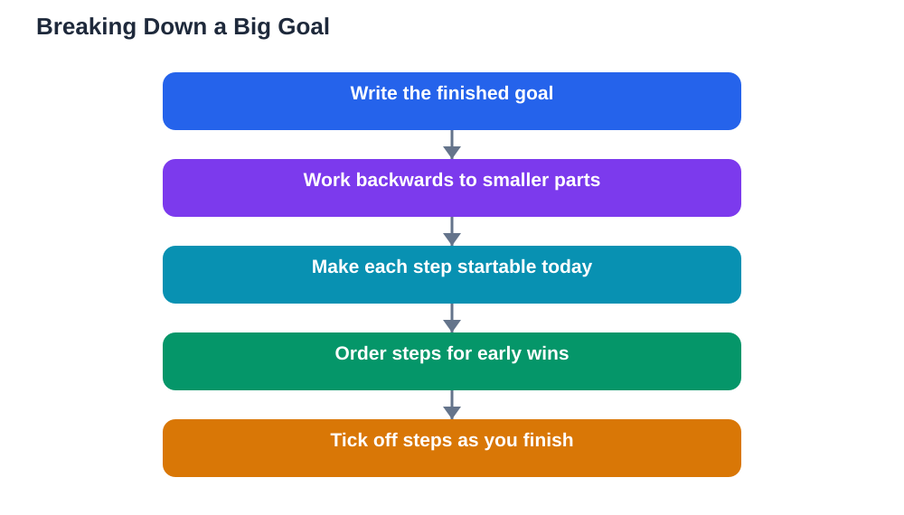

A big goal can feel exciting on the day you set it and overwhelming the next morning. The distance between where you are and where you want to be looks so large that starting feels pointless. Breaking big goals into small steps solves this problem, because it replaces one distant finish line with a series of near, doable actions. Each small step gives you something to finish today, and finished steps build the momentum that carries you forward.

Think of a big goal as a mountain with a path, not a wall to jump over. No one climbs in a single leap; climbers move from one foothold to the next, rest, check direction and continue. Study goals work the same way. A goal like mastering a whole subject becomes manageable when it is divided into chapters, and each chapter becomes manageable when it is divided into reading, practice, review and self-testing. The goal has not changed, but the next action has become obvious, and obvious actions get done.

## Start From the Finish Line and Work Backwards

Backward planning is the most reliable way to break down a goal. Write the finished goal at the top of a page, then ask what must be true just before it is finished. Then ask what must be true before that, and keep going until you reach something you can do today. For a goal like finishing a long assignment, the backwards chain might run from a final review, back through a complete draft, back through notes for each section, back to gathering sources and reading. Each link in the chain is smaller than the whole, and the first link is your starting point. This method also reveals hidden work early, such as research or revision, instead of letting it surprise you near the deadline.

## Make Each Step Small Enough to Start

A step is small enough when you can picture yourself doing it without dread and when it fits into a normal study session. If a step still feels huge, split it again. Reading a chapter can become reading one section, noting its key ideas and trying its practice questions. Writing a summary can become drafting three bullet points, then expanding them into paragraphs. A useful test is whether you could start the step within a few minutes of sitting down. If starting requires a long setup, a search for materials or a decision you have not made, the step is still too big or too vague. Shrink it until the first action is clear, and write that action down in plain words.

## Put the Steps in an Order That Builds Confidence

Order matters as much as size. Begin with a step you can complete quickly and well, because an early win proves the plan works and lifts your energy for harder steps. Then alternate harder and easier steps where possible, so effort is balanced across the week. Place steps that depend on each other in the right sequence, for example learning the basics of a topic before attempting its hardest problems. Leave review and self-testing near the end of the sequence, when you have material to review, but do not leave all checking until the last day. Small checks along the way catch misunderstandings early, when they are still cheap to fix.

## Track Steps Visibly So Progress Feels Real

A list you can see is a powerful motivator. Write your steps on paper or in a planner and mark each one as you finish it, with a tick, a date or a short note about what you learned. Watching the finished section grow changes how the goal feels: it stops looking like a mountain and starts looking like a path you are already walking. If a step takes longer than expected, note why, and adjust the remaining steps instead of pretending the delay did not happen. A visible tracker also makes it easy to restart after a break, because you can see exactly where you stopped and what comes next, without rethinking the whole plan.

## What to Do When a Step Gets Stuck

Every big goal has a step that resists you. When that happens, resist the urge to jump to a different goal or to push harder at the same blocked step. First, make the step smaller: if a section is confusing, split it into its definitions, its worked examples and its practice questions, and tackle them one at a time. Second, change the approach: re-read the material slowly, try an example by hand, or explain the idea aloud as if teaching it. Third, ask for help with a precise question, such as which part of a method is unclear, rather than a general request to explain everything. A stuck step is information, not failure; it tells you where your understanding needs support, and fixing that gap often unlocks several later steps.

## AI Help: Muse AI

Muse AI is Meta's personal AI assistant, and it can help you split a large study goal into smaller, ordered steps. You can describe your goal and ask it to suggest a sequence of bite-size actions or a simple checklist to work through. Use its suggestions as a starting draft, then adjust the steps to fit your own timetable and materials.

Join Muse with invite code LTGSWD — in the Muse app, go to Settings > Redeem token and enter the code.

Disclosure: LTGSWD is the author's Muse invite code.

## FAQ

### How small should each step be?

Small enough to finish in one study session and clear enough to start without delay. If you sit down and still wonder what to do first, the step needs splitting or rewriting. A step that produces something visible, like notes, answers or a summary, is easier to track than a step defined only by time spent.

### How many steps should a big goal have?

There is no fixed number; a goal naturally produces as many steps as its parts require. A chapter goal might need a handful of steps, while a term-long goal might need a longer list grouped by week. If the list looks endless, group steps under headings so the structure stays visible and the next action stays obvious.

### What if I finish steps out of order?

That is usually fine, as long as dependent steps still come in sequence. Skipping ahead to a step you feel ready for can rebuild momentum, and you can return to the missed step later. Just update your tracker so you know what remains, and avoid leaving all the hardest steps clustered at the end.

### Should I reward myself for finishing steps?

Small, simple rewards help, such as a short break, a favourite snack or time on a hobby after a session. Keep rewards modest and tied to completing steps, not to perfection. The real reward, finishing the goal itself, grows more believable with every step you mark done.

## Conclusion

Big goals are finished the same way they are started: one small, clear step at a time. Break the goal backwards, order the steps for early wins, track them visibly and shrink any step that stalls you. Before long, the mountain becomes a path you have already walked most of the way along.

[Try the free AI lesson solver](/#tool)
