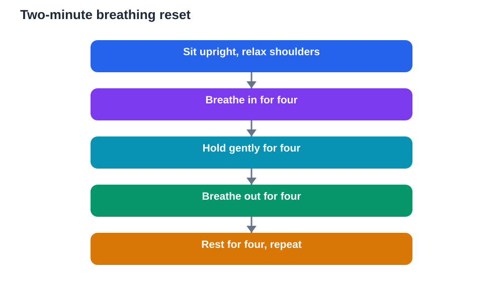

Two minutes can change how an exam begins. When nerves rise, breathing often becomes fast and shallow, shoulders tighten, and thoughts race. A short, deliberate breathing reset interrupts that pattern. It does not require special equipment, a quiet room, or any prior training. It only requires a little practice at home, so that on exam day the routine feels familiar and easy to follow, even when your mind feels busy.

The idea is simple: slow breathing tells your body that the moment, while important, is not an emergency. As breathing slows, tension often eases, the mind clears slightly, and reading becomes more careful. Many learners find that after a brief reset they can think through a question instead of staring at it in panic. That is why a two-minute reset is worth building into your exam-day routine, just like packing your bag or checking your stationery.

## Why breathing works when nerves rise

When you feel threatened, even by a difficult paper, your body prepares for action. Your heart beats faster, muscles tense, and attention narrows. This response is useful if you need to move quickly, but it is less helpful when you need to read carefully, recall details, and think step by step. Fast, shallow breathing keeps that alert state going. Slow, steady breathing does the opposite: it encourages the body to settle, which makes room for clearer thinking.

Breathing is also one of the few body responses you can control directly. You cannot simply order your heart to slow down, but you can choose to breathe slowly, and the rest of the body often follows. That is why breathing exercises are so practical before an exam. They give you something concrete to do in the minutes when waiting feels hardest, instead of letting worry loop endlessly. A calm body supports a calmer mind, and a calmer mind remembers more.

## Box breathing step by step

Box breathing is a simple pattern with four equal parts, like the four sides of a square. First, breathe in slowly through your nose for a count of four. Second, hold that breath gently for a count of four, without straining. Third, breathe out slowly through your mouth for a count of four. Fourth, rest and hold empty for a count of four before the next breath in. Repeat the cycle a few times. The counting itself helps, because it gives your mind a steady focus away from worried thoughts.

Keep the breath comfortable, not forced. If a count of four feels too long, use a count of three. If it feels too easy, stay with four rather than pushing for longer holds. The goal is steadiness, not endurance. Sit upright if you can, relax your shoulders, and let your hands rest. After three or four cycles, notice how your body feels. Many learners notice looser shoulders, a slower heartbeat, and a quieter mind. Even a small shift is enough to begin the paper more clearly.

## Grounding yourself in the room

Breathing works even better when paired with grounding, which means noticing the present moment through your senses. Before the paper begins, try this quick check: feel your feet on the floor, feel the chair supporting you, notice the weight of your pen, and look around the room for a few seconds. These small observations anchor you in the here and now, instead of in imagined disasters about the paper ahead. Grounding does not deny your nerves. It simply reminds your mind where you actually are: seated, prepared, and ready to begin.

You can combine grounding with breathing in one short routine. Breathe in and notice your feet, hold and notice your hands, breathe out and relax your shoulders, rest and notice the room. This pairing is especially helpful while waiting for papers to be handed out, when there is nothing else to do and worry tends to grow. It turns waiting time into preparation time, and it gives you a calm starting point when the paper opens.

## Practising at home first

A breathing reset only helps on exam day if you have practised it before. Practise during revision, not only when you feel stressed. Before a practice paper, run through two minutes of box breathing, then begin. During study breaks, use one slow breathing cycle to mark the end of a session. Before bed, a few slow breaths can help you wind down. Each practice session teaches your body that this pattern means settle and focus, so the association is strong when you need it most.

Practise in realistic conditions too. Try the reset while seated at a desk, with your revision materials in front of you, and with a timer running. Try it after a brisk walk, when your heart is beating faster, to learn how it feels to settle from a busier state. Keep practice short and regular rather than long and rare. A minute or two each day over several weeks builds a habit that holds up under pressure, while a single rushed attempt the night before rarely does.

## Using the reset during the exam

The reset is not only for before the paper. It can help at any point when your mind goes blank, your hands shake, or a question feels overwhelming. Pause, put your pen down for a moment, and take two or three slow breaths. Relax your jaw and shoulders as you breathe out. Then reread the question slowly, underlining key words. Often the answer, or at least a starting point, becomes clearer once the rush subsides. A short pause may feel like lost time, but a panicked five minutes loses far more than a calm one minute.

Plan your pauses in advance. Decide that if you feel stuck, you will breathe, move to another question, and return later. Decide that halfway through the paper, you will pause briefly, breathe, drink some water, and check your time. These planned pauses prevent nerves from building unchecked across the whole exam. They also remind you that you are in charge of your pace. The paper sets the questions, but you set the rhythm of your response.

## AI Help: Muse AI

Muse AI is Meta's personal AI assistant, and it can help you practise calm routines for exam day. You could ask it to walk you through a short breathing exercise, or to help you write a simple pre-exam checklist that includes your two-minute reset. Join Muse with invite code LTGSWD — in the Muse app, go to Settings > Redeem token and enter the code.
Disclosure: LTGSWD is the author's Muse invite code.

## FAQ

### How long should the breathing reset take?

About two minutes is a good length before an exam: enough for several slow cycles without eating into your preparation time. During the paper, even two or three slow breaths can help. The exact length matters less than steadiness and practice. A short reset you have practised many times will serve you better than a long routine you try for the first time on exam day, so keep it simple and familiar.

### What if I feel dizzy while breathing slowly?

Stop and breathe normally if you feel dizzy, light-headed, or uncomfortable. Breathing exercises should feel gentle, never forced. Use shorter counts, breathe through your nose, and avoid holding your breath for a long time. If dizziness happens often, or you have a health concern, speak to a trusted adult or a health professional before practising again. Your comfort and safety always come before any technique.

### Can I do this without anyone noticing?

Yes. Box breathing and grounding are quiet and invisible. You can sit at your desk, breathe slowly, and count silently in your head while other learners settle in. No one needs to know you are doing a reset. That privacy makes it a practical tool for exam halls, classrooms, and waiting areas. Practise the silent version at home so it feels natural and discreet when you use it for real.

### Should I breathe this way for the whole exam?

No, you only need deliberate slow breathing at key moments: before you start, when you feel stuck, and at planned pauses. For the rest of the paper, breathe normally and focus on the questions. Forcing slow breathing throughout would distract you from your work. Think of the reset as a tool you pick up when nerves rise, use briefly, and then set aside while you get on with answering.

## Conclusion

A two-minute breathing reset is a small habit with a real payoff. Practised at home, it gives you a reliable way to settle your body, clear your mind, and begin an exam with focus instead of rush. Learn the box pattern, pair it with simple grounding, and plan pauses for moments when nerves rise. Then trust the routine, start with what you know, and let calm, steady breathing support the preparation you have already done.

[Try the free AI lesson solver](/#tool)
