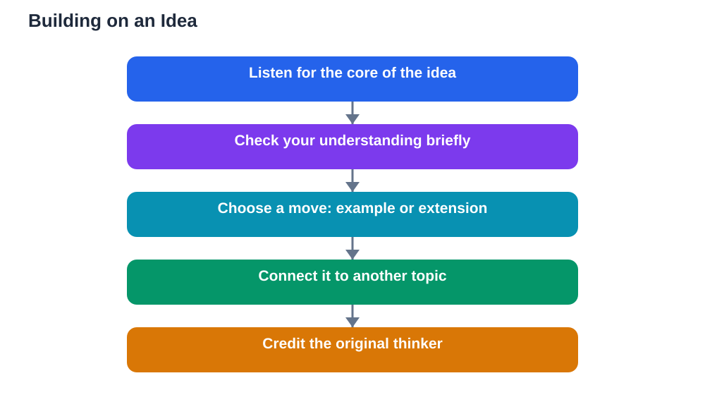

Most class discussions stall for the same reason: students speak in turn, but nobody connects what is said. One student offers an idea, the next offers a different idea, and the conversation hops from point to point without ever going deeper. Building on others' ideas is the skill that fixes this. It turns a string of separate comments into a real conversation where thinking grows step by step.

Building on an idea means taking what someone said and doing something useful with it. You might add an example, extend the reasoning, connect it to another topic, or raise a question it leads to. Each of these moves shows you were listening, and each one pushes the discussion further than it would have gone alone.

## Why Building Beats Repeating

Repeating an idea, even in agreement, adds nothing new. Saying "I agree" and stopping there leaves the discussion exactly where it was. Building, by contrast, creates progress. A class that builds on ideas can reach conclusions that no single student would have reached alone, because each contribution becomes a stepping stone for the next.

This is also how real-world thinking works. Scientists, writers, and problem solvers rarely start from nothing. They take existing ideas and extend them. Practising this in class discussions trains a habit that matters far beyond school: the ability to work with other people's thinking instead of just alongside it.

## Listen for the Core of the Idea

You cannot build on an idea you have not understood. Before responding, ask yourself what the speaker's main point actually was. Strip away the extra words and find the core claim or question underneath. If you are unsure, it is perfectly fine to check: "So are you saying that...?" This check shows respect and prevents you from building on a misunderstanding.

Listening for the core also helps you spot where the idea could go next. An idea with an unexamined consequence, an unexplored example, or a link to something you studied earlier is an invitation to build. Train yourself to hear those openings, and you will rarely be stuck for something useful to say.

## Add an Example That Tests the Idea

One of the simplest ways to build on an idea is to add an example. Examples test whether an idea holds up in a concrete case, and they often reveal strengths or limits that abstract talk hides. A frame like "That reminds me of an example where..." or "Would that also apply to...?" opens this move naturally.

Choose examples that genuinely connect, not random ones. The best example either confirms the idea in a new situation, which strengthens it, or shows a case where it breaks down, which sharpens it. Either outcome moves the discussion forward, and both show that you engaged seriously with the original thought.

## Extend the Reasoning One Step Further

Extending means following the idea to its next logical step. If a classmate argues that a certain approach works, you might ask what would happen if it were applied more widely, or what its long-term effect would be. Frames such as "If that is true, then would it also mean..." help you take this step clearly.

This move is powerful because it often surfaces consequences nobody had considered. A discussion that extends reasoning feels exciting precisely because it goes somewhere unexpected. Even if the extension turns out to be wrong, exploring it teaches the class something about the idea's limits, which is valuable in itself.

## Connect Ideas Across Topics

Some of the best contributions in a discussion are connections. When you notice that today's idea resembles something from an earlier lesson, a different subject, or a real-life situation, saying so can unlock a fresh angle for everyone. Connections show deep understanding, because they prove you are not just memorising isolated facts.

Use frames like "That connects with what we learned about..." or "This is similar to..." and then explain the link briefly. A connection without an explanation is just a claim, so take a sentence to show why the two ideas belong together. Classmates often build further on a good connection, and the discussion gains a richness it would not otherwise have.

## Ask a Question the Idea Leads To

Building does not always mean adding your own claim. Sometimes the best move is a question that the original idea raises. "What would happen if we changed one part of that idea?" or "Does that idea still work in this situation?" are questions that push the whole group to think harder.

Questions like these are generous contributions. They hand the discussion back to the group with a clear direction, and they often draw in quieter students who now have something specific to respond to. A good building question is specific, tied to the idea, and open enough that several answers are possible.

## Credit the Original Thinker

When you build on someone's idea, name them. A simple "Building on what Sara said..." or "Following on from that point..." does two things: it shows respect, and it helps everyone track how the discussion developed. Discussions where contributions are credited feel fairer, and students contribute more freely when they know their ideas will be acknowledged rather than absorbed without credit.

Crediting also keeps the conversation organised. When the teacher later summarises the discussion, a clear chain of who added what makes the whole thread easier to follow and remember. Small courtesies like this compound over time into a classroom culture where ideas are shared generously.

## AI Help: Muse AI

Muse AI is Meta's personal AI assistant, and it can help you practise building on ideas before class. You can share an idea with Muse and ask it to suggest an example, a connection, or a follow-up question that extends it, then choose the move that fits your discussion best. This rehearsal makes building on classmates' ideas feel natural.

Join Muse with invite code LTGSWD — in the Muse app, go to Settings > Redeem token and enter the code.

Disclosure: LTGSWD is the author's Muse invite code.

## FAQ

### What if I agree but have nothing to add?

Try one of the building moves: an example, an extension, a connection, or a question the idea raises. If you genuinely cannot add anything, it is fine to say "I agree, and I would like to hear more about..." and pass the discussion on. Agreement plus curiosity is still a contribution.

### Is building on an idea the same as copying it?

No. Copying repeats the idea without adding anything. Building takes the idea somewhere new, and crediting the original thinker makes the difference clear. Teachers value building precisely because it shows your own thinking at work on someone else's starting point.

### What if I misunderstand the idea I build on?

That happens, and it is easily fixed. The original speaker can correct you, and the correction itself often deepens the discussion. Checking your understanding first with "So are you saying that...?" reduces this risk, but do not let fear of misunderstanding stop you from contributing.

### How do I build on an idea I disagree with?

You can still build before disagreeing, by extending the idea fairly and then raising your doubt: "If we follow that idea further, it seems to lead to..., and I wonder whether that holds." This shows you took the idea seriously, which makes your disagreement more persuasive and more polite.

## Conclusion

Building on others' ideas is what turns separate comments into a real discussion. Listen for the core of each idea, then add an example, extend the reasoning, make a connection, or ask a question it leads to, and always credit the thinker you built on. Practise one building move in your next class discussion and watch how much further the conversation goes. When you study alone, remember that AI tools can make mistakes, so verify solutions against your textbook.

[Try the free AI lesson solver](/#tool)
