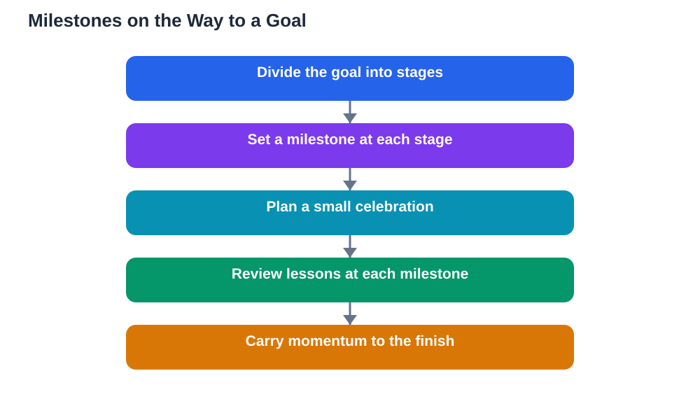

Long goals test patience. The finish line can stay far away for weeks, and working without any sign of arrival is draining. Milestones solve this by dividing the journey into marked points worth noticing. Each milestone is a genuine achievement on the way to the goal, and celebrating it properly refuels motivation for the next stretch. Students who mark milestones tend to keep going longer, because their progress is something they experience, not just something they hope for.

A milestone is not a random treat for working hard. It is a predefined checkpoint tied to real progress, such as finishing the first half of a project, completing all the practice for one topic, or being able to explain a difficult idea without notes. When you reach it, you pause, notice what you achieved, and mark the moment in a way that feels rewarding. That pause matters: without it, one achievement blurs into the next task, and effort starts to feel endless.

## What Makes a Good Milestone

A good milestone is clear, meaningful and placed at a natural break in the work. Clear means you know exactly when you have reached it, such as finishing a section or completing a set of tasks. Meaningful means it represents real progress, not just time passed; a milestone should feel earned. Natural breaks include finishing a chapter, completing a draft, or mastering one skill before moving to the next. Space milestones evenly through a goal where possible, so no stretch feels too long without a marker. For a long goal, three or four milestones work well: enough to keep the journey structured, few enough that each one still feels special.

## Plan Milestones Before You Start

Milestones work best when they are chosen at the start, not invented after the fact. When you set a goal, divide it into stages and write a milestone for each stage, along with a small celebration for reaching it. Planning celebrations in advance has two benefits: it gives you something concrete to look forward to, and it stops celebrations from becoming excuses to stop working. A celebration planned for a milestone feels like part of the plan, while an unplanned reward often arrives at the moment of lowest energy and turns into a long break. Write milestones and celebrations on the same page as the goal, so they stay visible throughout.

## Celebrate in Ways That Help, Not Hinder

The best celebrations are enjoyable, brief and kind to your future self. A favourite meal, an evening with friends, time on a hobby, or a relaxing break all work well. What to avoid is a celebration that undoes the progress or breaks the routine badly, such as abandoning study for days or staying up so late that the next session is ruined. Keep celebrations proportional: small milestones earn small celebrations, and the largest celebration belongs at the finish line. Also celebrate in a way that acknowledges the work itself: tell someone who supported you, write down what you achieved, or look back at how far you have come. Recognition makes the achievement feel real.

## Use Milestones to Review, Not Just to Celebrate

A milestone is also a natural review point. When you reach one, pause to ask what worked in the last stage and what should change in the next. Perhaps a study method proved effective, or a particular time of day worked best, or a topic took longer than expected. Carry those lessons into the next stage, and adjust the remaining milestones if the plan needs it. This review habit turns milestones into steering points, not just parties. A goal with regular reviews adapts to reality, while a goal without them can drift off course for weeks before anyone notices.

## When Milestones Feel Out of Reach

Sometimes a milestone stays out of reach longer than expected, and the celebration tied to it starts to feel like a taunt. When that happens, check whether the milestone was too large or the stage badly planned. Splitting a distant milestone into two smaller ones is a sensible fix, not cheating, because the purpose of milestones is to make progress visible. Also check whether the work itself needs support: a stuck topic, missing materials or an overloaded week can all stall a stage. Fix the block, adjust the milestone if needed, and keep the celebration waiting just ahead. A milestone that moves slightly is still a milestone, and reaching it late beats abandoning it entirely.

## AI Help: Muse AI

Muse AI is Meta's personal AI assistant, and it can help you divide a study goal into sensible milestones. You can describe your goal and ask it to suggest natural checkpoints and simple ways to mark each one. Use its suggestions as a draft, then choose milestones that feel genuinely meaningful for your own work.

Join Muse with invite code LTGSWD — in the Muse app, go to Settings > Redeem token and enter the code.

Disclosure: LTGSWD is the author's Muse invite code.

## FAQ

### How is a milestone different from a goal?

A goal is the final destination, while milestones are checkpoints along the way. A goal might take a whole term, but its milestones mark real progress at intervals, such as finishing each major part. Milestones make a big goal feel like a series of smaller, achievable wins.

### What is a good celebration for a study milestone?

Something enjoyable, short and harmless to your routine, like a favourite snack, a relaxing evening, or time with friends. The celebration should feel like a reward for real progress, not a break that derails the next stage. Save the biggest celebration for finishing the whole goal.

### Should I celebrate even if the work was not perfect?

Yes, if the milestone itself was reached. Milestones reward progress and completion, not perfection. Waiting for flawless work before celebrating means celebrations rarely happen, and motivation fades. Notice what could improve during the milestone review, but still mark the achievement.

### What if I reach a milestone but feel too tired to celebrate?

Keep the celebration small and restful, or postpone it by a day rather than skipping it entirely. A short walk, a favourite meal or a quiet evening can mark the moment without demanding energy. The point is to notice the achievement, not to force a big event.

## Conclusion

Milestones turn a long, tiring journey into a path with places to pause, look back and gather strength. Plan them at the start, celebrate them in ways that support your next stage, and use each one to review and adjust. The finish line will still take work, but you will arrive there having enjoyed and learned from the journey, not merely endured it.

[Try the free AI lesson solver](/#tool)
