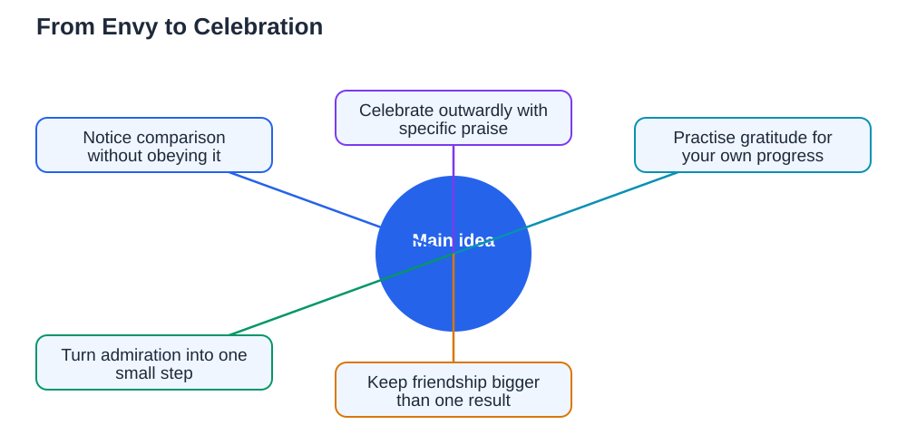

Celebrating others' success sounds simple, yet it can feel surprisingly hard. When a friend wins an award, earns praise, or achieves something you wanted for yourself, two feelings can arrive together: genuine happiness for them, and a quiet ache of envy. Both feelings are normal, and having the second does not make you a bad friend. What matters is which feeling guides your actions. Learning to celebrate others sincerely, without letting envy take over, strengthens friendships, protects your confidence, and even helps your own progress, because it keeps you focused on growth rather than comparison.

## Celebrating Others Success: Notice Comparison Without Obeying It

Comparison is the usual source of envy. When someone succeeds, your mind may instantly compare their result with yours and conclude that you are behind. Noticing this thought is the first step to handling it. You can observe it without obeying it: "I notice I am comparing myself, and that does not mean I am failing." Remember that you see someone else's highlight, not their full journey, including their struggles, practice, and setbacks. Comparison also ignores the fact that people grow at different speeds and in different areas. A friend's success does not reduce your chances or your worth. It is simply their moment, and yours will come through your own path.

## Celebrate Outwardly, Even When It Feels Hard

Celebration is partly an action, not only a feeling, and acting generously often helps the feeling follow. Offer a sincere congratulation, mention something specific they did well, and join in the applause or praise without adding a comment about yourself. Specific praise, such as "Your presentation was so clear and confident," feels warmer than a generic "well done," and it shows you truly paid attention. Avoid remarks that quietly take credit away, such as pointing out luck or your own near-miss in the same breath. If your feelings are still raw, a brief, kind congratulation is enough. Acting with generosity in the moment builds a habit that makes future celebrations easier.

## Practise Gratitude for Your Own Path

Gratitude is a strong antidote to envy, because it turns your attention from what you lack to what you have and what you are building. Take a moment to notice your own progress, however small: a skill you improved, a habit you kept, or a challenge you faced. Keeping a short private list of your own wins, including effort-based ones such as steady practice or helping a friend, helps you see growth that praise and awards do not capture. Gratitude does not mean settling for less or pretending you have no goals. It means recognising that your path has value right now, even while you keep working toward more. For more on a kinder inner voice, see [Kind Self-Talk: Your Inner Voice](/blog/self-talk-kind-inner-voice.html).

## Let Their Success Inspire, Not Pressure, You

Someone else's success can inspire you, but only if you use it wisely. Instead of copying their exact path, ask what you can learn from it. What habit, preparation, or approach helped them? Which small part of that could fit your own goals? Turning admiration into a practical idea, such as a new study habit or a skill to practise, makes their win useful to you without making it a pressure to match them exactly. Avoid setting a deadline driven by envy, such as "I must beat them next time," which usually creates stress rather than growth. Inspiration says, "That shows what steady effort can do." Pressure says, "I am behind." Choose the first story, and let it guide one small step of your own.

## Keep Friendships Bigger Than Any Single Result

Friendships last longer than any single result, and celebrating others protects that longer story. When you celebrate a friend's success warmly, you build trust that survives future competitions, because they know you value them beyond outcomes. The same generosity usually returns to you when your own moment arrives. If envy feels strong or lasting, talk honestly with someone you trust, rather than letting it quietly damage the friendship. Naming envy takes away much of its power. Remember that a friend's success and your own success are not in competition. There is room for both, and celebrating theirs today makes celebrating yours together even sweeter tomorrow.

## AI Help: Muse AI

Muse AI is Meta's personal AI assistant, and it can help you turn envy into inspiration. You can ask it to help you set a small personal goal inspired by a friend's achievement, or to suggest gratitude habits that keep your own progress in view. Join Muse with invite code LTGSWD — in the Muse app, go to Settings > Redeem token and enter the code.
Disclosure: LTGSWD is the author's Muse invite code.

## FAQ

### Is it normal to feel envious when a friend succeeds?

Yes, it is completely normal to feel both happiness for a friend and a quiet ache of envy at the same time. Envy does not make you a bad friend. What matters is your actions: a sincere congratulation and kind behaviour matter far more than a passing feeling you did not choose.

### How can I congratulate someone sincerely when I feel envious?

Keep it brief, specific, and focused on them, such as praising something they did well. Avoid adding comments about luck or your own result in the same breath. Acting generously often helps warmer feelings follow, and a short, kind congratulation is always enough.

### Does celebrating others mean I should not want success myself?

Not at all. You can celebrate a friend warmly while still working toward your own goals. Gratitude for your own path and inspiration from theirs can live side by side. Healthy ambition focuses on your own steady growth, not on matching someone else exactly.

### What should I do if envy keeps affecting a friendship?

Talk honestly with someone you trust about how you feel, rather than letting envy quietly damage the friendship. Naming the feeling takes away much of its power. Focus on your own small wins and one practical step inspired by your friend, and give the friendship time to feel easier again.

## Conclusion

Celebrating others' success without envy is a skill built on noticing comparison, celebrating outwardly, practising gratitude, and letting inspiration replace pressure. A friend's win does not diminish your path. It shows what steady effort can achieve, and it gives you a chance to be the kind of friend you hope others will be for you. Celebrate generously, keep walking your own path, and trust that your moments will come too.

[Try the free AI lesson solver](/#tool)
