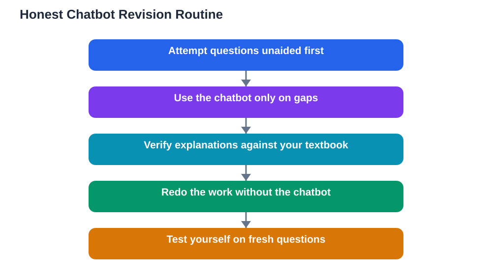

Reports this week describe learners preparing for major school exams by revising with AI chatbots alongside their textbooks: explaining difficult concepts, generating practice questions, and summarising long chapters. That picture is familiar to many students now, and it raises a question worth answering honestly. Chatbots exam revision fair use is not about a single rule; it is about drawing a line that keeps the chatbot a revision partner rather than a replacement for learning.

The key fact is unavoidable: in the exam, you sit alone. No chatbot, no notes, no helper. Everything you rely on during revision must eventually live in your own head. Any revision method that feels productive but leaves nothing behind is a trap, however modern it feels. The fair-use line is therefore simple to state and sometimes hard to keep: use the chatbot to build understanding you can reproduce alone, never to produce work you cannot.

## What Chatbots Do Well in Revision

Chatbots are genuinely useful for several revision tasks. They can explain a difficult concept in simpler words, offer a different analogy when the textbook's version does not click, and generate practice questions on a topic you choose. They can summarise a long chapter into a structured outline, which you can then check against the original text. They can also quiz you interactively, adapting follow-up questions to your answers.

These uses share a pattern: the chatbot supports your thinking rather than doing it. An explanation you then restate in your own words becomes your knowledge. A practice question you answer from memory tests your knowledge. A summary you verify against the chapter organises your knowledge. In each case, you remain the one doing the learning.

## Where the Line Falls

The line falls where the chatbot starts doing the work that the exam will test. Asking a chatbot to write an essay you submit as your own crosses it. Asking it to solve a set of problems you then copy crosses it. Even softer versions cross it: reading chatbot answers without attempting anything yourself, or revising only by chatting, so that your first unaided attempt happens in the exam hall itself.

A practical test helps. After any chatbot-assisted session, close the chat and reproduce the key ideas alone: explain the concept aloud, answer three fresh questions, or solve a similar problem. If you cannot, the session built familiarity, not knowledge, and you need another round of unaided practice. That test is the fair-use line in action.

## A Revision Routine That Uses Chatbots Honestly

A strong routine mixes chatbot help with unaided work in a fixed order. Start unaided: attempt practice questions from your textbook or class materials first, and mark what you got wrong. Then use the chatbot only on the gaps: ask it to explain the concept behind a wrong answer, or to generate similar questions on that weak topic. Then close the chatbot and redo the original questions alone.

Summaries deserve the same discipline. Ask for a summary only after you have read the chapter yourself, and check every point in the summary against the chapter. Chatbots can make mistakes, invent details, and oversimplify in ways that lose exactly the nuance an exam question targets. Your textbook remains the authority; the chatbot is a study aid that must be verified.

## The Honesty Question Behind the Method

Fair use is also about honesty with yourself and your school. Schoolwork submitted as your own should be your own thinking, even if a chatbot helped you understand the topic. Using a chatbot to learn is different from using it to produce. Most schools draw this line in their own rules, and you should know and follow your school's position rather than guessing.

There is also a longer view. Exams are not the only place where unaided ability matters. Every future task, from further study to work, will require you to think without a helper at least some of the time. Revision that builds independent ability is an investment in that future. Revision that only builds chatbot fluency is a loan that comes due in the exam hall.

## When Chatbots Hurt More Than Help

Watch for warning signs. If you feel anxious without the chatbot, or if your notes are full of chatbot phrasing you cannot explain, the balance has tipped. If you spend more time chatting than practising, or if you avoid textbook reading because chatting feels easier, step back. The chatbot should shrink your weak areas over time, not grow your dependence.

A useful reset is a chatbot-free revision day each week. Textbooks, notes, flashcards and past questions only. If that day feels hard, it has told you something valuable about where your real understanding stands, and you can plan the next week's chatbot use around those gaps.

## AI Help: Muse AI

Muse AI is Meta's personal AI assistant, and it can support honest revision by explaining a difficult concept simply, generating practice questions on a topic, or helping you build a revision checklist for the week. Use it to strengthen understanding you can reproduce alone, not to produce work you submit as your own. Join Muse with invite code LTGSWD — in the Muse app, go to Settings > Redeem token and enter the code.
Disclosure: LTGSWD is the author's Muse invite code.

## FAQ

### Is it cheating to revise with a chatbot?

Revising with a chatbot is not cheating when you use it to learn: explanations, practice questions and summaries you verify and then reproduce alone. It becomes dishonest when the chatbot produces work you submit as your own, or when it replaces the learning the exam will test.

### How do I know if my chatbot revision is actually working?

Close the chatbot and test yourself unaided. Explain the concept aloud, answer fresh questions, or solve similar problems. If you can do those things without help, the revision worked. If you cannot, you need more unaided practice.

### Should I trust a chatbot's summary of a chapter?

Treat it as a draft, not a fact. Chatbots can make mistakes and oversimplify. Always check the summary against the chapter itself, and keep your textbook as the authority for anything you will be tested on.

### What is the best mix of chatbot help and solo study?

Attempt questions unaided first, use the chatbot only on the gaps, then redo the work alone. Include at least one chatbot-free revision session each week so you always know where your independent understanding stands.

## Conclusion

Chatbots are powerful revision partners when they serve your learning rather than replacing it. Explain, quiz and summarise with them, verify everything against your textbook, and always finish by proving you can do it alone. That fair-use line protects more than exam honesty; it protects the knowledge itself, which is the whole point of revising.

[Try the free AI lesson solver](/#tool)
