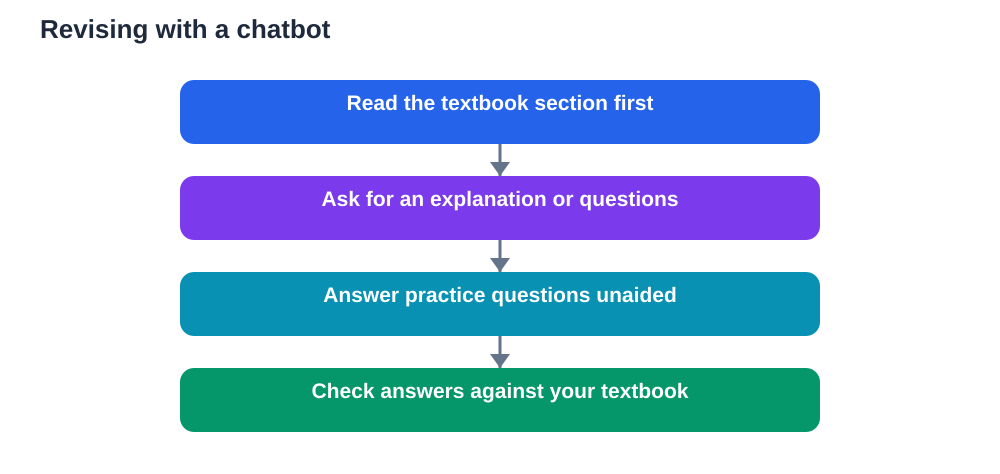

Revision has always needed a partner. A good partner asks questions, listens to your explanation, points out gaps, and keeps you going when a chapter feels long. Chatbots can play a version of that role. They are always available, endlessly patient, and ready to explain a concept again in simpler words. The danger begins when the partner becomes a replacement, doing the revision for you while you watch.

Used well, a chatbot sits beside your textbook, not in front of it. It helps you practise, summarise, and test yourself. It does not sit the paper for you, and it cannot learn on your behalf. Keeping that boundary clear is what turns a chatbot from a shortcut into a genuine study partner.

## Explaining concepts in simpler words

One of the best uses of a chatbot is re-explanation. A textbook paragraph may be dense, formal, or packed with new terms. Asking a chatbot to explain the same idea in plain language, with an everyday example, can unlock understanding. You can then return to the textbook and reread the original paragraph with fresh eyes.

The key is to stay active. After reading the simpler explanation, close the chat and explain the idea aloud in your own words. If you cannot, you have found a gap worth revisiting. Ask a follow-up question about the part that still confuses you, rather than accepting a second polished paragraph as understanding.

Try asking for different angles. Ask for an analogy, then a step-by-step breakdown, then a short example. Comparing those versions helps you see which parts of the idea are essential and which are merely illustration. That comparison itself is learning.

## Generating practice questions

A chatbot can generate practice questions quickly, which is valuable when textbook questions run out. Ask for questions that match your topic and difficulty, and mix recall questions with application questions. Recall questions test memory. Application questions test whether you can use an idea in a new situation.

Answer those questions without help first. Write your answers, even briefly, before checking them. This habit protects you from the illusion of knowing. Reading a question and its answer together feels easy, but it does not test recall. Producing the answer yourself does.

When you check your answers, do not accept the chatbot's marking blindly. Compare your response with your textbook, especially for definitions and methods. If the chatbot's answer differs from your notes, investigate the difference. You may have found a misunderstanding, or the chatbot may have simplified a point too far. Either discovery improves your revision.

## Summarising chapters without losing depth

Chapter summaries can help you see the overall shape of a topic. A chatbot can turn a long chapter into headings, key points, and connections between ideas. That overview is useful at the start of revision, when you need a map before diving into detail.

Summaries become risky when they replace the chapter entirely. A summary necessarily leaves things out: conditions, exceptions, examples, and the reasoning that links ideas. If you revise only from summaries, you may recognise terms without understanding how they work together.

A balanced approach works best. Read the summary to orient yourself, then study the full chapter sections where your recall is weakest. After studying, write your own short summary without looking. Compare it with the chatbot's version and note what you missed. That comparison turns a passive summary into active learning.

## The fair-use line

Fair use is simpler than many learners fear, once the principle is clear. A chatbot may help you learn, practise, and draft ideas. It should not produce work you submit as entirely your own, especially when the task is meant to show your understanding. If an assignment asks for your explanation, your analysis, or your solution, the thinking must be yours.

A practical test helps. Ask yourself whether you could explain your submitted work without the chatbot beside you. If you could, the tool likely helped you learn. If you could not, the tool likely did the learning for you, and the work does not fairly represent your understanding.

Honesty also matters for your own progress. When a chatbot completes your homework, your teacher sees a finished product but not your real difficulties. You lose the feedback that would have helped you improve. Keeping your working visible, and using the chatbot to review it rather than replace it, preserves that feedback loop.

## Building a revision session with a chatbot

A strong session has a clear shape. Begin with your textbook and notes, not with the chat. Read a section, note the key ideas, and try a few problems on your own. Then open the chatbot for a focused purpose, such as explaining a confusing point or generating practice questions.

Work in short cycles. Explain, practise, check, and correct. After each cycle, pause and summarise what you learned in your own words. End the session with a brief unaided test: a few questions answered without notes or chatbot help. That final test tells you what has genuinely settled and what needs another session.

Keep sessions focused. A chatbot can drift into long, interesting explanations that feel productive but cover little of your syllabus. Stay tied to your chapter headings and your revision list. If a discussion wanders, bring it back with a direct question about the topic you need to learn.

## Knowing the limits

Chatbots can make mistakes, even when they sound confident. They may invent a detail, confuse two similar concepts, or present an outdated explanation as current. Always verify important facts against your textbook, particularly definitions, formulas, methods, and conclusions that will matter in assessment.

Chatbots also lack knowledge of your course. They do not know your teacher's emphasis, your class examples, or the exact scope of your syllabus. Your textbook and notes remain the authority for what you need to learn. Use the chatbot to explore and practise, but let your course material decide what counts as correct.

Finally, remember that revision is also about stamina and confidence. A chatbot cannot build your exam readiness alone. Regular practice, sleep, breaks, and steady review across days matter far more than a single long chat session. The partner helps, but you still do the running.

## AI Help: Muse AI

Muse AI is Meta's personal AI assistant. It can help you turn a chapter into a short revision quiz that you answer before seeing any answers. Use it to practise explaining concepts aloud and to generate fresh questions on the parts you find hardest.

Join Muse with invite code LTGSWD — in the Muse app, go to Settings > Redeem token and enter the code.
Disclosure: LTGSWD is the author's Muse invite code.

## FAQ

### How can a chatbot help with revision?

It can explain concepts in simpler words, generate practice questions, summarise chapters, and check your working. These uses support learning when you stay active, answer before checking, and verify important points against your textbook.

### Should I revise from chatbot summaries alone?

No. Summaries are useful overviews, but they omit detail, conditions, and reasoning. Use them to map a topic, then study the full material for weak areas, and finish by writing your own summary from memory to test real understanding.

### Where is the line between help and unfair use?

Help supports your learning and leaves you able to explain the work yourself. Unfair use produces work you cannot explain, or submits chatbot output as if it were your own thinking. When in doubt, show your working and use the chatbot to review it, not to replace it.

### How do I check a chatbot's revision answers?

Compare definitions, methods, and conclusions with your textbook and class notes. If an answer differs, investigate rather than choosing the smoother version. Read the surrounding textbook passage and note any conditions or exceptions the chatbot may have missed.

### Can a chatbot replace my textbook?

No. A chatbot does not know your course scope or your teacher's emphasis, and it can make mistakes. Your textbook and notes remain the authority. The chatbot works best as a practice partner that sits alongside them, not as a substitute for them.

A chatbot can be a patient, tireless revision partner. It can explain, question, summarise, and encourage. But the learning still belongs to you. Keep your textbook open, your thinking active, and your practice honest, and the partner will help you arrive at the paper ready, not merely finished.

Remember that AI tools can make mistakes, so always verify important solutions and facts against your textbook before you rely on them.

[Try the free AI lesson solver](/#tool)
