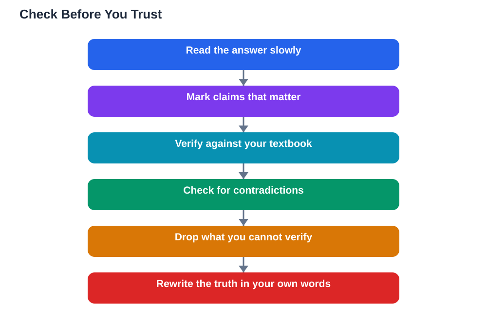

AI tools are now part of daily study for a great many learners, used for preliminary research, summarising texts, and drafting assignment ideas, and checking ai output study skills have become as important as the tools themselves. The encouraging news is that many students have already learned to evaluate what AI produces rather than accepting it blindly. That habit is worth building deliberately, because AI output can be fluent, confident, and completely wrong at the same time. Learning to check before you trust protects your grades, your understanding, and your honesty, and it turns you from a passive reader of machine text into an active judge of it.

## Why Confident AI Output Needs Checking

AI systems produce text by predicting what words are likely to follow, not by checking facts against a trusted source. That is why an answer can read beautifully while containing a wrong date, an invented definition, or a reference to a source that does not exist. Confidence is not evidence: the system sounds equally sure about true statements and false ones, and polite, well-structured writing can hide serious errors. This is not a reason to avoid AI tools, but it is a reason to treat every AI answer as a draft to verify, never as a finished truth. The students who benefit most from AI are not the ones who use it most, but the ones who check it most carefully, keeping their own judgement in charge of every claim they pass on.

## Checking AI Output Study: A Practical Routine

A simple checking routine catches most errors without taking much time. First, read the answer slowly and mark every claim that matters: dates, names, definitions, formulas, and quotations. Second, check the important claims against a source you trust, such as your textbook, class notes, or a reference your teacher recommended. Third, look for internal consistency: does the answer contradict itself, or does a later paragraph quietly undo an earlier claim? Fourth, be suspicious of anything oddly specific that you cannot verify, such as a precise statistic or a quotation with no source, since those are common places for invented detail. Finally, rewrite the verified version in your own words, because copying unchecked text into your work transfers the error and hides it from your own understanding. This routine quickly becomes a habit, and habits are what protect you when you are tired or rushed.

## Common Error Patterns Worth Knowing

Knowing the usual error patterns makes checking faster. AI tools sometimes mix up similar concepts, giving the definition of one idea under the name of another. They sometimes invent plausible-sounding sources, complete with titles and authors that do not exist. They can also overgeneralise, turning a claim that is true in one situation into a rule that supposedly applies everywhere. Another common pattern is outdated information presented as current, because the tool's knowledge may not include recent changes. When you notice one of these patterns, slow down and verify more, not less. Ask the tool to show its reasoning or to explain a claim step by step, and compare that reasoning with your textbook. If the explanation falls apart under questioning, you have found an error worth correcting rather than copying.

## Building Evaluation Skills for Life

Checking AI output is not just a school skill; it is a life skill. The same habit protects you when you read news, health advice, or product claims online, where confident writing also hides weak evidence. Students who practise evaluation learn to ask who benefits from a claim, what evidence supports it, and what a second source says, and those questions serve them in every subject and beyond school entirely. Teachers value this skill because it shows real understanding: a student who can explain why an AI answer was wrong understands the topic better than a student who merely repeated a correct answer. So treat every AI interaction as practice in judgement. The goal is not to catch the machine out, but to become the kind of learner who never hands their thinking to anyone else, human or machine.

## AI Help: Muse AI

Muse AI is Meta's personal AI assistant, and it can help you practise checking AI output. You can ask it to explain a concept step by step, then compare its reasoning with your textbook to see where verification matters most.

Join Muse with invite code LTGSWD — in the Muse app, go to Settings > Redeem token and enter the code.

Disclosure: LTGSWD is the author's Muse invite code.

## FAQ

### Why does AI output sometimes sound right but contain errors?

Because AI generates fluent, likely-sounding text rather than verified facts. A well-written answer can contain wrong dates, mixed-up definitions, or invented sources while sounding completely confident.

### What should I check first in an AI answer?

Start with the claims that matter most: dates, definitions, formulas, names, and quotations. Check those against your textbook or class notes before worrying about style or minor wording.

### How do I spot an invented source or statistic?

Look for detail you cannot verify anywhere else, such as a very precise figure or a quotation with no traceable source. If a second trusted source does not confirm it, treat it as unverified and leave it out.

### Is it enough to ask the AI tool whether its answer is correct?

No. Asking the same tool to confirm itself is not a real check. Verification means comparing the claim with an independent, trusted source, such as your textbook or your teacher's material.

### Does checking AI output slow down my studying too much?

At first it takes a little longer, but it soon becomes quick and automatic, and it saves far more time than fixing errors later. It also deepens understanding, so revision afterwards is faster and more secure.

## Conclusion

AI tools can speed up research, summaries, and drafting, but only careful checking turns that speed into real learning. Build the routine: mark the claims that matter, verify them against trusted sources, watch for familiar error patterns, and rewrite the truth in your own words. That habit keeps you honest, accurate, and in charge of your own education. For help with your school work and study questions, [Try the free AI lesson solver](/#tool).
