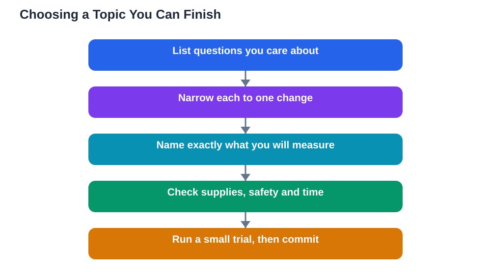

Choosing a science fair topic feels exciting and overwhelming at the same time. Every idea sounds interesting at first, and it is tempting to pick the biggest, flashiest question you can think of. Yet the projects that turn out best are rarely the biggest ones. They are the ones a student can actually finish, test fairly, and explain clearly. A good topic sits in the sweet spot between interesting and doable: it sparks your curiosity, it can be answered with a fair experiment, and it fits the time, space, and supplies you really have. This guide will help you find that sweet spot, step by step, so you start with a question you can be proud of at the finish line.

## Choosing a Science Fair Topic: Start With Curiosity, Not Flash

The best place to start is your own curiosity. Think about questions you have already asked yourself: why does one kind of bread go stale faster, what makes a paper plane fly farther, or how does light affect the way a plant grows? A question you genuinely care about will carry you through the slow parts of a project, such as repeating measurements and writing up results. A flashy topic you do not care about will feel like a chore by the second week. Make a list of ten questions that interest you, without judging them yet. Include everyday observations from the kitchen, the garden, sports, music, and the world around you. Curiosity is fuel, and a project runs on it for weeks, so choose a question that still sounds interesting after you have said it out loud a few times.

## Make the Question Testable: One Change, One Measurement

A science fair topic must be testable, which means you can change one thing, keep everything else the same, and measure what happens. Compare a vague idea with a testable one. "Plants and light" is a theme, not a question. "Does the colour of light affect how tall a seedling grows in two weeks?" is a question you can test, because it names one change, the colour of light, and one measurement, seedling height. Run each idea on your list through this filter. Can you name the one thing you will change? Can you name exactly what you will measure, and how? Can you keep the other conditions the same? If an idea fails any of these checks, try narrowing it until it passes. Narrowing is not settling for less; it is turning a theme into real science. For help turning your question into a prediction, see [Science Fair Hypothesis: If, Then, Because](/blog/science-fair-hypothesis-guide.html).

## Check Feasibility Before You Fall in Love With an Idea

Before you commit, check feasibility honestly. What supplies do you need, and do you already have them at home or at school, or can you get them easily and safely? How much time will the experiment take, including repeats, and does that fit before your deadline? Is there enough space, and is the method safe with adult supervision where needed? A project that needs rare equipment, dangerous materials, or months of waiting is a poor choice, however exciting it sounds. A project using home supplies, such as paper, water, seeds, cups, and simple measuring tools, can still be excellent science, because good science is about fair testing, not expensive gear. Write a short supplies list and a rough timeline for your top three ideas, then pick the one that is clearly finishable. Planning backwards from your deadline is covered in [Science Fair Timeline: Planning Backwards From the Date](/blog/science-fair-timeline-planning.html).

## Avoid Topics That Are Too Big, Too Vague, or Already Answered

Some topics look appealing but cause trouble later. A topic that is too big, such as testing every factor that affects plant growth at once, cannot be finished fairly in the time available. A topic that is too vague, such as "how does weather work", cannot be turned into one experiment. A topic whose answer is already a well-known fact that you simply look up, rather than test, leaves you with nothing to measure. Also be careful with topics that depend on things you cannot control, such as waiting for a particular kind of weather or for an animal to behave a certain way. If your idea has any of these problems, do not throw it away. Shrink it. Pick one factor, one comparison, and one clear measurement, and you will often rescue a good project from an oversized idea.

## Test Your Shortlist With a Small Trial Run

Once you have two or three strong candidates, run a tiny trial before you commit fully. A trial run means doing one quick version of the experiment with a small number of samples, just to check that the method works, the measurement is possible, and nothing unexpected breaks the plan. You might discover that your measuring method is awkward, that a material behaves differently than expected, or that one setup needs adjusting. Finding these problems early is a success, not a failure, because fixing them now saves your whole project later. Keep notes on what you tried and what you changed, since that record becomes part of your experiment log. Choose the topic whose trial felt smoothest and most interesting, and commit to it with confidence.

## AI Help: Muse AI

Muse AI is Meta's personal AI assistant, and it can help you brainstorm science fair topics in a practical way. You can ask it to suggest testable versions of a broad idea, or to help you list everyday materials you could use for an experiment. Join Muse with invite code LTGSWD — in the Muse app, go to Settings > Redeem token and enter the code.
Disclosure: LTGSWD is the author's Muse invite code.

## FAQ

### How do I know if my topic is too big?

A topic is too big when it changes more than one thing at once, needs supplies or time you do not have, or cannot be repeated for a fair comparison. Try shrinking it to one change and one measurement. If the smaller version still interests you and fits your timeline, it is the right size for a strong project.

### Can I choose a topic my friend is also doing?

It is better to choose your own angle, even if you start from a similar theme. Two students testing the same question with different materials, conditions, or measurements will learn different things, but identical projects are hard to present as your own work. Pick a variation that reflects your own curiosity, and keep your own measurements and notes.

### What if I lose interest halfway through?

Losing interest often means the question was chosen for flash rather than curiosity, or the experiment is too slow to show results. Talk to a teacher or parent about narrowing the question or adding a measurement that shows change sooner. It is usually better to adjust a project early than to struggle on with a question that no longer excites you.

### Should I pick a topic I already know the answer to?

You can, as long as you still test it fairly instead of just reporting the known answer. A fair test with real measurements, repeats, and honest results is valuable even when the outcome matches expectations. What matters is that you ran the experiment properly and can explain what your own data showed.

## Conclusion

A great science fair topic is not the biggest idea in the room. It is a question you care about, that you can test by changing one thing and measuring the result, and that you can finish with the time and supplies you have. Start with curiosity, narrow each idea until it is testable, check feasibility honestly, and run a small trial before committing. Do that, and you will begin your project with a question you can actually answer, and finish with results you can explain with pride.

[Try the free AI lesson solver](/#tool)
