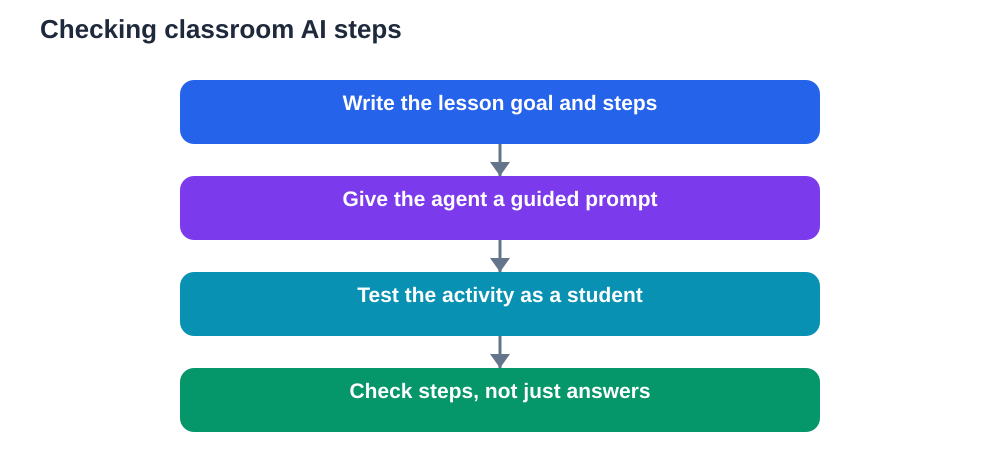

Classroom AI agents promise to help with tutoring, feedback, practice, and lesson support. In practice, they do not always do what the teacher intended. Recent reports note that these agents often fail to follow teacher intent or skip steps, although guided prompts reduce failures. That gap matters, because a classroom activity is not successful merely when it produces an answer. It succeeds when it follows the learning plan, step by step, in the way the teacher designed it.

Understanding this gap helps teachers use AI agents wisely. The tool is not a replacement for the lesson plan. It is a helper that needs clear direction, careful checking, and a teacher who stays in charge of the sequence of learning.

## What teacher intent really means

Teacher intent is more than the topic of a lesson. It includes the goal, the order of activities, the level of challenge, the kind of thinking students should practise, and the evidence the teacher wants to see. A lesson might aim to build careful reasoning, encourage discussion, or give students time to struggle productively before receiving help. Those intentions shape every choice in the classroom.

An AI agent that ignores intent may still produce fluent material, yet miss the point. It might give the answer before students have attempted the problem, simplify a task that was meant to be challenging, or skip a discussion step that was meant to build understanding. The output looks complete, but the learning process has been bypassed.

This is why teachers must describe intent explicitly when using an agent. A vague instruction, such as asking for help with a topic, leaves the agent free to choose its own path. A specific instruction, covering goal, steps, student role, and what to avoid, gives the agent a much better chance of following the plan.

## Why agents skip steps

AI agents are designed to be helpful and efficient, which can work against a lesson plan. Efficiency in a classroom is not always desirable. Sometimes the slow step is the learning step. An agent that rushes to a conclusion may skip the very struggle, discussion, or checking that the teacher wanted students to experience.

Agents can also misunderstand complex instructions. A lesson plan may contain several conditions at once: work in pairs, attempt first, discuss, then check. An agent may follow the first condition and forget the rest, or interpret a condition too loosely. Longer and more layered instructions increase this risk, especially when the agent must keep track of roles, timing, and sequence.

Another cause is ambiguity. Words like discuss, explore, or practise can mean different things in different classrooms. An agent may choose a reasonable interpretation that still differs from the teacher's intention. The more precise the language, the less room there is for drift.

Finally, agents may prioritise producing a polished final product over supporting a process. A beautifully formatted worksheet is not the same as a well-sequenced learning activity. Teachers should judge an agent by its fidelity to the plan, not by the smoothness of its output.

## Guided prompts reduce failures

Guided prompts work because they turn a broad wish into a clear procedure. Instead of asking an agent to teach a topic, a teacher can specify the goal, the student activity, the order of steps, and the stopping points where students should think before continuing. Each step becomes checkable.

A useful guided prompt names the learner's role. Will students attempt first, discuss in pairs, write an explanation, or compare two methods? It names the agent's role too. Should it give hints, ask questions, check working, or summarise after students have tried? When roles are clear, the agent is less likely to take over the student's job.

Guided prompts also set boundaries. A teacher can instruct the agent not to reveal final answers until students have attempted the task, not to skip a discussion step, and not to move on until a checkpoint is complete. Boundaries protect the learning sequence, even when the agent would otherwise rush ahead.

Short, sequenced prompts often work better than one long, complex instruction. Breaking a lesson into stages, and checking each stage before moving on, mirrors good teaching itself. It also makes errors easier to spot and correct early, before they shape the whole activity.

## Check steps, not just answers

The most important habit for teachers using AI agents is to check the process, not only the product. A correct final answer can hide a skipped discussion, a missing attempt, or a simplified task. A careful teacher reviews the steps the agent took, the questions it asked, and the moments when students were meant to think.

Before a lesson, test the agent with a small run. Follow its instructions as a student would. Notice where it jumps ahead, where it confuses roles, or where it offers help too early. Adjust the prompt and test again. This rehearsal takes time, but it prevents a lesson from quietly drifting off plan in front of a full class.

During the lesson, stay observant. Watch whether students are attempting, discussing, and explaining, or merely copying outputs. If the agent's behaviour undermines the plan, pause it. A teacher's judgement overrides the tool, and redirecting an activity mid-lesson is a normal part of good teaching, not a failure.

After the lesson, review what actually happened. Did students practise the intended skill? Did they produce the kind of evidence the teacher wanted? Did any step disappear? That review improves the next prompt and builds a set of reliable instructions for future lessons.

## Designing agent activities teachers can trust

Start with the learning goal in one clear sentence. Then list the steps students should take, in order, with the thinking each step should practise. Only then decide what the agent should do at each step. This order keeps the lesson plan primary and the tool secondary.

Use checkpoints. A checkpoint might be a student attempt, a short explanation, or a pair discussion. Instruct the agent to wait at checkpoints rather than proceeding automatically. Waiting creates space for thinking, and it gives the teacher a natural moment to observe and intervene.

Keep the agent's language appropriate. Specify the reading level, the amount of detail, and the examples to avoid. If the agent introduces ideas beyond the lesson scope, students may become confused or distracted. A focused agent supports a focused lesson.

Finally, keep a human fallback. If the agent fails, the teacher should be able to continue the lesson with textbook material, discussion, or paper practice. A lesson that collapses without the tool was too dependent on it. A robust lesson uses the agent to enhance good teaching, not to carry it alone.

## AI Help: Muse AI

Muse AI is Meta's personal AI assistant. It can help teachers draft clear, step-by-step prompts that keep a classroom activity on plan. Use it to outline the goal, the student steps, and the checkpoints where learners should think before moving on.

Join Muse with invite code LTGSWD — in the Muse app, go to Settings > Redeem token and enter the code.
Disclosure: LTGSWD is the author's Muse invite code.

## FAQ

### Why do classroom AI agents sometimes fail?

They may misunderstand complex instructions, skip slow but valuable learning steps, or interpret vague terms differently from the teacher. They also tend to prioritise a polished final answer over the learning process, which can bypass attempts, discussion, and checking.

### How do guided prompts help?

Guided prompts specify the goal, the order of steps, the roles of students and the agent, and the boundaries around help. Clear, sequenced instructions reduce ambiguity and make it easier to check whether the agent is following the lesson plan.

### What should a teacher check before using an agent?

Test the activity as a student would, following the agent's instructions from start to finish. Look for skipped steps, early answers, confused roles, or material beyond the lesson scope. Adjust the prompt and retest before using it with a full class.

### How can a teacher check steps during a lesson?

Observe whether students are attempting, discussing, and explaining, rather than copying outputs. Pause or redirect the agent if it undermines the plan. After the lesson, review whether students practised the intended skill and produced the expected evidence of learning.

### Should a lesson depend entirely on an AI agent?

No. Keep a human fallback using textbook material, discussion, or paper practice. A robust lesson uses the agent to enhance teaching, not to carry it. If the agent fails, the learning should still be able to continue smoothly.

An AI agent is only as good as its fidelity to the teacher's plan. Clear goals, guided prompts, checkpoints, and step-by-step checking turn a fluent tool into a trustworthy classroom helper. When teachers stay in charge of the sequence, students gain the benefit of AI support without losing the thinking that makes learning real.

Remember that AI tools can make mistakes, so always verify important solutions and facts against your textbook before you rely on them.

[Try the free AI lesson solver](/#tool)
