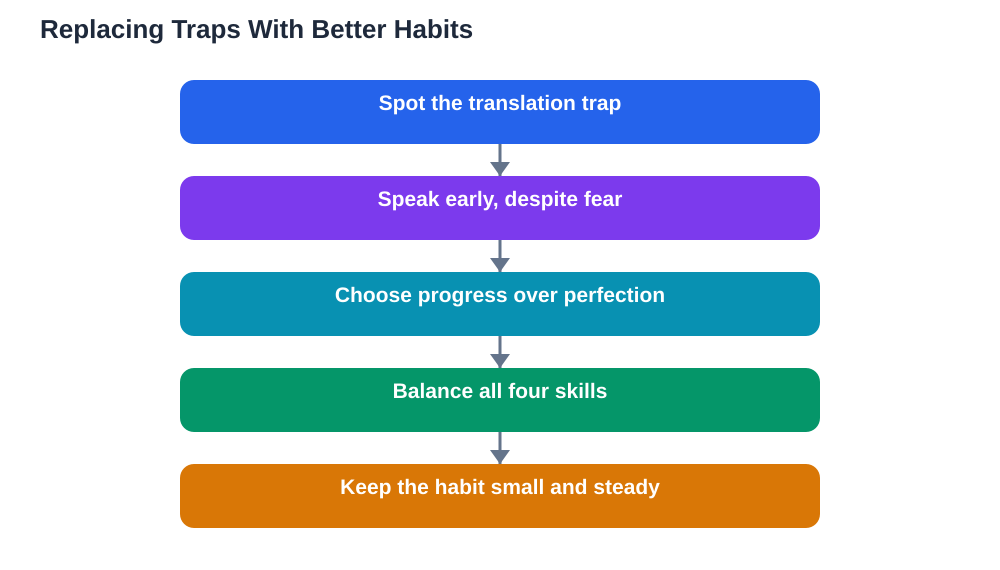

Common language learning mistakes are rarely a sign of low ability. They are usually sensible-sounding habits that quietly slow progress: translating everything word for word, waiting until you feel ready to speak, or studying grammar before ever having a conversation. Most learners make several of these mistakes, and most teachers recognise them instantly, because they appear again and again. The good news is that every one of these mistakes has a simple replacement habit. Once you can spot the traps, you can step around them, and your learning will feel easier, faster, and far more enjoyable.

## Common Language Learning Mistakes: The Translation Trap

The translation trap is the habit of converting every sentence from your first language into the new language, word by word, before speaking or writing. It feels careful, but it creates slow, unnatural sentences, because languages do not match word for word. Word order differs, phrases work differently, and some ideas need completely different constructions. The replacement habit is to learn phrases as whole units and to think in short, direct sentences in the new language whenever you can. When you catch yourself translating, pause and search for a phrase you already know that carries the same meaning, even if it is simpler. Simple and natural always beats complex and translated. Over time, the direct path strengthens, translation fades into a backup, and your sentences start to sound like the language itself rather than a converted copy.

## Fear of Speaking: The Mistake That Costs the Most

Fear of speaking is the most expensive mistake in language learning, because it removes exactly the practice that builds fluency. Learners who wait until they feel ready often wait for months or years, while their reading and listening improve but their speaking stays frozen. The truth is that readiness comes from speaking, not before it. Start with tiny, safe speaking steps: say greetings aloud, read passages aloud, describe your day to yourself, and then have short conversations with a patient partner. Mistakes during these steps are not failures, they are the feedback that teaches you. You can read more about starting early in [Speaking From Day One: Be Brave in a New Language](/blog/speaking-from-day-one-language.html). Every speaker you admire was once a beginner who spoke badly and kept going anyway.

## Chasing Perfection Instead of Progress

Perfectionism disguises itself as high standards, but in language learning it usually means endless reviewing, fear of errors, and very little real use of the language. Learners caught in this trap reread the same lesson, rewrite the same notes, and delay speaking until every detail feels mastered, which never happens. The replacement habit is to aim for good enough and moving forward: learn a pattern, use it a few times, accept some errors, and move on, returning later for refinement. Progress in a language looks like a rising line with wobbles, not a flat line of perfection. Celebrate what you can now do that you could not do last month, because that comparison is the honest measure of growth, while perfection is a finish line that keeps moving away.

## Studying Only One Skill and Ignoring the Rest

Another common mistake is studying only the skill you enjoy, or only the skill a course emphasises, while ignoring the rest. A learner who only reads may read well but freeze in conversation. A learner who only uses an app may collect vocabulary but never understand spoken language. Language skills support each other: listening improves pronunciation, speaking improves recall, reading builds vocabulary, and writing clarifies grammar. A balanced week does not need to be complicated: include a little listening, a little speaking aloud, some reading, and some writing, even if the amounts are small. Balance prevents the frustrating situation of being strong in one skill and helpless in another, and it keeps learning varied enough to stay interesting.

## Inconsistent Study and the All-or-Nothing Cycle

The all-or-nothing cycle is a quiet destroyer of language progress. It goes like this: study intensely for a few days, miss a day, feel guilty, and then abandon the habit entirely until motivation returns. The replacement is a habit small enough to survive bad days, such as a short daily session with a few words and a little speaking or listening. Missing a day is not a disaster, it is a normal part of any long habit, and the only thing that matters is returning the next day. Keep your daily target modest, track your streak of returned days rather than perfect days, and forgive the gaps quickly. Languages are learned over months and years, so the habit that survives is worth far more than the burst that burns out. A steady routine such as the one in [Ten Words a Day: A Language Habit That Sticks](/blog/ten-words-a-day-language.html) is a good model for sustainable progress. If you use the Lesson Solver tool for textbook exercises, remember to verify its solutions against your textbook, keep in mind that AI can make mistakes, and note that the tool needs your own free Google AI Studio API key.

## AI Help: Muse AI

Muse AI is Meta's personal AI assistant, and it can help you avoid these common traps. You can ask it to explain a phrase naturally instead of word by word, or to suggest a small, balanced weekly plan that mixes listening, speaking, reading, and writing. Join Muse with invite code LTGSWD — in the Muse app, go to Settings > Redeem token and enter the code.
Disclosure: LTGSWD is the author's Muse invite code.

## FAQ

### What is the single biggest mistake beginners make?

Waiting too long to speak is usually the costliest mistake, because it delays the very practice that builds fluency. Reading and listening matter, but they cannot replace the skill of turning thoughts into spoken words. Start speaking in small, safe steps from the beginning, and let accuracy grow through real use and gentle corrections.

### Is translating in my head always bad?

No, translation is a useful bridge, especially for understanding new words and complex ideas. It becomes a problem only when it is your only path, slowing every sentence and producing unnatural phrasing. Use translation as a temporary aid, and practise direct thinking with simple sentences alongside it, so the direct path grows stronger over time.

### How do I know if my study routine is balanced?

A balanced routine includes a little of each skill across the week: listening, speaking aloud, reading, and writing, even in small amounts. If you notice one skill far behind the others, such as understanding speech while reading well, shift a little time toward the weaker skill. Balance does not require equal time every day, just regular attention to every skill over the week.

### Should I fix every mistake I make?

No, fixing every mistake interrupts conversation, damages confidence, and slows learning. Focus on mistakes that block meaning or repeat often, and let small slips pass during fluent speaking. You can review patterns later in study time, but during conversation, keeping going matters more than perfect accuracy.

## Conclusion

The most common language learning mistakes share one root: they replace real, imperfect use of the language with something safer but less effective. Translate less and learn phrases whole, speak early despite fear, choose progress over perfection, balance your skills, and keep your habit small enough to survive bad days. Avoid these traps, and your learning will feel lighter, steadier, and far more rewarding.

[Try the free AI lesson solver](/#tool)
