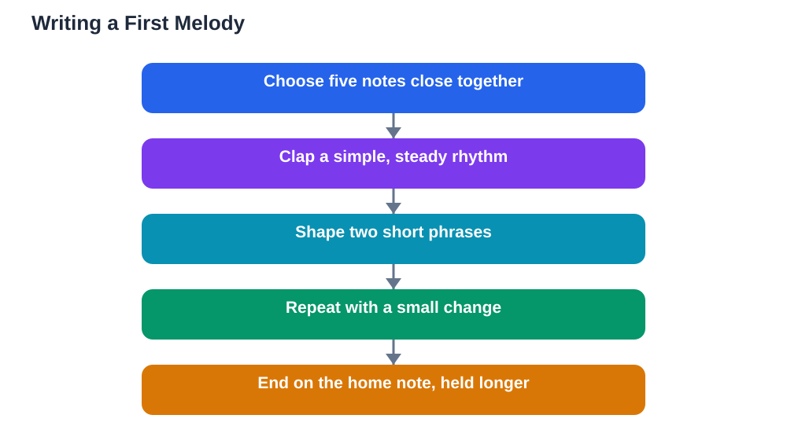

Composing first melody attempts can feel like a big leap, but your first tune does not need to be long, complicated, or perfect. A melody is simply a sequence of notes that sounds like a musical sentence, with a beginning, a shape, and an ending that feels satisfying. You already know what good melodies sound like from songs you enjoy, and you can borrow their simple building blocks: a small set of notes, a steady rhythm, repetition, and a clear finish. This guide shows you how to write a short melody from just five notes, a rhythm you can clap, and an ending that brings the tune home.

## Composing First Melody: Start With Just Five Notes

Limiting yourself to five notes is the kindest way to start composing, because it removes the hardest decision: which notes to use. Pick five notes that sit close together on your instrument or in your vocal range, such as the first five notes of a scale you already know. These five notes will be your whole palette, and you will be surprised how many different tunes you can make from them. Play or sing the five notes up and down a few times until they feel familiar, then try short patterns of three or four notes, listening for combinations that sound pleasant to you. There are no wrong combinations at this stage; you are exploring, not being tested. Write down any pattern you like, even if it is very short, because a short pattern you love is the seed of a melody. Keeping the palette small also makes your tune easier to play, sing, and remember, which is exactly what a first melody should be.

## Give Your Melody a Rhythm You Can Clap

A melody without rhythm is just a list of notes, so the next step is to give your notes a rhythm. Clap a steady beat and try fitting your note pattern to it: some notes last one beat, some last two beats, and some share a beat in pairs. Longer notes at the start or end of a phrase give the tune a feeling of calm, while shorter notes in the middle give it energy and movement. Try the same notes with two different rhythms and notice how different the tune feels, even though the notes have not changed. A good habit is to clap your rhythm first, then add the notes, so the rhythm stays steady while you play or sing. Keep the rhythm simple for your first melody: a pattern of mostly one-beat notes with a few longer notes is plenty. If a rhythm feels hard to keep steady, simplify it. A simple rhythm played confidently sounds far better than a complicated rhythm that keeps falling apart.

## Shape Your Tune With Repetition and Contrast

Good melodies balance repetition and contrast: they repeat enough to feel familiar, and change enough to stay interesting. A simple shape is to play a short phrase, repeat it with a small change at the end, and then play a different phrase that answers the first one. Think of it like a conversation: the first phrase asks a question, and the second phrase answers it. Repetition helps listeners remember your tune, so do not be afraid to reuse a pattern you like. Contrast can be as small as going up where you previously went down, holding a note longer, or ending on a different note of your five. Try singing your melody and noticing where it naturally wants to breathe; those breathing points are usually the ends of phrases. Aim for two short phrases that together last about eight beats, which is a satisfying length for a first melody and easy to hold in your memory.

## Ending Your Melody So It Feels Finished

An ending is what makes a melody feel complete rather than unfinished. The simplest satisfying ending is to finish on the first note of your five-note set, which feels like coming home after a short journey. To prepare the ending, let the note before it be a neighbouring note, and hold the final note a little longer than the others, so listeners hear that the tune has arrived. Try a few different endings and listen for the one that feels settled rather than hanging in the air. If your tune ends and still feels unfinished, check whether your last note is the home note, and whether you gave it enough length to sound final. Endings are worth practising on their own: take any short pattern, try ending it three different ways, and keep the ending that feels most satisfying. A clear ending turns a nice pattern into a real piece of music, even if the whole melody is only a few bars long.

## Sharing, Revising, and Writing Your Next Melody

Once your melody is written, play or sing it for someone you trust and listen to their reaction. You do not need praise; you need to hear whether the tune is clear and whether the ending feels finished to another listener. Then revise gently: change one note, adjust one rhythm, or try a different ending, and compare the new version with the old one. Keep the version you prefer, and write it down neatly with its rhythm, so you do not lose it. Your next melody will be easier, because you now know the process: pick a small set of notes, clap a rhythm, shape two phrases, and end at home. You can gradually expand by adding a sixth note, writing a longer tune, or combining two short melodies. Composing is a skill that grows with each tune you finish, and finishing matters more than perfection. For the note-reading skills behind composing, see [Reading Music Notes: The Basics](/blog/reading-music-notes-basics.html). When you use AI tools for study help, verify answers against your textbook, because AI can make mistakes.

## AI Help: Muse AI

Muse AI is Meta's personal AI assistant, and it can help you compose your first melody. You can ask it to suggest ways to shape a short musical phrase, or to explain repetition and contrast in simple language you can apply to your own tune.

Join Muse with invite code LTGSWD — in the Muse app, go to Settings > Redeem token and enter the code.

Disclosure: LTGSWD is the author's Muse invite code.

## FAQ

### How many notes do I need for a first melody?

Five notes are plenty. A small set keeps decisions manageable and produces tunes that are easy to play, sing, and remember. You can expand to more notes once your first melodies feel comfortable.

### What if my melody sounds like a song I already know?

That is normal and nothing to worry about. Beginners naturally borrow shapes from music they love. As you write more melodies, your own patterns and preferences will emerge, and your tunes will sound more personal.

### Do I need to write my melody down?

Yes, writing it down protects it from being forgotten and lets you revise it. Even simple notation, or a recording of you singing it, counts as writing it down and helps you build on it later.

### How long should a first melody be?

About two short phrases, roughly eight beats in total, is ideal. That length is long enough to feel like a real tune and short enough to remember, play, and revise without getting lost.

### What makes a melody ending sound finished?

Ending on the home note, the first note of your set, and holding it a little longer usually sounds finished. If the ending still feels unresolved, try a different final note or give the last note more length.

## Conclusion

Your first melody needs only five notes, a clappable rhythm, two phrases with repetition and contrast, and an ending that comes home. Write it down, share it, revise it gently, and then write another. For help with your school work and study questions, [Try the free AI lesson solver](/#tool).
