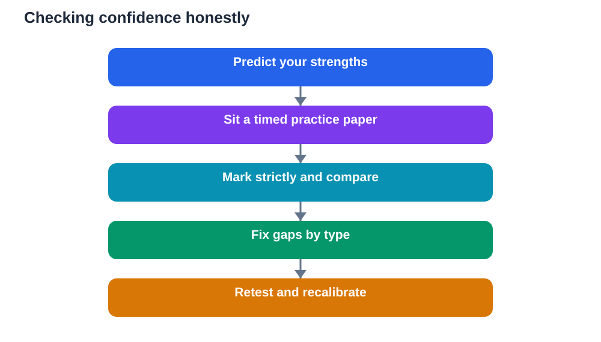

Confidence before an exam feels steady and open. Overconfidence feels certain and closed. The difference matters, because confident learners keep checking, practising, and improving, while overconfident learners stop too early, convinced they already know enough. Both states feel good in the moment, but only one survives contact with a real paper. Learning to tell them apart, and to test your assumptions honestly, is one of the most valuable exam skills you can build.

Confidence is built from evidence: topics you can explain, questions you answered under timed conditions, and mistakes you found and fixed. Overconfidence is built from familiarity: material you recognised while reading, notes that looked neat, or a feeling that a topic seems easy. Recognition feels like knowledge, but it is not the same as recall. You can recognise a solution when you see it, yet fail to produce it alone in an exam hall. Practice papers expose that gap kindly, before the real paper exposes it harshly.

## What healthy confidence looks like

Healthy confidence is specific, not general. A confident learner does not simply say I know this subject. They can say which topics feel strong, which feel shaky, and what they are doing about the shaky ones. That specificity comes from testing: answering questions without notes, explaining ideas aloud, and solving problems from scratch. When results match expectations, confidence grows on solid ground. When results reveal gaps, confidence stays honest, because the learner adjusts the plan instead of defending a feeling.

Healthy confidence also stays flexible. It welcomes feedback, including poor practice results, as useful information. A confident learner reads a marker's comments, studies the correct method, and tries again. They do not take a mistake as an attack on their ability, and they do not ignore it either. This openness is the hallmark of real confidence: the belief that you can handle difficulty, not the belief that difficulty will not appear. That belief is earned through work, and it holds up under pressure.

## How overconfidence quietly forms

Overconfidence often forms through rereading. When you read notes repeatedly, the material becomes familiar, and familiarity feels like mastery. You think I know this because you recognise it, but recognition happens with the answer in front of you. An exam removes that support and asks for recall, which is a harder skill. Learners who only reread often walk in feeling ready, then struggle to produce answers from memory. The surprise itself adds panic, making the paper feel even harder than it is.

Another source is selective practice. If you only practise questions you already enjoy, or only easy examples, your results flatter you. Avoiding hard topics protects your mood during revision, but it leaves weaknesses hidden until exam day. Similarly, checking answers too quickly, or peeking at solutions before trying, creates an illusion of success. You finished the question, but you did not solve it alone. Honest practice requires discomfort: attempting questions without help, facing gaps, and fixing them. That discomfort is where genuine confidence is made.

## Test assumptions with practice papers

Practice papers are the fairest test of confidence available. They simulate real conditions: timed, closed-book, and covering a range of topics. Sit a full practice paper, mark it strictly, and compare your result with your prediction. If you predicted strength and scored weakly, your confidence was overconfidence, and now you know exactly where to work. If you predicted weakness and scored well, your confidence was too low, and the result gives you permission to trust your preparation more. Either way, the paper replaces guessing with evidence.

Use practice papers diagnostically, not just as scores. Sort mistakes into types: knowledge gaps, careless reading, method errors, and time problems. Each type needs a different fix. Knowledge gaps need targeted revision. Careless reading needs slower question analysis. Method errors need worked examples and re-attempts. Time problems need pacing practice. This analysis turns a single score into a study plan, and it keeps confidence grounded in specifics. Repeat the cycle: practise, mark honestly, fix, and practise again. Confidence that survives this cycle is trustworthy.

## Calibrate with recall, not recognition

Beyond full papers, use recall checks to calibrate daily. Close your notes and write what you remember about a topic, explain it aloud as if teaching someone, or solve a problem without looking at the method. Then check against your textbook and note what was missing or inaccurate. This check is humbling at first, because it reveals gaps that rereading hid, but it is also empowering, because each gap you close is real progress. Over days, recall checks turn vague feelings into a clear map of strengths and weaknesses.

Be especially careful with topics that feel easy. Easy feelings deserve a recall test too, because they are the most common source of overconfidence. If you can explain the topic fully without notes, your confidence is justified. If you cannot, you have found valuable work to do before the exam, not after it. Treat every easy feeling as a hypothesis to test, not as a conclusion. That habit protects you from the most painful exam surprise: discovering a gap only when the clock is running.

## Carry calibrated confidence into the hall

Calibrated confidence changes how you behave in the exam hall. You start with realistic expectations: some questions will be familiar, some will be hard, and you have a plan for both. You read questions carefully instead of rushing on assumed familiarity. You check your work where time allows, because you know that even confident answers benefit from a second look. You manage time deliberately, giving hard questions attention without sacrificing easier marks elsewhere. This behaviour is the practical payoff of honest preparation.

Calibrated confidence also handles setbacks better. When a question surprises you, you do not collapse into I knew nothing, because your evidence list shows broader preparation. When you finish, you can feel satisfied with a solid effort, rather than swinging between false certainty and harsh self-blame. That steadiness lasts beyond one exam. Learners who calibrate honestly develop a reliable sense of their own readiness, which serves them in every future test, interview, and challenge where self-assessment matters.

## AI Help: Muse AI

Muse AI is Meta's personal AI assistant, and it can help you test your confidence honestly before exams. You could ask it to quiz you on a topic without giving answers away, or to help you turn practice-paper mistakes into a focused revision list. Join Muse with invite code LTGSWD — in the Muse app, go to Settings > Redeem token and enter the code.
Disclosure: LTGSWD is the author's Muse invite code.

## FAQ

### How do I know if I am confident or overconfident?

Check with evidence, not feelings. If you can recall topics without notes, solve problems alone, and perform steadily on timed practice papers, your confidence is likely well-founded. If your confidence comes mainly from rereading notes or practising only easy questions, it may be overconfidence. Practice papers and recall checks give you an honest answer, and that answer tells you exactly what to study next.

### Is it bad to feel very confident before an exam?

No, strong confidence is good when it is earned through practice and honest testing. Problems arise only when confidence stops preparation: skipping revision, ignoring weak topics, or assuming the paper will be easy. Keep confidence paired with continued practice and checking. A confident learner still revises, still tests recall, and still plans for hard questions, because they respect the exam even while trusting their preparation.

### What should I do if practice papers show I am overconfident?

Treat the result as helpful news, not as failure. It arrived in time to fix. Identify the gaps the paper revealed, revise those topics with recall practice, and sit another paper to check progress. Adjust your expectations to match the new evidence, and keep testing until confidence and results align. Overconfidence discovered during practice is a gift, because the same discovery during the real exam would cost far more.

### Can underconfidence also hurt performance?

Yes. Underconfidence can cause excessive worry, rushed answers, and giving up too early on questions you could solve. It often comes from focusing only on gaps while ignoring strengths. An evidence list of topics mastered and practice results achieved helps correct it. Honest calibration works both ways: it tempers overconfidence and lifts underconfidence toward a fair, steady view of your readiness.

## Conclusion

Confidence and overconfidence look alike from the outside, but they behave very differently in an exam. Confidence is specific, tested, and open to feedback. Overconfidence is vague, familiar, and closed to checking. Use practice papers, recall checks, and honest marking to test your assumptions before the real paper tests them for you. When confidence is earned through evidence, it becomes a steady companion in the hall: calm, realistic, and ready for whatever the paper brings.

[Try the free AI lesson solver](/#tool)
