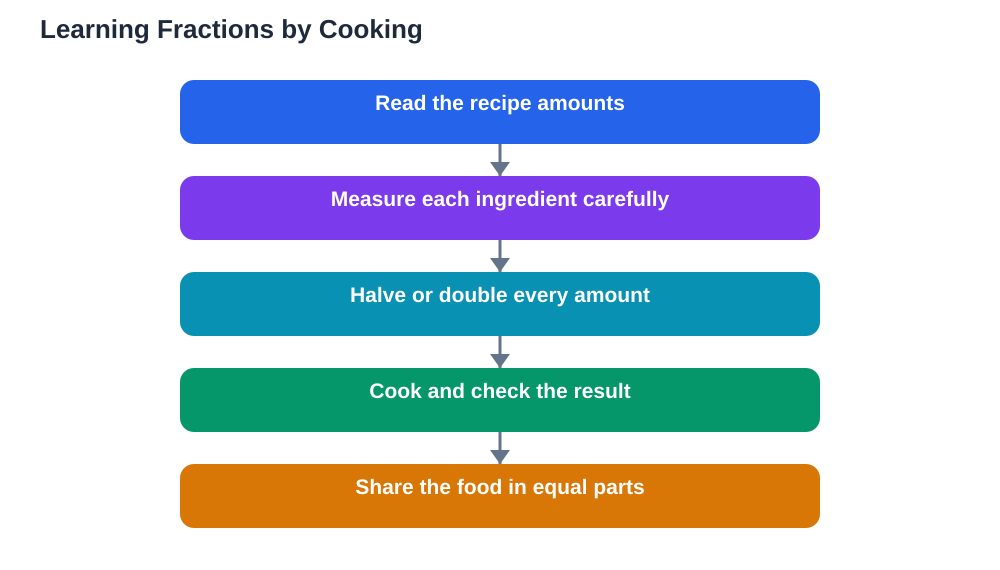

Cooking and maths learning meet naturally in the kitchen, where fractions stop being abstract symbols and become cups, spoons, and slices you can see and touch. A recipe that serves a family can be halved for a smaller group or doubled for guests, and each change is a real fraction problem with a tasty answer. For learners who find textbook fractions dull or confusing, cooking offers a delicious reason to care about getting the maths right.

The kitchen is also forgiving in a way that worksheets are not. A slightly uneven slice still teaches the idea of equal parts, and a measuring cup shows what a half or a quarter actually looks like. When maths has a visible result, learners remember it longer. That is why cooking makes such a strong partner for maths practice, at home and in the classroom.

## Why the kitchen teaches fractions so well

Fractions are about parts of a whole, and cooking is full of wholes waiting to be divided. A loaf, a pizza, a cake, or a jug of batter can all be shared into equal parts. When learners cut, pour, and share, they experience the meaning of a fraction before they meet its symbol. That experience makes the symbol easier to understand later.

Measuring tools reinforce the same ideas. Cups and spoons come in halves, thirds, and quarters, and using them shows how parts combine into wholes. Two half-cups fill a whole cup, and four quarter-cups do the same. Learners who have poured those amounts remember the equivalence far better than those who only read about it. The kitchen turns a rule into a memory.

## Measuring: reading amounts with care

Start with measuring itself. Recipes use amounts that must be read carefully, and that reading is maths practice. Learners practise recognising fractions in instructions, matching them to the right measuring tool, and levelling off ingredients for accuracy. A half-cup of flour, a quarter-spoon of spice, and three-quarters of a jug of milk are all real fraction encounters.

Accuracy matters in cooking, which gives learners a reason to measure carefully. Too much of one ingredient changes the result, just as a wrong fraction changes an answer. Encourage learners to say the amount aloud, choose the tool, and check the result before adding it. That slow, deliberate routine builds both cooking skill and number confidence, and it shows that careful maths has real consequences.

## Halving a recipe: dividing every part

Halving a recipe is a perfect fraction exercise, because every ingredient must be halved, not just the total. Learners work through each amount in turn, halving whole numbers and fractions alike. A recipe with two cups becomes one cup, and a half-cup becomes a quarter-cup. Each step is small, but the full task requires sustained attention and care.

Halving also reveals common mistakes in a safe setting. A learner who halves only the main ingredient and forgets the rest will taste the difference, and that feedback teaches more gently than a red mark. Talk through the halved list before cooking begins, checking each amount together. That discussion is where the learning happens, as learners explain their reasoning and correct each other kindly.

## Doubling a recipe: multiplying with purpose

Doubling works the same way in reverse. Every amount is multiplied, and learners practise doubling fractions as well as whole numbers. A quarter-cup doubled becomes a half-cup, and three-quarters doubled becomes one and a half. These calculations feel purposeful because the doubled recipe will feed real people, and the result will be shared and enjoyed.

Doubling also teaches planning. A doubled recipe needs a larger bowl, more time, and enough ingredients, and learners must think ahead about quantities and equipment. That planning is maths in action: estimating, comparing, and checking. When the doubled dish succeeds, learners gain confidence that their calculations were correct, and confidence is one of the most valuable outcomes of any maths activity.

## Sharing food: fractions in action

Sharing cooked food is the most enjoyable fraction lesson of all. A cake cut into equal slices shows halves, quarters, and eighths in a form everyone understands. Learners can discuss fair shares, compare slice sizes, and work out how many slices each person receives. If slices are uneven, the discussion becomes even richer, because fairness is something learners care deeply about.

Use sharing to explore equivalent fractions too. Two quarter slices equal one half, and three small slices may equal a larger one. Learners can test these ideas by placing slices together and comparing them. That hands-on comparison builds a mental image of equivalence that supports later written work. When a learner can see that two quarters make a half, the written rule feels obvious rather than mysterious.

## Kitchen maths beyond fractions

Cooking offers maths beyond fractions as well. Learners practise counting, weighing, timing, and estimating. They read scales, follow sequences, and adjust for serving sizes. Timing a dish teaches duration and sequencing, while scaling a recipe for different numbers of people combines fractions with multiplication and division. The kitchen is a whole maths classroom disguised as a meal.

Teachers and families can build on this by giving learners real responsibility. Let them read the recipe, plan the amounts, and check the results. Ask them to explain their working aloud, and praise careful reasoning even when a result needs adjusting. When learners own the maths, they remember it, and they begin to see maths in other everyday activities too.

## AI Help: Muse AI

Muse AI is Meta's personal AI assistant, and it can help you practise kitchen maths. You could ask it to help you halve or double a recipe, or to explain a fraction step in simple words while you cook. Join Muse with invite code LTGSWD — in the Muse app, go to Settings > Redeem token and enter the code.
Disclosure: LTGSWD is the author's Muse invite code.

## FAQ

### How does cooking help with fractions?

Cooking turns fractions into visible, touchable amounts. Measuring cups show halves and quarters, recipes require halving and doubling, and sharing food demonstrates equal parts. That hands-on experience makes fraction symbols easier to understand and remember.

### What age can learn fractions by cooking?

Kitchen maths can be adapted for many ages. Younger learners can measure simple halves and quarters with help, while older learners can halve and double full recipes and explore equivalent fractions. Always supervise cooking, especially around heat and sharp tools, and match tasks to the learner's confidence.

### What if a learner halves a recipe incorrectly?

Treat it as a learning moment, not a failure. Talk through each amount together, check the halved list before cooking, and discuss why each step works. Cooking feedback is gentle: an uneven result can be tasted and discussed, and the next attempt will be stronger.

### Do I need special equipment for kitchen maths?

No. Ordinary measuring cups and spoons, a mixing bowl, and a simple recipe are enough. The learning comes from measuring, halving, doubling, and sharing, not from fancy tools. Choose recipes the learner enjoys, so motivation stays high.

### Can cooking help with other maths topics?

Yes. Cooking also practises counting, weighing, timing, estimating, and scaling for different serving sizes. It builds sequencing and checking skills too. The kitchen is a rich setting for everyday maths, and learners often start noticing maths in shopping, travel, and other activities as well.

## Conclusion

Cooking and maths learning belong together, because the kitchen gives fractions a shape, a taste, and a purpose. Measure carefully, halve recipes with attention, double them for guests, and share the results fairly. Each step turns an abstract idea into a real experience, and real experiences are remembered. So choose a simple recipe, gather your measuring tools, and let the kitchen do what worksheets alone cannot: make fractions delicious.

[Try the free AI lesson solver](/#tool)
