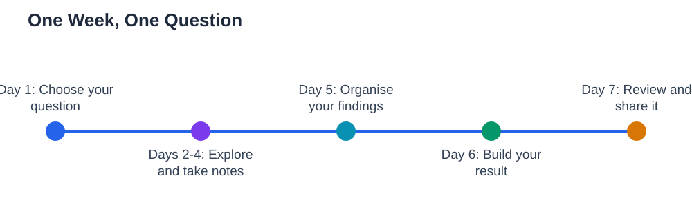

Most school learning starts with someone else's question: a chapter heading, an assignment, a syllabus topic. A curiosity project flips that around. It starts with a question of your own, something you genuinely want to know, and it gives you a week to chase the answer properly. Curiosity projects build skills that assigned work rarely teaches: choosing a question, finding reliable information, organising what you find, and presenting a result. They also remind you that learning can be enjoyable, because the motivation comes from inside. This guide shows how to run a curiosity project from question to finished result in one week.

## Curiosity Projects Students Enjoy: One Question, One Week

A good curiosity project starts with one question, not ten. A question like "How do bridges stay up?" is better than "Learn about engineering," because it gives your week a clear target. The best questions are specific enough to answer in a week, open enough to need real exploring, and interesting enough that you care about the answer. Spend a little time choosing: write down three questions you genuinely wonder about, then pick the one that excites you most and can be explored with resources you have. A week is a good length. Shorter projects feel rushed, while longer ones lose momentum. Set a finish day at the start, and decide what your result will be: a short written explanation, a poster, a model, a presentation, or a small experiment with notes. Knowing the result in advance keeps the project focused, because every piece of exploring should feed into something you can show at the end.

## Explore Properly: Sources, Notes and Experiments

Exploring means more than reading one article and copying it. Use at least two or three sources, and compare what they say. Your textbook, a library book, and a trusted video or article together give a fuller picture than any one of them alone, and disagreements between sources are often the most interesting findings. Take notes in your own words as you explore, and write down where each fact came from, so you can check it later and give credit fairly. If your question allows a small experiment, observation, or survey, do one: hands-on exploring teaches things reading cannot, and it often raises better follow-up questions. Draw diagrams, make tables, or sketch what you are learning, because organising information visually reveals gaps and connections. A curiosity project is also good practice in judging sources: ask who made each source, whether it explains its reasoning, and whether it matches your other sources. If a claim appears in only one place and sounds dramatic, treat it with caution until you can verify it elsewhere.

## Keep the Project Moving All Week

A week-long project needs a light daily rhythm, or it collapses into a last-minute rush. A simple plan works well: day one, choose and refine your question; days two to four, explore and take notes; day five, organise your findings; day six, build your result; day seven, review and present it. Short daily sessions beat one long weekend session, because your mind keeps working on the question between sessions, and new ideas often arrive during breaks. At the end of each day, write one sentence about what you found and one question for tomorrow. That tiny habit keeps the project alive and gives you a thread to pick up the next day. If you get stuck, narrow the question rather than abandoning it: a smaller question answered well is a better project than a big question answered vaguely. And if your exploring leads you to a better question than the one you started with, that is not a failure; it is discovery, and adjusting your question mid-project is part of real inquiry.

## Turn Findings Into a Result You Can Show

A project without a result feels unfinished, so building the result deserves real time, not the last evening. Organise your findings before you build: what is the main answer to your question, what evidence supports it, what surprised you, and what is still unclear? A good result answers the question clearly, shows the evidence, and is honest about uncertainty. If you write, keep it short and clear, with your own words throughout and sources noted. If you present, practise explaining the answer aloud first, because explaining reveals gaps that reading hides. If you build or experiment, include notes on what you did and what happened, including anything that did not work, since honest results are more useful than perfect-looking ones. Share your result with someone: a classmate, a teacher, or your family. Explaining your project to another person is the final step of learning from it, and their questions often show you what to explore next.

## What Curiosity Projects Teach Beyond the Topic

The topic of a curiosity project matters less than the skills it builds. Choosing a question teaches independence. Comparing sources teaches judgement. Organising findings teaches clarity. Presenting a result teaches communication. These skills transfer to every subject and to work beyond school, where nobody hands you a syllabus. Curiosity projects also teach persistence: a question that resists easy answering trains you to keep exploring, try different sources, and refine your thinking. That persistence is what separates students who give up at the first difficulty from students who learn deeply. Even a project that ends with "I still don't fully know" is valuable if you can explain what you found, what you tried, and what you would explore next. For help structuring the daily habit behind a project week, see [Building a Daily Study Habit](/blog/building-a-daily-study-habit.html). Run one curiosity project, and you will likely want to run another, because learning driven by your own questions feels very different from learning driven by someone else's.

## AI Help: Muse AI

Muse AI is Meta's personal AI assistant, and it can help a curiosity project by suggesting ways to explore your question or explaining a tricky idea you meet along the way. You can ask it to help you organise your findings into a clear outline, or to suggest follow-up questions for your next day of exploring. Join Muse with invite code LTGSWD — in the Muse app, go to Settings > Redeem token and enter the code.
Disclosure: LTGSWD is the author's Muse invite code.

## FAQ

### How do I pick a good question for a curiosity project?

Pick a question you genuinely want answered, specific enough to explore in a week, and open enough to need more than one source. Write down three candidate questions and choose the one that excites you most and can be explored with resources you already have. If a question turns out too big, narrow it rather than abandoning it.

### How long should a curiosity project take?

One week works well for most students: long enough for real exploring, short enough to keep momentum. Plan short daily sessions across the week rather than one long session at the end, and set a finish day and a result type at the start so the project stays focused.

### What if I cannot find an answer to my question?

That is a normal and valuable outcome. Explain what you found, what you tried, and what remains unclear, and note what you would explore next. Real inquiry often ends with better questions rather than complete answers, and an honest partial answer is a stronger result than a copied complete one.

### Do I need special equipment or resources for a curiosity project?

Usually not. A textbook, a library book, and a few trusted online sources are enough for most questions, and many projects benefit from simple observations or small experiments you can do at home. The key resources are your question, your notes, and your daily time, not expensive equipment.

## Conclusion

A curiosity project is simple in structure and rich in learning: one question, one week, one result. Choose a question you care about, explore it with several sources and your own notes, keep a steady daily rhythm, and finish with a result you can show and explain. Along the way you build independence, judgement, clarity, and persistence, skills that serve every subject. Start with a question that has been sitting in the back of your mind, and give it a week. You may be surprised by how much you learn, and by how much you enjoy learning it.

[Try the free AI lesson solver](/#tool)
