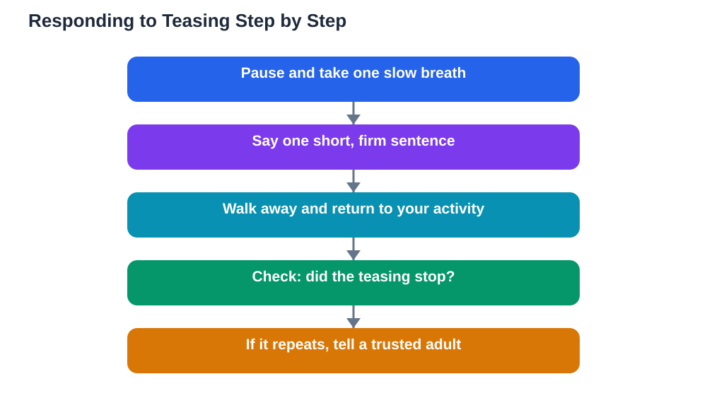

Dealing with teasing is a skill every student may need at some point, and it is not about winning an argument or having the perfect comeback. Teasing often aims to get a big reaction, so the most powerful response is usually a calm one. When you stay steady, speak briefly, and then move on, you take away the reaction the teaser was hoping for. That does not mean teasing is your fault, or that you should simply accept unkind behaviour. It means you have practical tools for the moment itself, and clear steps for getting help when teasing keeps happening.

## Dealing With Teasing Students: Stay Calm in the Moment

Calm is your first tool, and it starts with your body. When teasing catches you off guard, take one slow breath before you speak, stand comfortably, and look steady rather than upset. You do not need to hide your feelings, but you do not need to show them at full strength either. A calm pause gives you time to choose your words instead of reacting in anger or tears. Practise this pause at home, so it feels more natural when you need it. Calm does not mean weak. In fact, a student who stays calm while others are trying to provoke them looks strong, and that strength often makes teasers lose interest quickly.

## Use Short, Firm Words

Short, firm words work better than long explanations or clever insults. Phrases such as "That is not funny, please stop," "I do not like that," or "Leave me alone" are clear and hard to argue with. Say them once, in a steady voice, and then walk away or return to what you were doing. Repeating the same line or getting drawn into a back-and-forth usually gives the teaser more of what they want. Avoid returning insults, because that turns a short moment into a longer conflict and can make the situation worse for everyone. Firm does not mean rude. It means clear about what you will and will not accept, without adding fuel to the fire.

## Know When Ignoring Helps and When It Does Not

Ignoring mild, one-off teasing can work well, because some teasers stop when they get no reaction. Ignoring means calmly turning your attention elsewhere, not pretending you feel fine when you do not. However, ignoring is not the right tool for repeated teasing, threats, or teasing that targets something personal and keeps coming back. In those cases, ignoring can feel like permission, and the behaviour may grow. The key question is simple: did it stop? If a calm response or ignoring ends the teasing, your approach worked. If it continues, you need the next tool, which is telling a trusted adult. You can also read about sorting out peer problems in [Friendship Conflicts and How to Solve Them](/blog/friendship-conflicts-solutions.html).

## Name It Clearly and Get Help

When teasing repeats, name it plainly to an adult you trust: who did it, what was said or done, when it happened, and how often. Clear details help adults act fairly and quickly, so try to remember the facts rather than only the feelings. Telling an adult is not tattling. Tattling is about getting someone in trouble over something small, while telling is about getting help when something keeps hurting you or someone else. If the first adult does not act, tell another one, and keep telling until someone helps. You can also stay near friends and trusted adults during breaks, since teasing is less likely when you are not alone. Getting help is a sign of good judgement, not weakness.

## Look After Yourself Afterwards

Teasing can leave a sting even after you handled it well, so looking after yourself matters. Talk to a friend, a family member, or a trusted adult about how you feel, and do something you enjoy to restore your mood. Remind yourself that teasing says far more about the teaser than about you. It helps to keep a small record of repeated incidents, with dates and brief notes, so that if you need help later you have clear facts to share. Over time, most students find that calm responses, firm words, and trusted support make teasing rarer and easier to handle. You deserve to feel safe and respected at school, and asking for support is how you protect that.

## AI Help: Muse AI

Muse AI is Meta's personal AI assistant, and it can help you prepare calm responses to teasing. You can ask it to suggest short, firm phrases to practise, or to help you draft a clear account of what happened to share with a trusted adult. Join Muse with invite code LTGSWD — in the Muse app, go to Settings > Redeem token and enter the code.
Disclosure: LTGSWD is the author's Muse invite code.

## FAQ

### What is the best thing to say when someone teases me?

A short, firm sentence works best, such as "That is not funny, please stop." Say it once in a steady voice, then walk away or return to your activity. Long arguments and returned insults usually make the situation last longer and feel worse.

### Should I just ignore all teasing?

Ignoring can help with mild, one-off teasing that stops when it gets no reaction. It does not work well for repeated teasing, threats, or personal attacks. If teasing keeps happening, tell a trusted adult with clear details, and keep telling until someone helps.

### Is telling an adult the same as tattling?

No, telling is about getting help when something keeps hurting you or someone else, while tattling is about getting someone in trouble over something small. Adults need clear facts to act fairly, so telling them who, what, when, and how often is responsible and brave.

### What if teasing happens online instead of in person?

The same principles apply: stay calm, do not reply in anger, keep a record of what was said, and tell a trusted adult. Avoid deleting evidence before an adult has seen it, and use blocking and reporting tools where they are available. Online teasing deserves the same serious response as teasing in person.

## Conclusion

Dealing with teasing comes down to a few steady habits: stay calm, use short firm words, ignore only what truly stops, and get help when it repeats. You do not have to handle repeated teasing alone, and asking for support is a strength. Practise your responses, keep trusted adults informed, and remember that you deserve respect every day at school.

[Try the free AI lesson solver](/#tool)
