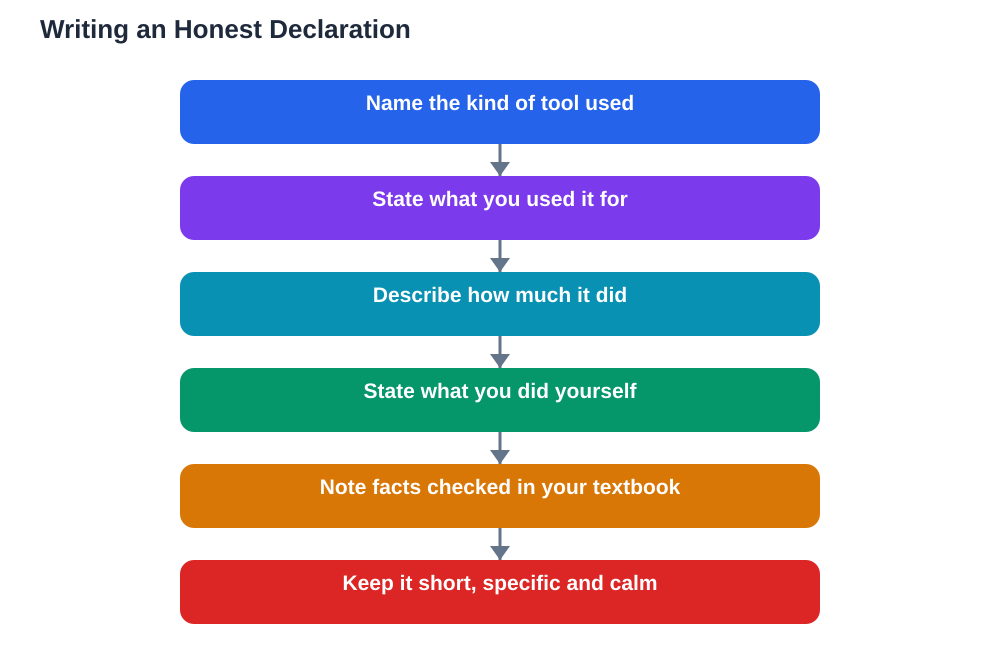

As AI tools become a normal part of studying, declaring ai help schoolwork honestly has become a basic academic skill, as ordinary as citing a book. A declaration is simply a short, truthful note saying how AI helped you, and it protects you in two ways: it keeps your work honest, and it keeps your learning real. Students sometimes worry that declaring help will count against them, but the opposite is usually true. Teachers respect a clear declaration far more than they trust a suspiciously polished piece of work with no explanation, and honesty builds the trust that makes future help possible.

## Why Honest Declaration Protects Learning and Trust

A declaration protects learning because it forces you to notice what you actually did yourself. When you write down that AI helped you brainstorm ideas or check your grammar, you can see clearly which parts of the work are yours and which parts were assisted, and you can judge whether you truly understand the topic. It protects trust because it removes doubt: your teacher does not have to guess whether the work is yours, and you do not have to worry about being accused of hiding something. Honesty also protects you over time, since habits formed now carry into further study and work, where undisclosed help can have serious consequences. Declaring is not an admission of weakness; it is evidence that you used a tool thoughtfully and can account for your own work.

## Declaring AI Help Schoolwork: Purpose and Scope

A good declaration covers purpose and scope in plain language. Purpose means what you used AI for: brainstorming ideas, explaining a difficult concept, planning your structure, checking your draft, or practising questions. Scope means how much it did: did it suggest a few ideas you then developed, or did it draft whole paragraphs you edited? The difference matters, because a tool that sparked an idea is very different from a tool that wrote your argument. You do not need to list every question you asked; a short summary is enough. For example, you might write that you used an AI tool to brainstorm essay angles and to explain a concept you then wrote about in your own words. That single sentence tells your reader everything they need to know, and it takes less than a minute to write.

## What to Write: A Simple Template

Keep declarations short, specific, and calm. A useful template has three parts: the tool type, the task, and your own contribution. You might write: I used an AI chatbot to brainstorm ideas and to check my understanding of a concept; I planned, wrote, and revised the work myself, and I checked key facts against my textbook. That covers purpose, scope, and ownership in two sentences. If your school provides its own declaration form or wording, follow that instead, since school rules always come first. Avoid vague wording such as saying you used AI generally, because vagueness invites questions, and avoid overlong confessions that bury the facts. Honesty is clearest when it is brief and specific, and a good declaration reads like a normal part of the work, not like an apology.

## AI as Support, Not Substitute

The principle behind every declaration is simple: AI is support, not substitute. Support means the tool helps you think, plan, practise, or check, while the learning, the judgement, and the final words remain yours. Substitution means the tool does the thinking and you merely hand in its output, and no declaration can make substitution honest, because the work still is not yours. A helpful test is to ask whether you could explain and defend your work without the tool. If you can, AI supported you well. If you cannot, you need to go back, learn the material properly, and rewrite in your own words before submitting. Remember too that AI can make mistakes, so verify important claims against your textbook regardless of how you used the tool. Declaring honestly and learning genuinely go together: one proves the other.

## AI Help: Muse AI

Muse AI is Meta's personal AI assistant, and it can help you write a clear declaration. You can ask it to help you phrase a short, honest note describing how AI supported your schoolwork, in plain language that fits your school's rules.

Join Muse with invite code LTGSWD — in the Muse app, go to Settings > Redeem token and enter the code.

Disclosure: LTGSWD is the author's Muse invite code.

## FAQ

### Do I need to declare every small use of AI?

Follow your school's rules first, but as a habit, declare any use that shaped your work, such as brainstorming, drafting help, or concept explanations. Tiny uses like checking a spelling are less important, yet honesty costs so little that declaring is rarely the wrong choice.

### Will declaring AI help lower my grade?

Usually not. Teachers assess your understanding and your honesty, and a clear declaration shows both. Undisclosed help that is later discovered damages trust far more than an honest note ever will.

### What should a declaration actually say?

Say what kind of tool you used, what you used it for, and what you did yourself. Keep it to one or two sentences, be specific about purpose and scope, and note that you checked key facts against your textbook where relevant.

### What if my school has no rule about declaring AI help?

Declare anyway, briefly. A short note shows good judgement, protects you if questions arise later, and helps your teacher understand how you worked, which is valuable even when no rule requires it.

### Can a declaration make copied AI text acceptable?

No. A declaration explains help, it does not excuse substitution. If AI wrote the work and you did not learn or rewrite it yourself, declaring it does not make it your own work.

## Conclusion

Declaring AI help is honest, simple, and smart: a sentence or two about purpose and scope protects your learning, earns your teacher's trust, and keeps you in charge of your own work. Use AI as support, learn the material yourself, verify what matters against your textbook, and say plainly how you worked. That habit will serve you in every class you take. For help with your school work and study questions, [Try the free AI lesson solver](/#tool).
