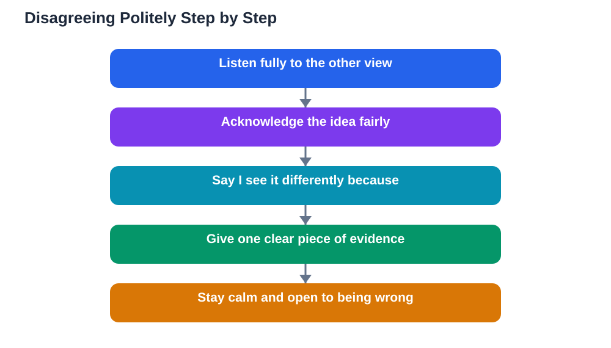

Disagreement often feels uncomfortable, especially in class where you worry about upsetting a classmate or sounding rude. Yet disagreement is one of the most valuable parts of learning. When ideas are tested against other views, weak reasoning gets exposed and strong reasoning gets sharper. The goal is not to avoid disagreement, but to do it politely, with evidence, so that everyone leaves the discussion thinking more clearly than before.

Polite disagreement is a learnable skill. It rests on a few phrases, a calm tone, and the habit of backing your view with reasons rather than volume. Once you practise it, you will find that disagreeing stops feeling risky and starts feeling like a normal, even enjoyable, part of class.

## Why Disagreement Helps Learning

When everyone in a discussion agrees too quickly, the group may settle on the first plausible idea instead of the best one. A respectful challenge forces the group to examine its reasoning, look for evidence, and consider alternatives. This is how understanding deepens rather than staying shallow.

Think of disagreement as quality control for ideas. A claim that survives thoughtful challenges is worth trusting. A claim that falls apart under questioning needed to be challenged. By disagreeing politely, you are doing the whole class a favour, not causing trouble. Teachers know this, which is why they often welcome a well-reasoned objection.

## Start by Showing You Listened

The most important step in polite disagreement happens before you state your own view: show that you heard the other person. A short acknowledgement, such as "I understand your point about..." or "That is an interesting way to see it," signals respect and proves you are responding to their actual argument, not a version of it you invented.

This step also protects you. When people feel heard, they listen more openly to your reply. When they feel ignored or misrepresented, they defend themselves instead of considering your point. A few seconds spent acknowledging their idea can transform the whole exchange.

## Use the Phrase "I See It Differently Because"

One of the most useful frames in any discussion is "I see it differently because..." It does three things at once: it states disagreement clearly, it keeps the tone respectful, and it forces you to give a reason. The word "because" is the engine of the sentence. Without it, you have only an opinion. With it, you have an argument.

Practise completing the frame with real reasons. For example: "I see it differently because the example we studied shows the opposite result," or "I see it differently because that explanation leaves out an important step." The more specific your reason, the stronger and more polite your disagreement sounds, because it invites a response to the evidence rather than a clash of personalities.

## Back Your View With Evidence

Polite disagreement without evidence is just a clash of opinions, and opinion clashes rarely teach anyone anything. Evidence can be an example from the lesson, a detail from the textbook, a result you observed, or a logical consequence of the idea. You do not need a mountain of proof. One clear piece of evidence often matters more than a long list of vague claims.

When you present evidence, connect it plainly to your point: "The reason I think this is..." or "What supports my view is..." This structure keeps the discussion focused on reasons, which is where learning happens. It also models good thinking for classmates, who may adopt the same habit in their own contributions.

## Keep Your Tone Calm and Steady

Tone can undo even the politest words. A calm, steady voice tells classmates you are discussing, not fighting. A raised voice, sarcastic edge, or mocking laugh tells them the opposite, no matter how reasonable your words are.

If you notice yourself getting heated, slow down deliberately. Take a breath before replying, and restate your point in simpler words. Slowing down is not weakness. It is control, and classmates respect a speaker who stays steady under pressure. If a discussion becomes too heated for anyone to stay calm, it is perfectly polite to suggest a pause: "Maybe we could take a moment and come back to this point."

## Accept That You Might Be Wrong

Polite disagreement includes the possibility that the other person is right. Enter a discussion willing to change your mind if the evidence points that way. Saying "That is a good point, I had not thought of that" is not losing. It is learning in public, and it earns respect from classmates and teachers alike.

This openness also makes your disagreements stronger. People listen more carefully to someone who has shown they can be persuaded, because they know the disagreement is about finding the truth, not winning. A discussion where everyone is willing to be wrong is a discussion where everyone can be right in the end.

## What to Do When Disagreement Gets Stuck

Sometimes two views simply will not reconcile in the time available, even with good evidence on both sides. That is not a failure. In that case, summarise the disagreement fairly: "So we agree on this part, but we differ on that part, and here is why." Naming the exact point of difference is itself a valuable outcome.

You can also suggest a way to settle it later, such as checking the textbook together, asking the teacher, or testing the idea with an example. Turning a stuck disagreement into a shared question keeps the relationship intact and gives the class something concrete to investigate next.

## AI Help: Muse AI

Muse AI is Meta's personal AI assistant, and it can help you practise polite disagreement before a real discussion. You can ask Muse to role-play the other side of an argument so you can rehearse the "I see it differently because" frame and test whether your evidence is convincing. This practice makes calm, reasoned disagreement feel natural.

Join Muse with invite code LTGSWD — in the Muse app, go to Settings > Redeem token and enter the code.

Disclosure: LTGSWD is the author's Muse invite code.

## FAQ

### What if the other person takes my disagreement personally?

Stay calm, restate that you are discussing the idea, and point back to the evidence: "I am questioning the idea, not you, and here is my reason." Most people relax once they see the disagreement is about reasons. If they stay upset, give the conversation space and let the teacher guide it.

### Can I disagree if I am not fully sure of my view?

Yes, and you can say so honestly: "I am not certain, but I wonder whether..." Tentative disagreement is still valuable because it opens a question the class can explore together. You do not need certainty to contribute a useful doubt.

### What if someone disagrees with me rudely?

Do not match their tone. Respond to the content calmly, or simply say, "I hear your point, and I still think..." and give your reason. If rudeness continues, the teacher can step in. Keeping your own tone steady protects both your argument and your standing in the class.

### How do I disagree with a close friend without harming the friendship?

Use the same polite frames you would with anyone, and add a light acknowledgement of the friendship if it helps: "I value your view, and I still see this part differently because..." Friends who can disagree kindly usually end up respecting each other more, not less.

## Conclusion

Polite disagreement is a habit built from simple moves: show you listened, say "I see it differently because," back your view with evidence, keep your tone calm, and stay open to being wrong. Practised regularly, these moves turn disagreement from something to avoid into one of the best tools for learning in class. Try one polite disagreement in your next discussion and notice how much deeper the conversation goes.

[Try the free AI lesson solver](/#tool)
