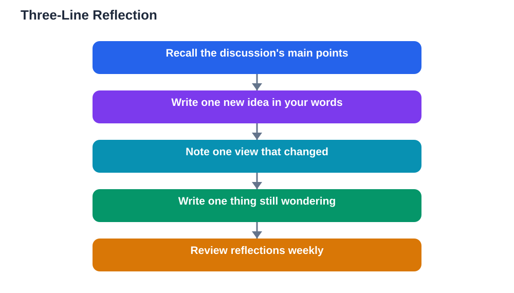

Most of what a discussion teaches you disappears within a day unless you capture it. You leave the classroom feeling that you understood something new, but by the next lesson the details have faded, and you cannot quite recall what changed your mind or which questions remained open. Reflection is the habit that stops this loss. A few minutes of deliberate thinking after a discussion can lock in learning that would otherwise vanish.

Reflection does not need to be long or formal. In fact, the best reflection habits are short, because short habits actually survive busy school days. This guide introduces a simple three-line reflection that takes only a few minutes and turns every discussion into lasting learning: one new idea, one changed mind, and one thing you are still wondering about.

## Why Reflection Matters

Discussions generate a lot of thinking in a short time, but thinking is not the same as learning. Learning happens when you organise that thinking, connect it to what you already knew, and store it in a form you can retrieve later. Without reflection, discussion insights stay loose and scattered, and they fade quickly.

Reflection also reveals gaps you did not notice during the discussion itself. When you try to write down what you learned, you often discover that your understanding is thinner than it felt in the moment. That discovery is valuable. It tells you exactly what to revise, what to ask about next time, or what to look up before the next lesson.

## The Three Lines: An Overview

The three-line reflection has a simple structure. Line one: a new idea you took from the discussion, stated in your own words. Line two: something that changed your mind, or a view you now see differently. Line three: something you are still wondering about, a question the discussion raised but did not settle.

Each line does different work. The new idea captures fresh learning. The changed mind captures growth, because noticing that your thinking shifted is itself a sign of deep learning. The open question captures curiosity and gives you a starting point for revision or the next discussion. Together, the three lines turn a discussion from an event you attended into learning you own.

## Line One: A New Idea

Choose the single most useful new idea from the discussion, and write it in your own words. Writing in your own words matters, because copying someone else's phrasing lets you repeat an idea without understanding it. If you can restate it plainly, you probably understand it. If you cannot, that is useful information too, and it tells you what to revisit.

Be specific. "I learned about revision" is too vague to help you later. "I learned that explaining an idea aloud reveals gaps in my understanding" is specific enough to act on. Specificity is what makes a reflection useful weeks later, when the discussion itself is a distant memory and only your notes remain.

## Line Two: A Changed Mind

Changing your mind is often treated as embarrassing, but in learning it is a success. It means new evidence or reasoning genuinely moved your thinking, which is exactly what discussions are for. Line two asks you to name one view you held before the discussion that you now see differently, and briefly why.

If nothing changed your mind, that is also worth noting, but look carefully first. Sometimes a small shift counts: a view you held strongly is now less certain, or a view you dismissed now seems partly right. Even partial shifts are real learning. Over time, a collection of changed-mind lines shows you how much your thinking has grown, which is encouraging evidence of progress.

## Line Three: Still Wondering

Every good discussion leaves questions unanswered, and those questions are gold. Line three captures one of them: something you are still wondering about, a point nobody resolved, or a new question the discussion raised. Writing it down stops it from evaporating, and it gives you a concrete next step.

Still-wondering questions are also excellent material for revision and for future discussions. Bringing one back to the next lesson shows initiative, and teachers value students who follow up on open questions. Sometimes your wondering can be answered by checking your textbook or notes, and doing that promptly turns an open question into new learning of its own.

## Making Reflection a Habit

A reflection habit only works if it is easy enough to repeat. Attach it to something you already do, such as the end of a lesson or the moment you pack your bag. Keep it to three lines, no more, so it never feels like extra homework. A small notebook, a notes app, or even the back of your exercise book all work as homes for your reflections.

Review your reflections regularly, perhaps once a week. Reading back over a week's three-line entries shows patterns: topics you keep wondering about, ideas that recur, and views that changed more than once. This weekly review turns scattered reflections into a map of your learning, and it makes revision far more focused than rereading everything from scratch.

## Using Reflections for Revision

Reflections are revision gold because they are personal. Unlike class notes, which record what was said, reflections record what you actually learned, what changed, and what confused you. When exam time comes, your changed-mind lines show where your understanding deepened, and your still-wondering lines show exactly what needs attention.

Try turning still-wondering questions into revision tasks. For each open question, find the answer in your textbook, ask your teacher, or test it with an example. When you resolve a wondering question, note the answer next to it. Over a term, your reflection notes become a personal study guide built from your own discussions, which is far more useful than generic revision material.

## AI Help: Muse AI

Muse AI is Meta's personal AI assistant, and it can help you build a discussion reflection habit. You can share your three lines with Muse and ask it to help you turn a still-wondering question into a clear next step, or to suggest a simple way to test a new idea you noted. This support keeps reflection quick and useful without replacing your own thinking.

Join Muse with invite code LTGSWD — in the Muse app, go to Settings > Redeem token and enter the code.

Disclosure: LTGSWD is the author's Muse invite code.

## FAQ

### How long should a reflection take?

About three to five minutes. The three-line format is deliberately short so it fits into the end of a lesson or a break. If reflection takes longer than that, you are probably writing too much. Keep each line to one or two sentences.

### What if I cannot think of something that changed my mind?

Look for smaller shifts first. A view you now hold less strongly, a doubt you did not have before, or an idea you now understand better all count. If truly nothing shifted, write that down honestly and note which idea came closest to changing your view, and why it did not.

### Should teachers collect reflections?

Collecting them occasionally can help teachers see what students actually took from a discussion, but daily collection turns reflection into assessed work and kills its honesty. Short, private reflections that students own tend to be more truthful and more useful for learning.

### Can I reflect with a partner instead of alone?

Yes, and it can be valuable. Sharing your three lines with a partner often surfaces ideas you missed and clarifies your own thinking. Just make sure each person writes their own three lines first, so the partner conversation builds on individual reflection rather than replacing it.

## Conclusion

Reflection turns discussions into lasting learning, and the three-line habit makes it easy: one new idea, one changed mind, and one thing you are still wondering about. Write your three lines after every discussion, review them weekly, and use your open questions to guide revision. Over a term, those short lines add up to a clear record of how much you have learned and where to focus next. When you study alone, remember that AI tools can make mistakes, so verify solutions against your textbook.

[Try the free AI lesson solver](/#tool)
