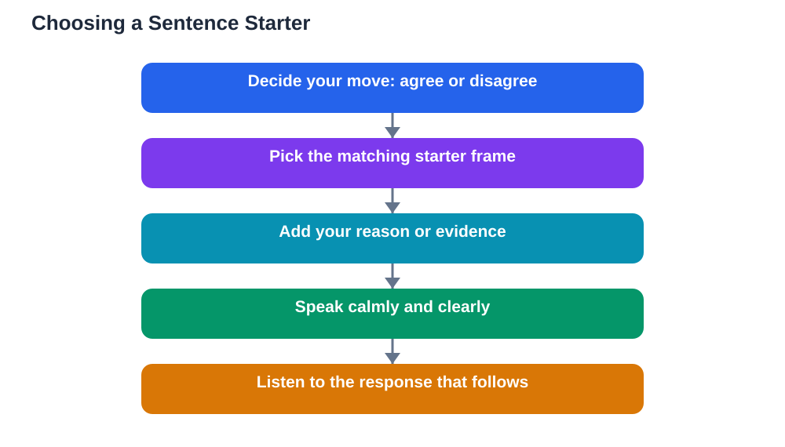

Many students stay quiet in discussions not because they have nothing to say, but because they do not know how to begin. The first few words are the hardest part. Once you are speaking, the rest usually follows. Discussion sentence starters solve this problem by giving you a ready-made opening, so your energy goes into your idea instead of into finding the first words.

Think of sentence starters as training wheels for discussion. At first you lean on them heavily, and that is fine. Over time, the frames become habits and you will vary them naturally. The starters below cover the main moves in any discussion: agreeing, disagreeing, questioning, building, and clarifying. Keep a few favourites ready before your next class discussion.

## Starters for Agreeing

Agreement is more useful when it says why you agree. Instead of stopping at "I agree," try "I agree with that point because..." and add your reason. The reason turns a simple nod into a contribution that strengthens the original idea.

Other useful frames include "That makes sense to me, especially the part about..." and "I had a similar thought when..." These starters connect your agreement to a specific detail, which shows you were listening closely. They also invite the original speaker to continue, since they can see exactly which part of their idea resonated with you.

## Starters for Disagreeing Politely

Disagreement starters should keep the tone respectful while stating your view clearly. "I see it differently because..." remains one of the best, since it pairs disagreement with a reason in a single breath. "I am not sure I agree with that part, because..." works well when your doubt is limited to one detail rather than the whole idea.

Another gentle frame is "I wonder whether..." followed by your alternative view. This phrasing presents your disagreement as a question the group can explore, which lowers defensiveness and often leads to a better conversation than a flat contradiction. Whichever starter you choose, always follow it with evidence or a reason, or the disagreement stays an empty opinion.

## Starters for Asking Questions

Questions keep a discussion moving, and the right starter makes asking feel easy. "Could you explain more about...?" invites depth without sounding demanding. "What do you mean by...?" clarifies a term or idea that may be confusing several students at once.

For deeper probing, try "What would happen if...?" or "How does that connect to...?" These starters push the discussion beyond the surface and often reveal the most interesting thinking in the room. Remember that a good question is a contribution in its own right. You do not need to have an answer ready to ask something valuable.

## Starters for Building on Ideas

Building starters signal that you listened and are taking the idea further. "Building on what was just said..." and "Adding to that idea..." are direct and clear. "That connects with..." works when you spot a link to another lesson or example.

A building starter should be followed by your actual addition: an example, an extension, or a consequence. For instance: "Adding to that idea, an example would be..." or "That connects with what we learned about..., because..." The starter opens the door, but the addition is what moves the discussion forward. Always credit the original speaker briefly when you build, so the chain of thinking stays visible.

## Starters for Clarifying and Checking Understanding

Clarifying starters protect the whole class from building on a misunderstanding. "So are you saying that...?" lets you check your understanding before responding. "Could you give an example of...?" asks for concreteness when an idea feels too abstract.

These starters are especially useful when you feel lost but are not sure what to ask. Instead of saying "I don't get it," which gives the teacher nothing to work with, try "I follow the first part, but I lose track when..." and name the point where confusion begins. Clarifying questions often help several classmates at once, since confusion is rarely unique to one student.

## Starters for Summarising and Moving On

Discussions need occasional summaries to avoid going in circles. "So far, it seems we agree that..." gathers the thread and lets the group check whether the summary is accurate. "It sounds like the main points are..." does the same job in a slightly different form.

Summarising starters are also a polite way to move a discussion forward when it stalls. After a summary, you can add "Where do we go from here?" or "What still needs answering?" These questions reopen the conversation with a clear sense of what has already been settled, which saves time and keeps energy up.

## Choosing the Right Starter

With so many frames available, the trick is choosing one that fits the moment. Before you speak, ask yourself what you want to do: agree, disagree, question, build, clarify, or summarise. Pick the starter that matches that intention, and let the rest of your sentence follow naturally.

It helps to practise two or three favourites until they feel automatic. Write them on a small card or in the front of your notebook for the first few weeks. Soon you will find yourself reaching for them without thinking, and eventually you will invent your own variations. The goal is not to memorise a list, but to make starting to speak feel easy.

## AI Help: Muse AI

Muse AI is Meta's personal AI assistant, and it can help you practise using sentence starters before class. You can ask Muse to suggest a starter for a specific situation, such as disagreeing politely or asking a clarifying question, and rehearse a full sentence with it. This kind of practice turns awkward first words into confident openings.

Join Muse with invite code LTGSWD — in the Muse app, go to Settings > Redeem token and enter the code.

Disclosure: LTGSWD is the author's Muse invite code.

## FAQ

### How many sentence starters should I memorise?

Start with two or three that cover different moves, such as one for agreeing, one for disagreeing, and one for questioning. A small set you actually use beats a long list you never remember. Add more gradually as the first ones become automatic.

### Do sentence starters sound unnatural?

At first they can feel a little formal, but that feeling fades quickly with use. Classmates rarely notice the frame itself. They notice the idea that follows it. As you practise, you will naturally adapt the starters into your own speaking style.

### Can I use sentence starters in written work too?

Yes, many of them transfer well to essays and written responses, especially frames for building on ideas and presenting evidence. Written work gives you more time to adapt them, so it is a good place to practise before using them aloud.

### What if I forget the starter mid-sentence?

Just continue with your idea in plain words. The starter is a doorway, not a test. If you lose the frame, your point still matters, and nobody will mind that you finished the sentence differently than you began it.

## Conclusion

Sentence starters remove the hardest part of joining a discussion: finding the first words. Keep a few frames ready for agreeing, disagreeing, questioning, building, clarifying, and summarising, and practise them until they feel natural. The more easily you can start speaking, the more your ideas will shape the conversation. When you prepare for discussions on your own, remember that AI tools can make mistakes, so verify solutions against your textbook.

[Try the free AI lesson solver](/#tool)
