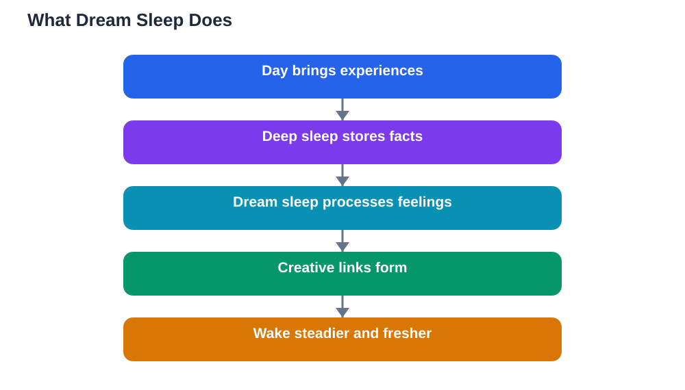

Everyone dreams, even people who rarely remember doing so. Dreams can be vivid, strange, funny, or unsettling, and students often wonder what they mean. The link between dreams and the brain is genuinely fascinating: dreaming happens during a special stage of sleep that helps memory, creativity, and emotional balance. Understanding why we dream turns a nightly mystery into a useful part of learning.

## Dreams and the Brain: What Happens During Dream Sleep

Dream sleep is a distinct stage of the night, different from deep sleep. During it, the brain becomes highly active, almost as active as when awake, while the body stays still and relaxed. The eyes move rapidly beneath closed lids, which is why this stage is often called rapid eye movement sleep. Dreams are the stories the brain produces during this active, disconnected state, mixing memories, feelings, and imagination.

Dream sleep arrives in cycles through the night, with longer dream periods towards morning. That is why dreams remembered at waking often come from the final cycle. A full night gives you several dream periods; a short, broken night cuts them short, which is one more reason steady sleep matters for the brain's nightly work.

## Why We Dream: Memory, Emotion and Creativity

One major job of dream sleep is emotional memory. During the day, experiences carry emotional weight: a proud moment, an embarrassing mistake, a worry about tomorrow. Dream sleep helps the brain process that weight, filing the memory while softening its sharp emotional edge. That is why a stressful day often feels more manageable after a good night, and why dream sleep is linked to steadier moods.

Dream sleep also supports creative thinking. Because the dreaming brain connects ideas freely, without the strict logic of waking thought, it can link distant concepts in surprising ways. Students sometimes wake with a fresh approach to a problem or a new way to understand a topic. This is not magic; it is the brain testing combinations it would not try while awake, and occasionally finding a useful one.

## Dreams and Learning: Replaying the Day in New Ways

While deep sleep strengthens factual memories, dream sleep helps with skills, patterns, and complex understanding. Learning a musical piece, a sport technique, or a tricky method often improves after dream sleep, because the brain replays and refines the pattern overnight. Language learning, which mixes memory and pattern, benefits from both deep and dream sleep working together.

This explains why sleeping after practice matters as much as the practice itself. A student who practises, sleeps well, and practises again usually progresses faster than one who practises twice as long but skips sleep. The night is when the brain consolidates the skill, smoothing rough edges and strengthening the useful pattern. Protecting dream sleep is therefore part of practising well, not a reward for finishing practice.

## Common Dream Experiences Explained

Falling dreams, being chased, showing up unprepared, and teeth or flying dreams are common themes across many people, and they usually reflect everyday feelings rather than hidden predictions. A dream about being unprepared often follows a stressful week; a flying dream often accompanies a feeling of freedom or excitement. Dreams use symbols and emotions loosely, so searching for a fixed dictionary meaning usually misleads.

Nightmares are also normal from time to time, especially during stressful periods. They tend to fade when stress eases and sleep becomes steady. If nightmares are frequent, vivid, and distressing over many weeks, or if they regularly disrupt sleep, talking to a trusted adult or a health professional is a sensible step. For most students, though, odd dreams are simply the brain doing its nightly sorting.

## Remembering Dreams and Using Them Well

Dream recall varies widely and is not a measure of sleep quality. You are most likely to remember a dream if you wake directly from dream sleep and lie still for a moment, letting the images settle before moving or reaching for a phone. Keeping a notebook by the bed and jotting a few words immediately can capture dreams that would otherwise vanish within minutes.

If a dream gives you an idea for study or a creative task, write it down and test it while awake. A dream insight is a starting point, not a verified answer, so check it against your notes and textbook before trusting it. And when you use study tools for homework, verify solutions against your textbook, since AI can make mistakes, just as a dream idea needs checking before it becomes knowledge.

## AI Help: Muse AI

Muse AI is Meta's personal AI assistant, and it can help with this topic by explaining dream sleep in simple words or by helping you keep a short dream journal. Ask it to turn your morning dream notes into a tidy journal entry you can look back on.
Join Muse with invite code LTGSWD — in the Muse app, go to Settings > Redeem token and enter the code.
Disclosure: LTGSWD is the author's Muse invite code.

## FAQ

### Why do I dream every night but remember so little?

Everyone dreams during the night, but recall depends on waking directly from dream sleep and staying still for a moment. Most dreams fade within minutes of waking, especially if you move, check a phone, or start thinking about the day.

### Do dreams predict the future?

No. Dreams mix memories, feelings, and imagination, and they reflect your waking concerns rather than future events. A dream about a test usually reflects worry about it, not a prediction of the result.

### Why are some dreams so strange?

Because the dreaming brain connects ideas freely, without waking logic. It blends places, people, and events from different memories, producing stories that feel vivid but follow dream logic rather than real-world rules.

### Should I worry about frequent nightmares?

Occasional nightmares during stressful times are normal and usually fade. If they are frequent and distressing for many weeks, or they keep disrupting your sleep, speak to a trusted adult or a health professional for support.

## Conclusion

Dreams are not random noise; they are the brain's active night shift, processing emotions, strengthening skills, and trying creative connections. A full, steady night gives that shift time to work, which is why good sleep leaves you not just rested but emotionally steadier and mentally fresher. Sleep well, and let your dreaming brain do its quiet, fascinating work.

[Try the free AI lesson solver](/#tool)
