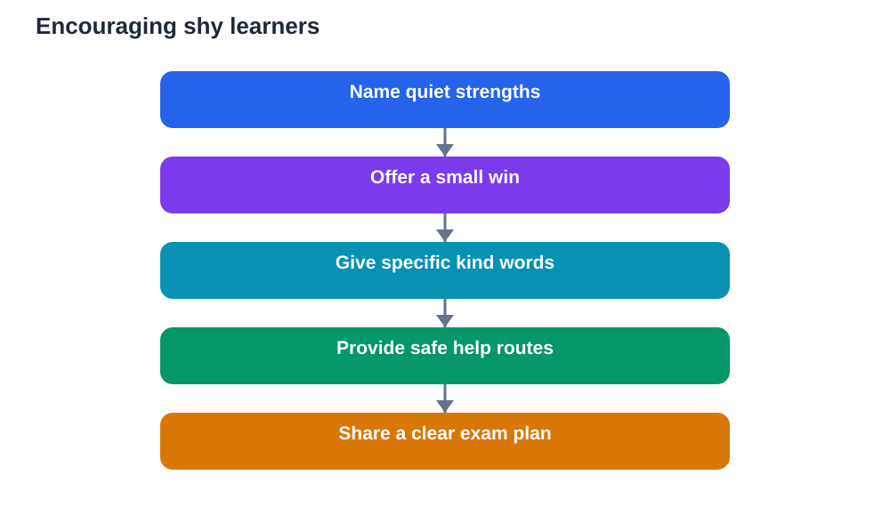

Shy students often carry a quiet strength that exams rarely measure: careful observation, deep thinking, and steady persistence. Yet before exams, shyness can feel like a disadvantage. A shy learner may hesitate to ask questions, avoid speaking in class, and worry that asking for help will draw unwanted attention. That worry can leave gaps unfilled and confidence low, not because the learner lacks ability, but because the usual routes to support feel uncomfortable. Encouragement, offered gently and specifically, can change that story.

This article is written for teachers, parents, and the shy learners themselves. Its message is simple: shyness is not a flaw to fix, and quiet learners deserve support that respects their temperament. Small wins, kind words, and a clear plan can help a shy student approach exams feeling prepared and valued, without forcing them to become loud or outgoing. Confidence for shy learners grows best in safe, low-pressure steps, not through sudden demands to perform publicly.

## See shyness clearly, without labels

Shyness is often misunderstood as lack of knowledge, lack of interest, or lack of effort. In reality, many shy learners think deeply before speaking, prefer writing to talking, and learn best through quiet, focused work. They may understand a lesson fully yet stay silent when the teacher asks for volunteers. Judging participation only by speaking aloud misses their learning entirely. A fairer view looks at written work, one-to-one conversations, and steady progress over time, where shy learners often shine.

Labels also harm. Calling a learner shy in a teasing or pitying way can reinforce the very hesitation adults hope to reduce. Instead, describe behaviour neutrally and positively: thoughtful, careful, observant, and persistent. When a shy learner hears their quiet strengths named with respect, they begin to see those strengths as assets rather than problems. That shift in how they are seen supports a shift in how they see themselves, which is the foundation of exam confidence.

## Offer small wins before big challenges

Confidence grows from completed steps, and for shy learners those steps should start small. A teacher might invite a shy student to answer a short question in writing first, then in a pair, then in a small group, before any whole-class speaking. A parent might celebrate finishing one topic, solving one difficult problem, or asking one question by note. Each small win is evidence that the learner can act, cope, and succeed, and evidence accumulates into belief. Small wins are not lesser wins. They are the building blocks of larger courage.

Design revision tasks with small wins in mind. Break a subject into short, achievable tasks with clear completion points, so the learner experiences frequent success rather than endless struggle. Use checklists, so progress is visible. Praise specific effort: you worked through that problem step by step, or your summary captured the main ideas clearly. Specific praise teaches the learner what they did well, so they can repeat it. Vague praise feels hollow, but specific praise builds a map of strengths the learner can trust on exam day.

## Use kind words that are specific and true

Kind words help most when they are specific, honest, and focused on effort and strategy, not just talent. Telling a shy learner they are brilliant may feel nice, but it offers little guidance and can feel untrue under pressure. Telling them their careful notes helped them recall the topic, or their steady practice improved their timing, gives them something real to hold onto. Kind words should also be private when possible. A quiet word after class, a short written note, or a calm conversation at home often means more to a shy learner than public praise that draws attention they did not seek.

Adults should also watch their language about exams themselves. Framing an exam as a judgement, a test of worth, or a moment that decides everything increases fear for all learners, especially shy ones. Framing it as a chance to show what you have learned, one question at a time, with preparation and a plan, keeps pressure proportionate. When adults speak calmly about exams, shy learners borrow that calm. When adults panic, compare, or threaten, shy learners absorb that anxiety and retreat further. The tone adults set is part of the encouragement.

## Create safe ways to ask for help

Many shy learners avoid asking questions because they fear sounding foolish or attracting attention. Safe routes to help remove that barrier. Written questions, anonymous question boxes, small-group help sessions, and one-to-one check-ins all let shy learners seek support without public exposure. Teachers can normalise questions by welcoming them warmly, answering without judgement, and thanking learners for asking. When one shy learner sees a question treated with respect, others feel safer to ask too.

Parents can create safe help at home by inviting questions during calm moments, such as while reviewing notes together, rather than demanding answers on the spot. If a learner struggles to explain aloud, invite them to write the question or point to the confusing part. The goal is understanding, not performance. AI tools can also offer a private first step: a shy learner can explore a concept quietly, check a solution against their textbook, and build understanding before asking a teacher. Private practice like this respects shyness while still moving learning forward, provided answers are always verified against the textbook.

## Build a clear plan for exam week

A clear plan reduces the uncertainty that feeds anxiety for shy learners. Together, teacher, parent, and learner can map exam week simply: what to revise each day, when to rest, what to pack, and what to do first in the hall. Write the plan down, keep it visible, and review it calmly. Knowing the sequence in advance means the learner does not have to improvise under stress or ask for last-minute instructions in a crowded room. Predictability is comforting, especially for quiet learners who dislike surprises.

Include coping steps in the plan: breathe slowly before starting, begin with familiar questions, move on if stuck, and return later. Practise these steps during timed practice at home, so they feel familiar. Also plan after-exam steps: a short break, no answer-checking spiral, and a kind review of effort rather than harsh judgement. When a shy learner knows what happens before, during, and after the exam, the whole experience feels smaller and more manageable. A plan does not remove nerves, but it gives nerves a structure to sit inside.

## AI Help: Muse AI

Muse AI is Meta's personal AI assistant, and it can offer private, low-pressure help for shy learners before exams. A shy student could ask it to explain a concept simply in writing, or to help make a gentle revision checklist, without needing to speak up in class. Join Muse with invite code LTGSWD — in the Muse app, go to Settings > Redeem token and enter the code.
Disclosure: LTGSWD is the author's Muse invite code.

## FAQ

### Should shy students be pushed to speak more before exams?

No, pushing a shy learner into public speaking before exams usually increases anxiety without improving exam readiness. Exams rarely require speaking aloud, so confidence should be built through the skills exams actually use: recall, writing, and problem-solving. Gentle, gradual opportunities to participate, offered with choice and privacy, help far more than forced public performance. Respect the learner's temperament while building their academic confidence.

### How can teachers encourage shy students without embarrassing them?

Use private, specific encouragement: a quiet word, a written note, or a one-to-one conversation. Praise concrete effort and strategy, not just results, and avoid singling learners out publicly for praise they did not seek. Offer varied ways to participate, including writing and small groups, and treat questions with warmth and respect. When shy learners feel safe and seen, they participate more naturally over time, on their own terms.

### What can parents say on exam morning to a shy child?

Keep words short, warm, and focused on effort and plan, rather than pressure or predictions. Phrases such as you have prepared steadily, take it one question at a time, and I am proud of your effort offer calm support without raising stakes. Avoid comparisons with siblings or classmates, and avoid last-minute quizzing, which can shake confidence. A calm goodbye, a good breakfast, and trust in their preparation are powerful encouragement.

### Can shy students perform well in exams?

Yes, absolutely. Shyness is a temperament, not a measure of ability, and many shy learners perform strongly through careful preparation, focused writing, and persistent practice. Exams reward knowledge, recall, and steady work, all of which shy learners often possess in abundance. With small wins, kind and specific encouragement, safe routes to help, and a clear plan, shy students can approach exams with quiet confidence and show their true learning.

## Conclusion

Encouragement for shy students before exams is not about changing who they are. It is about honouring their quiet strengths, offering small wins, speaking kind and specific words, creating safe ways to ask for help, and building a clear plan for exam week. When teachers and parents do these things steadily, shy learners feel seen, supported, and ready. They may still be quiet, and that is fine. Quiet confidence, built step by step, carries them into the exam hall ready to show what they know, in their own steady way.

[Try the free AI lesson solver](/#tool)
