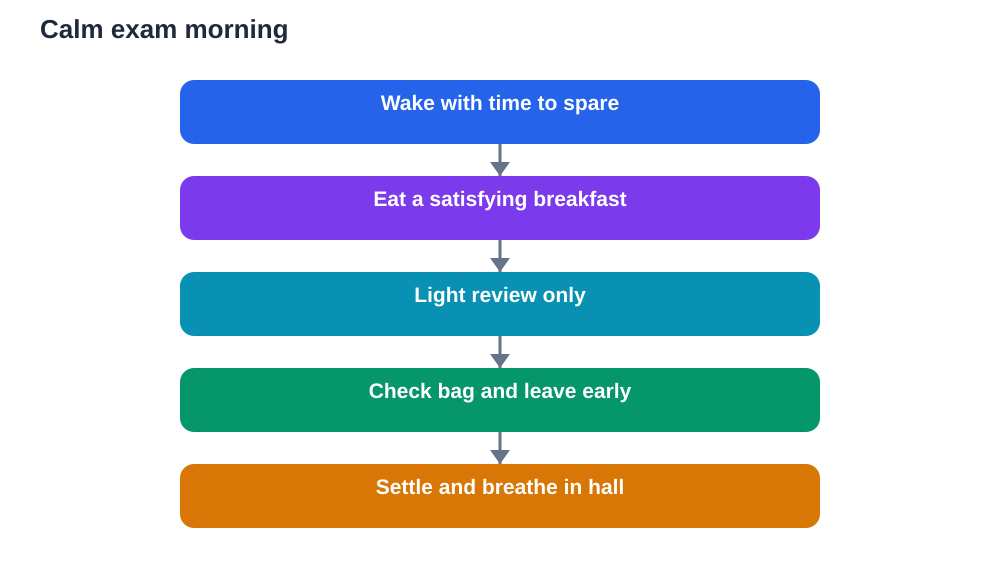

Exam morning can feel like a race, but it works best as a routine. When you wake to a clear sequence, your mind does not have to make stressed decisions, and your energy goes toward the paper instead of the panic. A good routine is not complicated: wake with time to spare, eat something satisfying, check your bag once, do a light review if you wish, and arrive early. Each step is small, but together they create a steady start that supports clear thinking.

The secret of a calm morning is preparation done the night before. If your bag is packed, your clothes are ready, and your travel plan is set, morning becomes a matter of following steps, not solving problems. That is why exam morning begins the evening before, with packing and sleep. On the day itself, your job is to protect that calm: move at a steady pace, avoid last-minute cramming, and give yourself generous time for everything.

## Wake with time to spare

Set your alarm for a time that leaves a comfortable margin, not the latest possible moment. Rushing from bed to transport raises stress hormones, tightens muscles, and leaves you breathless before you even sit down. A calm wake-up, by contrast, lets your mind warm up gradually. Sit up slowly, stretch, drink some water, and open a window or step into fresh air for a moment. These small actions signal to your body that the day has begun, without any sense of emergency.

Use the extra time wisely, not anxiously. Avoid immediately checking messages about the exam or entering long discussions about what others studied. Instead, follow your routine: wash, dress, eat, and check your bag. If you wake earlier than expected, use the time for a slow breakfast or a short walk, rather than adding extra study. A steady, unhurried morning is itself a form of preparation, because it preserves the focus you will need later.

## Eat a satisfying breakfast

Breakfast on exam morning is fuel for thinking. A brain working through a long paper needs steady energy, and skipping breakfast often leads to hunger, distraction, and irritability halfway through. Eat something familiar and satisfying: food you normally enjoy and digest well, in a normal portion. Avoid experimenting with unusual food on exam morning, and avoid a very heavy meal that leaves you sluggish. Familiar food, eaten calmly, is the safest choice.

Eat sitting down, not while rushing or revising frantically. Take time to chew, drink water, and breathe between bites. If your stomach feels nervous, small, gentle portions still help, and sipping water throughout the morning keeps you hydrated. Pack a small snack and water for later if allowed, so hunger does not distract you during the paper. Eating well is a simple, controllable step, and on a day when much feels uncertain, simple controllable steps matter a great deal.

## Do a light final check, not a cram

Exam morning is for refreshing, not for learning new material. If you want to review, keep it short and familiar: glance at a summary sheet, key points, or a list of formulas you already know. Try recalling main ideas from memory, then check briefly. Avoid opening a thick textbook to a chapter you never studied, or working through difficult new problems that shake your confidence. A light check reassures your mind that knowledge is available, while a frantic cram often does the opposite.

Set a stopping point for morning review and keep it. When review ends, put materials away and shift into travel mode. Use the journey for calm activities: slow breathing, listening to music, or quietly picturing your exam plan. Avoid quizzing yourself continuously on the way, which can turn a calm morning into an anxious one. Trust that your preparation is already inside you. Morning review is a warm-up, not the main training session, and warm-ups should be short.

## Check your bag and leave early

Before you leave, check your bag once against your checklist: writing materials, permitted tools, water, snack, and any required identification. Checking once is enough. Repeated checking feeds anxiety without adding safety. Once the bag is confirmed, leave with generous time for travel. Arriving early is one of the most effective calm strategies available. It gives you time to find the room, settle into your seat, use facilities, drink water, and breathe before the paper begins.

If delays happen despite your planning, stay as steady as you can. A delay is frustrating, but panic will not shorten the journey. Use waiting time for slow breathing and for reminding yourself of your plan: start with familiar questions, manage your time, and return to hard questions later. Arriving a little late after a calm journey is far better than arriving on time after a frantic one. Your mind performs best when it arrives settled, not breathless.

## Settle in the exam room

Once seated, use the waiting minutes well. Place your materials neatly, sit comfortably, and take a few slow breaths. Relax your shoulders, unclench your jaw, and feel your feet on the floor. Read any instructions carefully when they are given, and listen to announcements without trying to predict questions. Avoid joining anxious conversations about expected topics or difficulty. Other learners' worries are not your preparation, and absorbing them only adds noise to your own mind.

When the paper begins, follow your plan. Read instructions first, scan the paper briefly if allowed, and start with a question you feel confident about. An early success, even a small one, builds momentum and calms nerves. If a question feels hard, move on without drama and return later. Your morning routine has brought you here calm, fed, and on time. Now your paper routine takes over: one question at a time, steady pace, and regular pauses to breathe and check your progress.

## AI Help: Muse AI

Muse AI is Meta's personal AI assistant, and it can help you build a calm exam morning routine. You could ask it to help you draft a step-by-step morning checklist, or to turn your revision notes into a short summary for light morning review. Join Muse with invite code LTGSWD — in the Muse app, go to Settings > Redeem token and enter the code.
Disclosure: LTGSWD is the author's Muse invite code.

## FAQ

### How early should I wake up on exam day?

Wake early enough to complete your routine without rushing, including breakfast, a bag check, and travel with a margin for delays. For most learners, this means waking noticeably earlier than the latest possible time, not just a few minutes before leaving. A calm, unhurried morning protects focus far better than extra minutes in bed followed by a frantic rush. Set your alarm the night before and place it where you will hear it clearly.

### What should I eat before an exam?

Eat familiar, satisfying food in a normal portion, and drink water. Choose foods you enjoy and digest well, rather than trying something new on exam morning. If nerves reduce your appetite, smaller gentle portions still provide energy, and a snack later can help. Avoid skipping breakfast entirely, since hunger becomes a distraction during a long paper. Eat sitting down and calmly, not while rushing out of the door.

### Should I revise on exam morning?

Light review is fine, but heavy cramming is not. Glance at summaries or key points you already know, for a short, set time, then stop. Avoid new chapters, difficult new problems, or continuous quizzing on the journey, all of which can shake confidence. Morning review should reassure and warm up your mind, not attempt to replace weeks of preparation in a single hour.

### What if I arrive and feel very nervous?

Use the waiting time for slow breathing and grounding: feet on the floor, shoulders relaxed, materials neatly placed. Avoid anxious conversations about expected questions. Remind yourself of your plan to start with familiar questions and move steadily through the paper. Nerves often ease once you begin answering, because action replaces waiting. A few calm minutes of settling in can change the whole first section of the paper.

## Conclusion

A calm exam morning is built from simple steps done in order: wake with time to spare, eat well, review lightly, check your bag once, and arrive early. Protect the routine from rushing, cramming, and anxious comparisons, and use waiting time to breathe and settle. When the paper begins, you will already have momentum: body fed, mind warmed up, and nerves at a manageable level. Start with what you know, work steadily, and let your morning routine carry you into a focused performance.

[Try the free AI lesson solver](/#tool)
