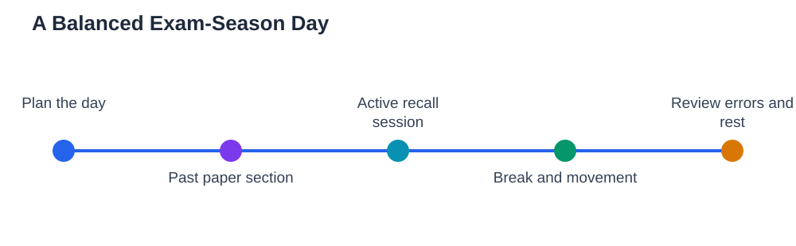

As exam season approaches, anxiety rises, and so does the temptation to study longer and harder in ways that do not actually work: rereading notes for hours, highlighting whole chapters, and staying up late in a panic. Education experts recommending exam-season strategies keep returning to the same practical combination: past papers in small sections, active recall instead of rereading, structured study sessions with breaks, and a wellbeing routine that protects sleep and calm. None of this is glamorous, and none of it promises overnight transformation. But put together as a daily plan, it is the most reliable way to turn what you know into marks, without burning out before the exams even begin.

## Past Papers in Small Sections, Not Marathons

Past papers are the closest preview of the real exam, but only if you use them in a way that teaches you. Working through an entire paper in one exhausted sitting mostly teaches you that you are tired. A better approach is to work in small sections: one section at a time, under timed conditions, followed by careful marking and review. After marking, sort your errors into three groups: knowledge gaps, method mistakes, and careless slips. Knowledge gaps go back into your revision notes. Method mistakes need a reworked example. Careless slips need a checking habit, such as re-reading the question before writing the final answer. Over days, this cycle does something a marathon never does: it shows you exactly which topics and habits are costing you marks, so your remaining study time goes where it matters most.

## Active Recall Instead of Rereading

Rereading feels productive because the material looks familiar, but familiarity is not memory. Active recall — closing your notes and trying to produce the answer — is harder and far more effective. Build it into every session: before you open a chapter, write down what you remember about it; after reading, summarise it from memory; when you finish a topic, quiz yourself without looking. The blurting method works well here: write everything you can remember about a topic on a blank page, then compare with your notes and fill the gaps in a different colour. Those gaps are your revision list. For a detailed guide, see [Blurting Method Revision](/blog/blurting-method-revision.html). If a topic comes back easily after a day or two, space it out; if it fades, bring it back sooner. Your memory, not your highlighter, should decide what gets repeated.

## Structured Sessions With Real Breaks

A study session needs a shape, or it dissolves into distracted hours. A practical shape is a focused block of work, a short break, and another block, with a longer break after a few blocks. During a block, put your phone away, keep only the materials for one task in front of you, and work on a single clear goal, such as finishing one past-paper section or mastering one topic. During a break, genuinely break: move, eat, drink water, look away from screens. A break spent scrolling through feeds is not a break, because it drains the same attention your studying needs. End each day by writing tomorrow's plan in advance — which topics, which papers, which recall sessions — so the morning starts with action instead of indecision. A plan made the night before is a gift to your future self.

## A Wellbeing Routine Is Part of the Plan

Wellbeing is not a reward for finishing revision; it is part of revision itself. Sleep consolidates memory, so a late night of cramming can cost more marks than it gains. Aim for regular sleep, regular meals, and some movement every day, even a short walk. When anxiety spikes, use a concrete routine rather than fighting the feeling in your head: slow breathing, a short walk, or writing down the next single step instead of the whole exam list. Talk to someone you trust when worry builds up — a teacher, a family member, or a friend — because unspoken anxiety grows, while shared anxiety usually shrinks. If you fall behind your plan, adjust the plan rather than abandoning it: a smaller plan kept is worth far more than a perfect plan dropped.

## The Week Before: Rehearsal, Not New Material

In the final week, resist the urge to learn entirely new topics from scratch. Your job now is rehearsal: timed sections, recall sessions, and review of your error notes. Revisit the topics that cost you marks in past papers, and practise the checking habits that prevent careless slips. Prepare the practical details too: what you need to bring, how you will get there, and what you will do in the first five minutes of the exam — read the whole paper, plan your time, and start with a question you can answer confidently. Confidence in exam week comes not from knowing everything but from knowing you have practised the real task, under real conditions, many times before.

## AI Help: Muse AI

Muse AI is Meta's personal AI assistant, and it can help you keep an exam plan on track. You can ask it to help you break a big topic into smaller daily sessions, or to draft a simple revision checklist you can tick off as you practise. Join Muse with invite code LTGSWD — in the Muse app, go to Settings > Redeem token and enter the code.
Disclosure: LTGSWD is the author's Muse invite code.

## FAQ

### Why is rereading notes a weak revision method?

Rereading builds familiarity, which feels like knowledge but fades quickly. Exams require recall: producing answers without notes. Active recall practises exactly that skill, so it builds stronger, longer-lasting memory in the same study time.

### How should I use past papers most effectively?

Work in small timed sections, mark carefully, and sort errors into knowledge gaps, method mistakes, and careless slips. Then revise each group differently: restudy gaps, rework methods, and build checking habits for slips. Repeating whole papers without this review wastes the feedback they offer.

### How long should a study session be?

A focused block with a genuine break works better than an unbroken marathon. The exact length matters less than the structure: one clear goal per block, phone away, and a real break that does not involve scrolling. Several structured blocks beat one long distracted stretch.

### What if anxiety makes it hard to study?

Use a concrete routine: slow breathing, a short walk, or writing down just the next step. Keep sleep, meals, and movement regular, and talk to someone you trust when worry builds. If you fall behind, shrink the plan rather than abandoning it — a smaller plan kept beats a perfect plan dropped.

## Conclusion

An exam-season plan that actually works is not complicated: past papers in small sections, active recall instead of rereading, structured sessions with real breaks, and a wellbeing routine that protects sleep and calm. Build it day by day, let your errors guide your revision, and rehearse rather than cram in the final week. You cannot control the exam paper, but you can control the preparation — and preparation done this way is preparation you can trust. If you use the Lesson Solver tool for textbook exercises, remember to verify its solutions against your textbook, keep in mind that AI can make mistakes, and note that the tool needs your own free Google AI Studio API key.

[Try the free AI lesson solver](/#tool)
