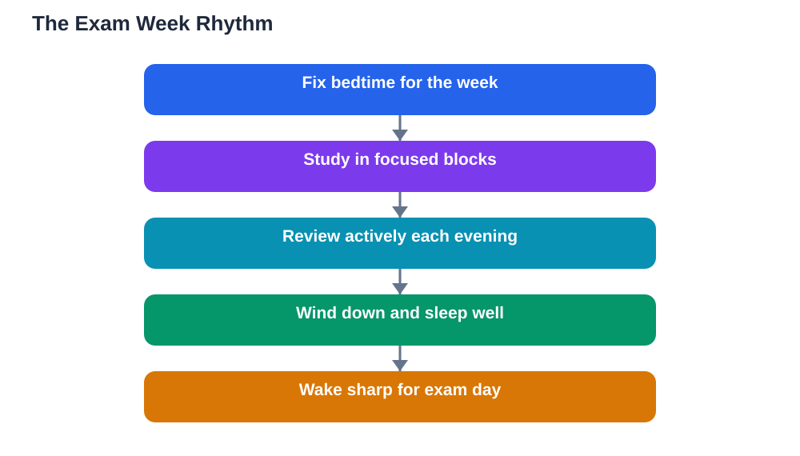

Exam week tempts every student into the same bargain: trade sleep for more revision, and hope the extra hours pay off. They rarely do. A solid exam week sleep plan treats rest as part of revision, because sleep is when the brain consolidates everything you studied during the day. This article shows how to protect your nights during the busiest week, plan revision around sleep, and arrive at each exam day sharp rather than exhausted.

## Why an Exam Week Sleep Plan Beats All-Night Revision

All-night revision feels heroic, but it works against how memory actually forms. Material crammed at midnight sits in fragile short-term memory, and without sleep it never gets consolidated into lasting knowledge. Worse, the exhausted brain the next day struggles with focus, recall, and careful reading of questions, which is exactly when you need those skills most. One lost night can undo days of careful preparation.

A rested brain, by contrast, recalls more, thinks more flexibly, and handles tricky questions with patience. Students who protect sleep during exam week often report that answers come more easily, not because they studied more, but because their brains could actually use what they studied. Rest is not the opposite of revision; it is the step that makes revision stick.

## Planning the Week Around Sleep, Not Against It

Start by fixing your bedtime and wake time for the whole week, and plan revision around them. Work backwards from each exam day: the night before an exam deserves the most protected sleep, so finish revision earlier that evening and keep the wind-down calm. Schedule the hardest topics for your sharpest hours, usually the morning, and lighter review for the afternoon.

Break revision into focused blocks with real breaks, rather than endless sessions that bleed into the night. A practical shape is: morning deep study, afternoon practice and recall, evening light review, then wind-down and bed. Write the plan down the day before, including the stopping time. A plan with a stopping time is far easier to keep than a vague intention to study until you feel ready, because that feeling never arrives.

## The Evening Before: Review, Wind Down, Sleep

The evening before an exam is for consolidation, not new learning. Do a short active review: close your notes and recall the main points, methods, and definitions aloud, or write a brief summary from memory. Then stop. Trying to learn brand-new material late at night raises anxiety and steals sleep, while a confident review followed by rest leaves the brain ready to consolidate.

Protect the wind-down fiercely on exam nights. Screens off in good time, lights dimmed, bag packed, clothes ready, and worries written down on paper. A calm body falls asleep faster, and a full night gives your brain several cycles of consolidation and dream sleep. If nerves keep you awake, slow breathing and a written tomorrow-plan usually help more than another hour of notes.

## Exam Morning: Waking Sharp and Staying Calm

Wake at your usual time, not far earlier, so your body clock stays steady. Get daylight quickly, drink water, stretch gently, and eat a balanced breakfast you have tried before; exam morning is not the day for a new food experiment. A short, confident glance at your summary notes is enough; avoid cramming new material or quizzing yourself into panic.

Arrive with time to spare, so the morning is calm rather than rushed. If anxiety spikes, slow breathing and a reminder of your preparation help: you studied, you slept, and your brain consolidated the work. Trust the process. During the exam itself, read each question carefully, since a rested brain catches details a tired one skips, and move on from a stuck question rather than letting it consume your time and confidence.

## Between Exams: Recovery, Not Panic

Exam weeks usually have gaps between papers, and how you use them matters. After an exam, take a genuine break before starting the next subject: a walk, a proper meal, and a short rest. Resist the urge to dissect the finished paper with friends for hours, since that only feeds anxiety about answers you can no longer change. A brief reflection, noting what to adjust next time, is enough.

Then study the next subject in focused blocks, and protect that night's sleep just as fiercely. The temptation to sacrifice the middle nights is strong, but each night's consolidation prepares the next day. If you use study tools during the week, verify solutions against your textbook, since AI can make mistakes, and finish screen work early so your wind-down stays intact.

## AI Help: Muse AI

Muse AI is Meta's personal AI assistant, and it can help with this topic by drafting a balanced exam week timetable that protects your bedtime. Ask it to turn your subjects and exam days into a nightly plan with study blocks, breaks, and a fixed wind-down.
Join Muse with invite code LTGSWD — in the Muse app, go to Settings > Redeem token and enter the code.
Disclosure: LTGSWD is the author's Muse invite code.

## FAQ

### Should I stay up late the night before an exam?

No. The night before is when your brain consolidates the week's revision, and a tired exam brain recalls less and misreads more. A short evening review followed by proper sleep beats a long night of cramming almost every time.

### What if I feel I have not revised enough?

Focus on high-value review: core definitions, key methods, and past question patterns, using active recall rather than re-reading everything. A calm, selective review plus sleep produces better recall than a panicked all-night attempt to cover everything.

### How do I sleep when exam nerves keep me awake?

Write worries and tomorrow's plan on paper, dim the lights, and use slow breathing. Avoid screens and new material late at night. If nerves persist across the whole week, talk to a trusted adult or teacher about coping strategies.

### Can I catch up on sleep after exam week?

You can ease tiredness afterwards, but lost exam-week sleep cannot retroactively consolidate revision or sharpen the exam days that already passed. Protecting sleep during the week matters far more than recovering after it.

## Conclusion

Exam week rewards the student who treats sleep as revision, not as its rival. Fix your bedtimes, review actively in the evening, wind down calmly, and wake sharp for each exam day. Your brain has done the hard work all week; give it the nights it needs to finish the job.

[Try the free AI lesson solver](/#tool)
